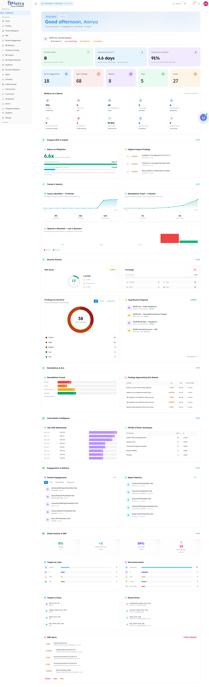

## Dashboard

### 1. What the Dashboard is for

The **Dashboard** is the first screen you see after signing in. It's your
organisation's **security posture at a glance** — a single, always-current
summary that answers three questions without you having to open any module:

- **Where do I stand right now?** (open findings, live engagements, assets)
- **What needs my attention most?** (recent findings, severity, SLA risk)
- **What's happened recently?** (recent engagements, programs, and reports)

Everything on it is **scoped to your organisation** and **filtered to your role**.
Sections for modules your organisation doesn't use (PTaaS, Bug Bounty, ASM) are
hidden. The Dashboard is a launchpad: every card links through to the module where
you can act.

### 2. How to reach it

- It loads automatically after login.
- From anywhere, click **Dashboard** at the top of the left sidebar or the **Tri-Netra** logo.

### 3. The Client Admin dashboard, top to bottom

#### a. Greeting banner

Your **first name**, your **role**, and your **organisation name**, with a summary
line such as *"Security Analytics — 3 live engagements · 42 findings · 12 targets"*.
The targets count appears only if your organisation uses ASM.

#### b. KPI tiles

| Tile | Meaning | Shown when |
|------|---------|-----------|
| **Live Engagements** | Pentests currently being tested. | PTaaS enabled |
| **Open Findings** | Findings not yet resolved, across all sources. | Always |
| **Reports** | Engagement reports available to you. | PTaaS enabled |
| **Team** | People in your organisation with platform access. | Always |
| **Assets** | Items in your testable inventory. | Always |

#### c. Security Posture

| Card | What it shows |
|------|---------------|
| **Findings by Severity** | A donut of open findings by severity. Filter it by source (All, PTaaS, BB, ASM). |
| **Recent Findings** | Your newest findings with severity, ID, state, date, and source. Click a row to open it, or **All** for the Findings list. |
| **Bug Bounty Programs** | Your programs and their status. *(Bug Bounty enabled)* |
| **Remediation Funnel** | How many findings sit at each remediation stage. |
| **Findings Approaching SLA Breach** | Findings close to their remediation deadline. Work these first. |

#### d. Vulnerability Intelligence

- **Top CWE Weaknesses** — the weakness types that appear most in your findings.
- **MITRE ATT&CK Techniques** — the attacker techniques your findings map to.

#### e. Engagements & Delivery *(PTaaS enabled)*

- **Pentest Engagements** — recent engagements and their state, with an **All** link.
- **Report Delivery** — where each engagement report stands.

#### f. Attack Surface & DRP *(ASM enabled)*

Coverage, surface growth over 7 days, scan success, open DRP alerts, an overall
**Risk Score** (Worsening / Improving / Stable), targets by type, discovered assets,
and recent scans.

### 4. Role differences

| Role | Dashboard |
|------|-----------|
| **Client Admin** | The full dashboard above. |
| **Client TPM** | *"Your organization's pentest engagements — track progress and triage findings."* Tiles: **Pentest engagements**, **Open findings**, **Recent reports**. Shows the posture ring with **Recent Findings**, **Recent Engagements**, **Bug Bounty Programs**, and a **Recent reports** card. |
| **Client Viewer** | *"Read-only snapshot of your organization's engagements and findings."* Tiles: **Active engagements**, **Open findings**, **Recent reports**. |

**The Recent reports card (Client TPM):** each report shows its status — **Final** or
**Client Approved** — and reports waiting too long for review show **Review overdue · Nd**.
Open a report from here to review and approve it.

### 5. How to use it day to day

1. **Scan the KPI tiles** for sudden changes.
2. **Check Findings Approaching SLA Breach** and **Recent Findings** first.
3. **Review reports** that are waiting for your approval.
4. **Watch the posture ring** week over week — the goal is fewer red and orange segments.

### Troubleshooting

| Symptom | Cause / Fix |
|---------|-------------|
| **A tile shows 0** | You have none of that item yet, or your organisation isn't onboarded for that module. |
| **No Bug Bounty / ASM / engagement sections** | Your organisation isn't subscribed to that module — ask your CSM. |
| **Numbers look stale** | Reload the page. |

---

← Previous: [Login](02-login.md) | Next: [Assets →](assets/overview.md)
