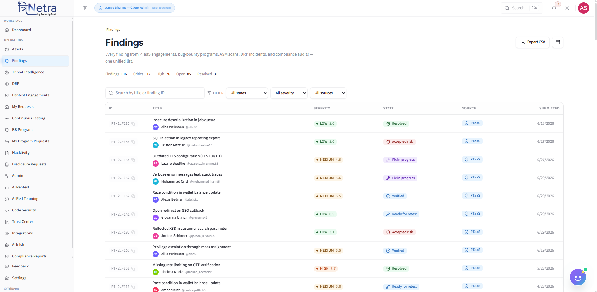
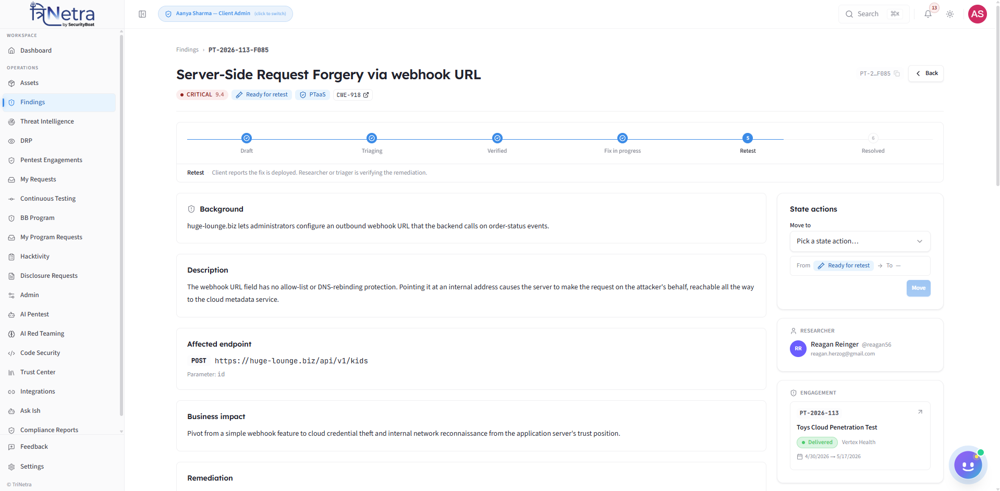
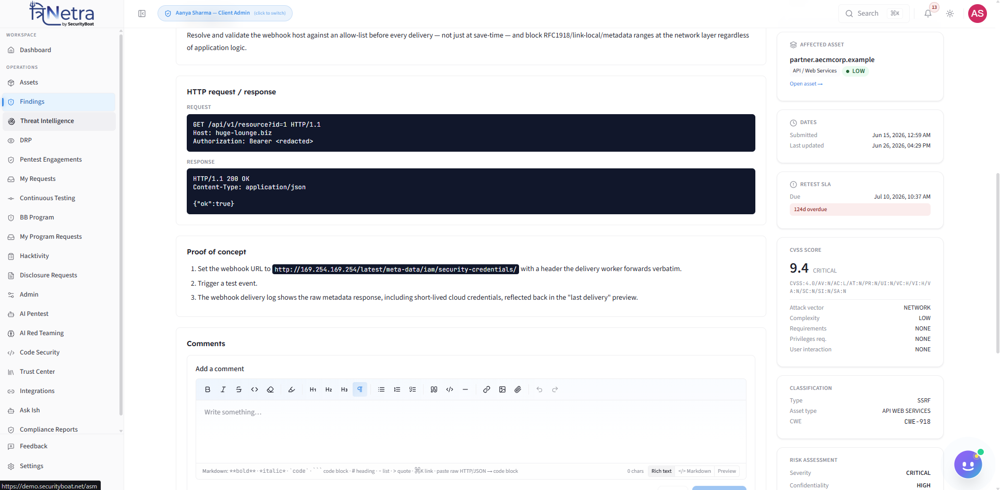
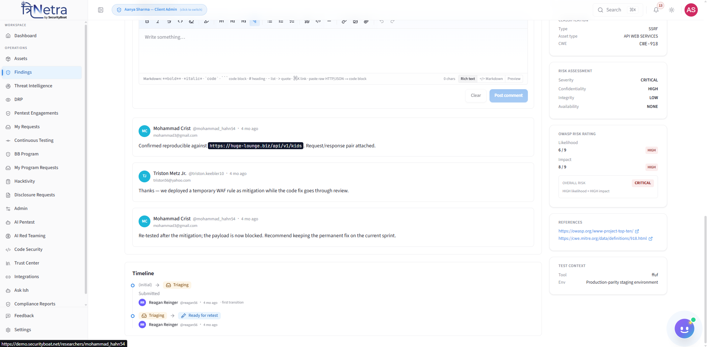
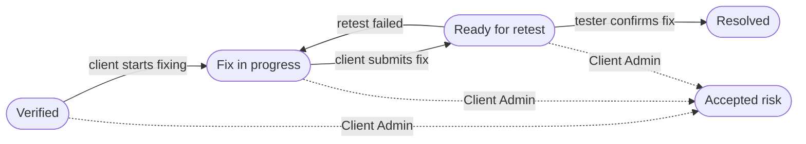

## Findings

### 1. What a "finding" is and why the module works the way it does

A **finding** is a single, documented security issue discovered on one of your
assets — a SQL injection, a broken access control, an exposed secret, and so on.
Tri-Netra keeps **one unified findings list** regardless of where the issue
came from:

| Source | Where it originates |
|--------|---------------------|
| **PTaaS** | A scheduled penetration-test engagement. |
| **Bug Bounty** | A researcher report on one of your Bug Bounty or VDP programs. |
| **ASM** | Attack-surface monitoring scans. |
| **DRP** | Digital-risk / incident detections. |
| **Compliance** | Issues raised during a compliance audit. |

The page description sums it up: *"Every finding from PTaaS engagements, bug-bounty
programs, ASM scans, DRP incidents, and compliance audits — one unified list."*

**When findings become visible to you depends on the source:**

| Source | When you first see it | States you can see |
|--------|----------------------|--------------------|
| **PTaaS** | After the testing team **verifies** it | Verified, Fix in progress, Ready for retest, Accepted risk, Resolved |
| **Bug Bounty** | As soon as the researcher **submits** it | New onward — Triaged, Pending client validation, Verified, Fix in progress, Ready for retest, Resolved, Informative, Spam |

You never see a **Draft**. Drafts are visible only to their author, the lead
researcher, and SecurityBoat. For pentests, unverified submissions are also held
back, because raw submissions can contain false positives or mis-scored severity.

### 2. What each client role can do

| Action | Client Admin | Client TPM | Client Viewer |
|--------|:---:|:---:|:---:|
| View / search findings | ✅ | ✅ | ✅ |
| Open a finding's detail | ✅ | ✅ | ✅ |
| Export findings to CSV | ✅ | ✅ | ✅ |
| Read comments | ✅ | ✅ | ✅ |
| Add comments and @mention people | ✅ | ✅ | ❌ |
| Move to **Fix in progress** / submit for retest | ✅ | ✅ | ❌ |
| **Accept risk** on a pentest finding | ✅ | ❌ | ❌ |
| Confirm a Bug Bounty finding referred for client validation | ✅ | ✅ | ❌ |
| Triage Bug Bounty findings on a **Self-Managed** program | ✅ | ✅ | ❌ |
| Edit a finding's content | ❌ | ❌ | ❌ |
| Create a finding | ❌ | ❌ | ❌ |

> **Why clients can't create or edit findings:** a finding must be tied to a real
> source (an engagement, a program, a scan) and written by the tester who found it,
> so its provenance and evidence can't be altered. There is intentionally **no
> "New finding" button** on this page.

### Navigation

Click **Findings** in the main sidebar menu.

---

### 3. The Findings list — every control explained

#### Summary counts (top)

| Tally | Meaning |
|-------|---------|
| **Findings** | Total findings visible to you. |
| **Critical** | Count at Critical severity. |
| **High** | Count at High severity. |
| **Open** | Everything not yet Resolved. |
| **Resolved** | Fixed and closed. |

#### Filters (saved in the page address)

Filters are written to the page address, so a filtered view can be bookmarked or shared.

| Filter | Values / use case |
|--------|-------------------|
| **Search** | *Search by title or finding ID…* — paste an ID from an email to jump to it. |
| **All states** | Lifecycle states such as New, Triaged, Pending Client Validation, Verified, Fix In Progress, Ready For Retest, Accepted Risk, Resolved. |
| **All severity** | Critical / High / Medium / Low / Informational. |
| **All sources** | PTaaS, Bug Bounty, ASM, DRP, Compliance. |
| **Clear** | Resets all filters. |

When you filter by **New**, an info popover — **What "New" means** — explains that
the word means different things per source:

- **Pentest (PTaaS)**, shown as **Triaging**: the finding has been submitted and a triager is reviewing it. Next step: Verified.
- **Bug bounty / VDP program**, shown as **New**: the report is awaiting initial review. Next step: Triaged.

#### Columns

| Column | Meaning |
|--------|---------|
| **ID** | The finding ID (click the pill to copy it). |
| **Title** | Short name of the issue. |
| **Severity** | Colour-coded pill with the **CVSS score**. |
| **State** | Main state badge, plus a closure label (e.g. Duplicate, Not Applicable, Needs info) when relevant. |
| **Source** | Which module the finding came from. |
| **Submitted** | Relative time (e.g. "3d ago"). |

The list shows **10 per page**, has a density toggle (compact / comfortable), and an
**Export CSV** button. Click a row to open the finding.

---

### 4. Exporting findings to CSV

**Export CSV** opens the **Export findings to CSV** dialog, so you can choose
exactly what goes into the file:

1. Pick which findings to include with the state drop-down (default **All states**).
   Your current search and filters also apply.
2. Tick the **fields** (columns) you want. The default selection is: Finding ID,
   Title, Severity, State, Vulnerability type, CVSS score, CWE ID, CVE ID, Endpoint
   URL, Description, Impact, Remediation, Submitter, Created at.
3. Download the file.

Fields you can add include source, asset type, VRT category, the CVSS vector and its
individual metrics, OWASP likelihood and impact, MITRE technique, endpoint method,
parameter and raw request, HTTP request and response, background, steps to reproduce,
the CIA (confidentiality, integrity, availability) levels and descriptions, tool
used, environment details, references, submitter email, and updated date.

The export includes **all** matching findings, not only the current page (up to
10,000 rows). The **State** and **Source** columns contain the system values (for
example `READY_FOR_RETEST`, `BUG_BOUNTY`) rather than the display labels.

The same dialog is available on a pentest engagement's **Findings** tab.

---

### 5. The finding detail page

Click any finding to open it.

#### Header and stepper

- **Title**, **severity** with CVSS score, **state** badge, closure label (if any), and **source**.
- For Bug Bounty findings, the **SB-Managed** / **Self-Managed** badge of the program. Hover for its meaning.
- CWE link and a copy-ID pill.
- A **lifecycle stepper** showing the current stage with a short description.

#### Main column

| Section | Meaning |
|---------|---------|
| **Background** | Context for the vulnerability class. |
| **Description** | What the issue is. |
| **Affected endpoint** | Exactly where it was found (method, URL, parameter). |
| **Business impact** | What an attacker could achieve. |
| **Remediation** | How to fix it. This is your action plan. |
| **HTTP request / response** | Raw evidence. |
| **Proof of concept** | Reproduction steps and screenshots. |
| **Comments** | The discussion thread (see below). |
| **Timeline** | Every state change, who made it, and the note left — newest first, **10 per page** with page buttons (e.g. *1–10 of 23 transitions*). |

#### Right column

| Card | What it shows |
|------|---------------|
| **State actions** | The actions your role can take now (see below). |
| **Researcher** | Who reported the finding, with a link to their profile. |
| **Engagement** / **BB Program** | The pentest or program it belongs to. Bug Bounty findings show a program card. |
| **Reward** | *Paid Bug Bounty programs:* the reward for this finding. |
| **Affected asset** | *Pentests:* the asset under test. |
| **Dates** | Submitted, verified, resolved dates. |
| **Retest SLA** | A countdown while the finding is awaiting retest; otherwise *"No retest currently scheduled."* |
| **CVSS score**, **Classification**, **Risk assessment**, **OWASP Risk Rating**, **References**, **Test context** | Scoring and classification details. |

#### The State actions panel

1. Open the **Pick a state action…** drop-down. It lists only the actions your role can take in the current state.
2. Check the **From → To** preview.
3. Enter the note. Some actions need a comment (the panel shows the minimum length); for others the note is optional and is recorded on the timeline.
4. Click **Confirm transition**.

#### Pentest (PTaaS) finding lifecycle

| Action | Who | When to use it | Input required |
|--------|-----|----------------|----------------|
| **Acknowledge and start fixing** (Verified → Fix in progress) | Client Admin / Client TPM | You have started remediating. | Optional note |
| **Submit fix for retest** (Fix in progress → Ready for retest) | Client Admin / Client TPM | Your fix is deployed; ask the tester to re-verify. | Optional note |
| **Accept risk formally** (→ Accepted risk) | Client Admin **only** | You formally accept the risk instead of fixing it. Available from Verified, Fix in progress, or Ready for retest. | Justification, at least 20 characters |
| **Clear NEEDS_INFO (info provided)** | Client Admin / Client TPM | The tester asked for more information and you have provided it. | At least 10 characters |
| **Confirm fix verified** / **Retest failed — send back to fix** | The tester (not you) | The tester re-tests your fix. | — |

#### Bug Bounty finding lifecycle

Bug Bounty findings follow a different path, including triage and an optional client-validation step on SB-Managed programs. See
[Program Findings](bug-bounty/detail/findings.md) for the diagram and who does what.

#### Comments

Use the comments thread to ask the tester questions, attach remediation notes, or
discuss severity.

- **@mentions:** type **@** to open **Mention a participant** and notify someone on the finding.
- **Visibility:** client roles choose who can see a comment:

| Option | Who can see it |
|--------|----------------|
| **Everyone** | All participants on the finding, including researchers. |
| **Internal** | Your team and SecurityBoat staff. Researchers cannot see it. |

  SecurityBoat staff can also post comments marked **Visible to Client**, which only your team and SecurityBoat see.
- Every comment shows a **Visible to …** pill.
- You can edit your own comment for a short time after posting (15 minutes) and delete your own comments.
- **Client Viewer** can read comments but cannot post.

---

### Best practices

- **Work Critical/High first** — the summary counts make the backlog obvious.
- **Move findings through the states honestly.** Submitting for retest before the
  fix is deployed wastes a retest cycle.
- **Use comments, not email.** Use **Internal** when the discussion should not reach the researcher.
- **Accept risk deliberately.** Only a Client Admin can, and it needs a clear business justification.
- **Export only the columns you need** for each audience.

### Troubleshooting

| Symptom | Cause / Fix |
|---------|-------------|
| **A pentest finding I was told about isn't in my list** | It hasn't been **verified** yet. It appears once the testing team verifies it. |
| **A Bug Bounty finding a researcher mentioned isn't in my list** | It is still a **Draft** on the researcher's side. |
| **No State actions available** | You're **Client Viewer**, or no action is open to your role in the current state. |
| **Can't "Accept risk"** | Only **Client Admin** can accept risk, and only on pentest findings. |
| **Confirm transition is disabled** | You haven't picked an action yet, or the required comment is too short. |
| **CSV shows codes like `FIX_IN_PROGRESS`** | Expected — the export uses system values for State and Source. |

---

← Previous: [Assets](assets/overview.md) | Next: [Engagements →](engagements/overview.md)
