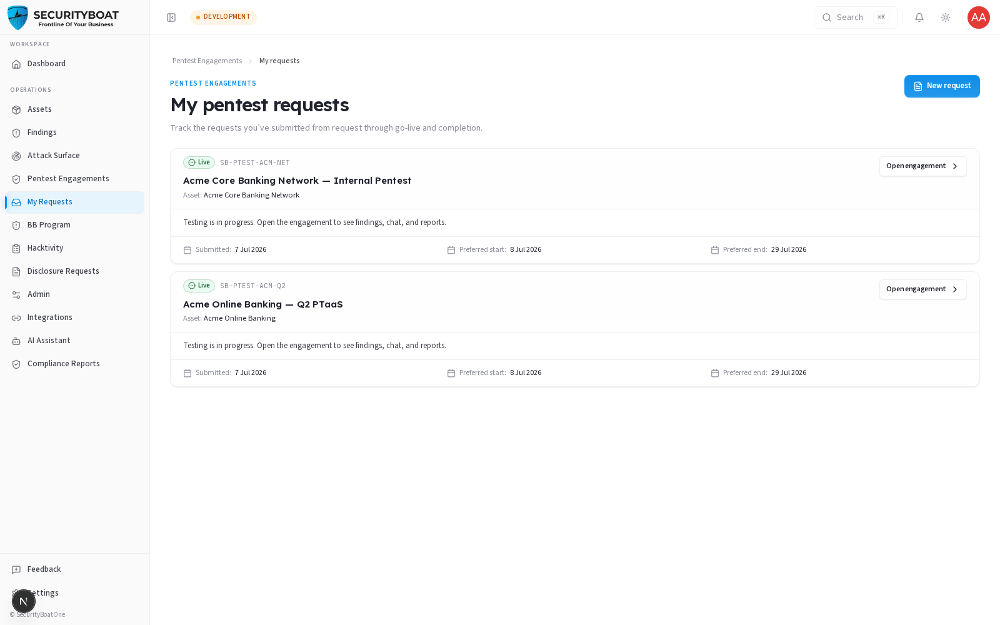

## My Requests

### 1. Why this page exists

When you submit a pentest request, it becomes an engagement in the **Requested**
state. SecurityBoat then works it through preparation (Draft, Scoping, Open to
assign, Team formed, Scheduled) before it goes **Live**.

**My Requests** is a client-friendly tracker that shows every request you've
submitted, its current state, and a plain-language explanation of what that stage
means — from submission through go-live and completion.

> In short: **Engagements** = the full workspace for live/delivered tests;
> **My Requests** = the status board for everything you've asked for, especially
> before it goes live.

### 2. Who can use it

| Action | Client Admin | Client TPM | Client Viewer |
|--------|:---:|:---:|:---:|
| View my org's requests | ✅ | ✅ | ❌ |
| Submit a new request | ✅ | ✅ | ❌ |

> Client Viewers don't have **My Requests** in the sidebar; they can follow engagements from **Pentest Engagements**.

### Navigation

Click **My Requests** in the main sidebar. The page is titled **My pentest requests** —
*"Track the requests you've submitted from request through go-live and completion."*

---

### 3. Reading the page

Each request is a card with:

- A **status badge** (see the table below) and the **Project ID** (e.g.
  `SB-PTEST-…`).
- The request **title** and the **asset** under test.
- Three dates: **Submitted**, **Preferred start**, **Preferred end**.
- An **Open engagement** button — appears once the request is approved and the
  engagement page is available to you.

**The status values and what they mean:**

The badge shows the same engagement state you see on the Engagements list (for
example **Requested**, **Draft**, **Scoping**, **Scheduled**, **Live**, **Closed**).
Under it, a one-line explanation tells you what that stage means for you:

| Stage | Badge examples | Explanation shown | What to do |
|-------|----------------|-------------------|------------|
| **Received** | Requested | We've received your request. Our team will review it shortly. | Wait for the review (usually about 1 business day). |
| **Approved, preparing** | Draft, Scoping, Open to assign, Team formed, Scheduled | Your pentest has been approved. The team is preparing scope and assigning testers — it will be live soon. | Expect a scoping call. |
| **Testing** | Live, Report drafting, Report review, Delivered, Remediation | Testing is in progress. Open the engagement to see findings, chat, and reports. | Click **Open engagement**. |
| **Completed** | Closed | The engagement is closed. Past findings and reports remain available. | Open the engagement for its findings and report. |
| **Closed before testing** | Closed | This request was closed before testing started. Contact your account team for next steps. | Contact your account team. |

---

### 4. Submitting a new request

Click **New engagement** on the Pentest Engagements page (or **Request a pentest** when
you have no requests yet) to open the request form. This is the same form
described in the [Create Engagement](engagements/create-engagement.md) guide
for the field-by-field breakdown (asset, engagement type, title, description,
preferred dates) and the review → scoping → approval → delivery flow.

---

### Best practices

- **Check here first** when you're wondering "what's happening with the test I
  asked for?" — it's faster than hunting the Engagements list.
- **One request per test window.** Don't resubmit if a request is already
  Submitted; use the engagement Chat once it's Live to add context.
- If a request sits in **Submitted** longer than expected, reach out to your CSM.

### Troubleshooting

| Symptom | Cause / Fix |
|---------|-------------|
| **"No requests yet"** | You haven't submitted any, or the engagement was created directly by SecurityBoat (it appears under Pentest Engagements). |
| **No Open engagement button** | The request is still **Requested** (not yet approved), or it was closed before testing. |
| **No My Requests in the sidebar** | You're **Client Viewer**, or your organisation isn't onboarded for PTaaS. |

---

← Previous: [Engagements](engagements/overview.md) | Next: [Compliance Reports →](08-compliance-reports.md)
