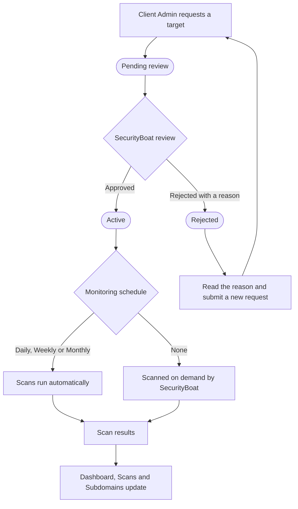

# Attack Surface Management (ASM) — Overview

> **Availability:** ASM is a **platform-gated** module. **Attack Surface** appears in your sidebar only if your organisation has been onboarded for ASM. If it is missing, or you see an **ASM Module Not Enabled** message, ask your Customer Success Manager (CSM) to enable it.

---

## What is ASM?

**Attack Surface Management (ASM)** continuously discovers and monitors everything your organisation exposes to the internet — domains, subdomains, IP addresses, open ports, technologies, and cloud resources — and flags weaknesses before an attacker finds them.

A pentest engagement is a deep, point-in-time test. ASM is **always-on breadth**: it watches your perimeter between engagements.

For a client, ASM is an **exposure console scoped to your own organisation**. SecurityBoat runs the scanners; you choose what to watch, and you read the results.

---

## What you can do

| Action | **Client Admin** | **Client TPM** | **Client Viewer** |
|--------|:---:|:---:|:---:|
| View the Dashboard, Targets, Scans, and Subdomains | ✅ | ✅ | ✅ |
| **Request** a new target (domain, IP, ASN, or cloud account) | ✅ | ❌ | ❌ |
| Edit a target's monitoring schedule, freshness SLA, label, and note | ✅ | ❌ | ❌ |
| Mark a subdomain as monitored and tag it | ✅ | ✅ | ❌ |
| Start, stop, or delete a scan | ❌ | ❌ | ❌ |
| Approve or reject target requests | ❌ | ❌ | ❌ |

> **Why clients don't start scans:** scanning is an active operation with real-world impact, so SecurityBoat owns the step of arming the scanner. You request a target, SecurityBoat reviews and approves it, and scans then run on the schedule you chose or when SecurityBoat starts them.

---

## How ASM works end to end

1. **Request** — a Client Admin submits a target and picks a monitoring schedule.
2. **Review** — SecurityBoat checks the request. Nothing is scanned and no schedule runs until the target is approved.
3. **Monitor** — an **Active** target is scanned on its schedule. Each scan discovers assets and looks for exposures.
4. **Read results** — the Dashboard, Scans, and Subdomains tabs show what was found.

---

## The ASM section

Click **Attack Surface** in the sidebar. It has four tabs:

| Tab | What it is for | Guide |
|-----|---------------|-------|
| **Dashboard** | Your exposure posture at a glance — threat levels, open findings, coverage, and trends | [Dashboard →](asm/dashboard.md) |
| **Targets** | The domains, IPs, ASNs, and cloud accounts being monitored, and how to request new ones | [Targets →](asm/targets.md) |
| **Scans** | Every scan run against your targets, and the full results of each | [Scans →](asm/scans.md) |
| **Subdomains** | A deduplicated inventory of every subdomain discovered across your targets | [Subdomains →](asm/subdomains.md) |

---

## ASM results and the Findings list

ASM results are shown **inside ASM** — on the Dashboard under **Recent Vulnerabilities**, and on each scan's **Vulnerabilities** and **TLS** tabs.

Raw scan exposures are **not** copied into your unified **Findings** list automatically. When SecurityBoat judges that an exposure needs formal tracking, it creates a finding from it (source **ASM**). That finding then follows the normal [Findings](05-findings.md) workflow. If an exposure needs a deeper look, you can also raise a [pentest request](engagements/create-engagement.md).

---

## Best practices

- **Raise your monitoring coverage.** A target with no schedule is only scanned on demand, so gaps hide there. Daily or weekly cadence on your important targets keeps results fresh.
- **Treat subdomain takeovers as urgent.** They are cheap for attackers to exploit and are called out on the Dashboard.
- **Give the reviewer context.** The **Note for the reviewer** on a request helps SecurityBoat approve it faster.
- **Watch drift after changes.** For cloud targets, the Dashboard shows new failures and regressions since the last scan.
- **Ask Ish.** The [AI Assistant](13-ai-assistant.md) can explain Dashboard numbers such as Coverage SLA or why a threat score is high.

---

## Troubleshooting

| Symptom | Cause / Fix |
|---------|-------------|
| **No "Attack Surface" in the sidebar** | Your organisation is not onboarded for ASM. Contact your CSM. |
| **"ASM Module Not Enabled" message** | ASM is not enabled for your organisation. Ask your CSM to enable it. |
| **"No attack surface yet" on the Dashboard** | No target has been scanned yet. Results appear after your first target is approved and scanned. |
| **I can't request a target or edit one** | Only Client Admin can. Client TPM and Client Viewer have read-only access. |
| **My target shows "Pending review"** | SecurityBoat has not approved it yet. Scans and schedules start only after approval. |
| **My target shows "Rejected"** | Hover over the badge to read the reason, then submit a new request. |

---

← Previous: [Integrations](10-integrations.md) | Next: [Dashboard →](asm/dashboard.md)
