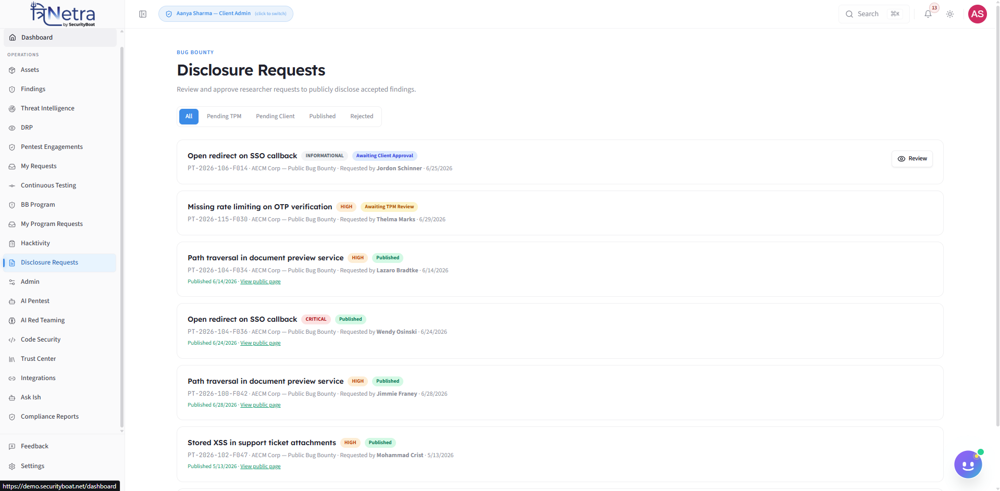
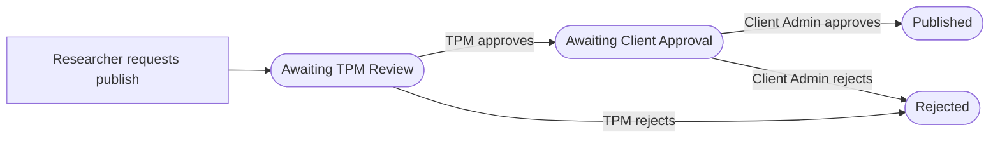

# Disclosure Requests

**Disclosure Requests** let you manage researcher requests to publicly disclose a finding from your Bug Bounty or VDP programs. You have the final say on whether a finding is published to the Hacktivity feed.

> **Who can see this page:** Client Admin and Client TPM. **Who approves or rejects:** Client Admin.

---

## Which findings can be disclosed

A researcher can request disclosure only for **their own** finding, and only once it is **Resolved** (or closed as **Not Applicable**). Findings that are still open, verified, or being fixed cannot be disclosed. Only one active request per finding is allowed; a rejected finding can be requested again.

The researcher sends the request with the **Request Publish** button on the program's **Findings** tab.

---

## Accessing Disclosure Requests

In the sidebar, under **OPERATIONS**, click **Disclosure Requests**. Notification links open the page with the relevant request highlighted.

---

## The request workflow

| Status | Description |
|---|---|
| **Awaiting TPM Review** | The researcher submitted the request. A SecurityBoat TPM checks it first. |
| **Awaiting Client Approval** | The TPM approved it. It now needs **your** decision. |
| **Published** | You approved it. The disclosure is live on Hacktivity, with a **View public** link. |
| **Rejected** | The disclosure was denied by the TPM or by your team. |

Use the filter tabs at the top of the page — **All**, **Pending TPM**, **Pending Client**, **Published**, **Rejected** — to focus on one stage. The list shows 10 requests per page.

---

## Deciding on a request (Client Admin)

1. Filter by **Pending Client**.
2. Open a request and review the finding title, severity, and the TPM's notes.
3. Optionally add a **Comment** explaining your decision.
4. Click **Approve** to publish, **Reject** to deny, or **Cancel** to decide later.

Common reasons to reject:

| Scenario | Reason to reject |
|---|---|
| The same vulnerability class exists in other systems still being fixed | Active risk |
| The disclosure reveals proprietary business logic or architecture | Confidentiality |
| The finding relates to a system under regulatory investigation | Legal / compliance |
| Publication timing conflicts with an upcoming audit | Audit readiness |

---

## Best practices

- **Respond promptly** — researchers rely on timely publication for their reputation.
- **Explain rejections** in the comment — vague rejections discourage future participation.
- **Coordinate with your TPM** on disclosure strategy.

---

← Previous: [Hacktivity](17-hacktivity.md) | Next: [Researchers →](24-researchers.md)
