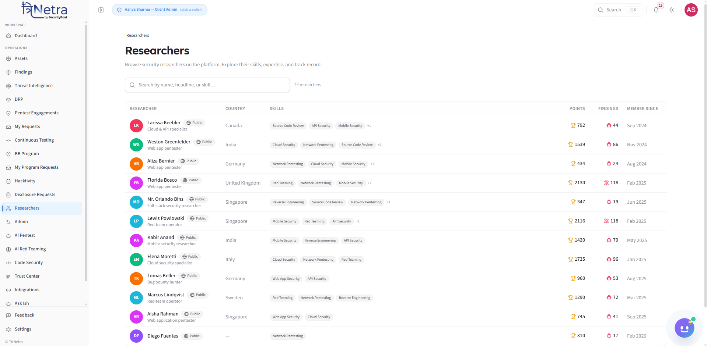

# Researchers

> **Who can view:** Client Admin, Client TPM, Client Viewer.

The **Researchers** page lets you browse the security researchers on the platform — their skills, expertise, and track record. It is useful when you want to understand who might test your assets, or which researchers to invite to a Self-Managed private Bug Bounty program.

To open it, click **Researchers** in the sidebar.

> Client roles see only researchers who have made their profile **public**. Researchers with a private profile are not listed.

---

## The researcher directory

| Element | What it does |
|---------|--------------|
| **Search** | *Search by name, headline, or skill…* — for example, type "API" or "Active Directory" to find researchers with that skill. |
| **Count** | The number of researchers matching your search. |
| **Table** | One row per researcher (see below). Click a row to open the researcher's profile. |
| **Pagination** | 10 researchers per page. The page number is kept in the page address, so **Back** returns you to the same page. |

| Column | What it shows |
|--------|---------------|
| **Researcher** | Avatar, name, a **Verified** badge if their identity is verified, and their professional headline |
| **Email** | Contact email |
| **Country** | Country or region |
| **Skills** | The first three skills, then "+N" for more |
| **Points** | Reputation points |
| **Findings** | Number of valid findings |
| **Member since** | When they joined (month and year) |

---

## Researcher profiles

Clicking a researcher opens their profile, which shows their headline, bio, skills, expertise areas, certifications, links, and track record on the platform.

---

## Troubleshooting

| Symptom | Cause / Fix |
|---------|-------------|
| **"No researchers match your search."** | Try a broader term, or search by a single skill. |
| **A researcher I know isn't listed** | Their profile is private, or they are not yet active on the platform. |
| **"Couldn't load researchers."** | Click **Try again**. If it persists, refresh the page. |

---

← Previous: [Disclosure Requests](18-disclosure-requests.md) | Next: [AI Assistant (Ish) →](13-ai-assistant.md)
