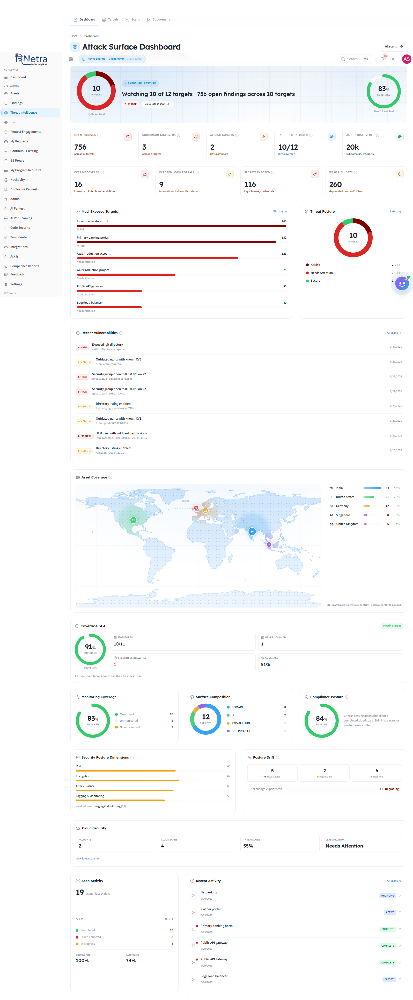
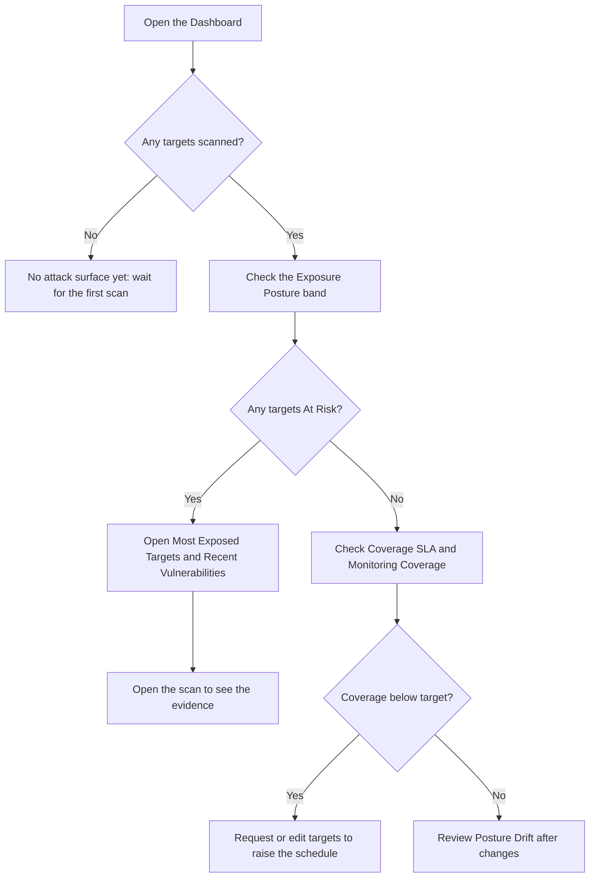

# ASM Dashboard

> **Who can view:** Client Admin, Client TPM, Client Viewer. The Dashboard is read-only and always shows your own organisation.

The **Attack Surface Dashboard** is your exposure posture console — *"Your organization's exposure posture and continuous attack-surface monitoring."* Open it from **Attack Surface → Dashboard**. The **All scans →** button jumps to the Scans tab.

All numbers are calculated from the **newest completed scan of each target**, so they reflect your latest known state.

---

## Empty state

Until a target has been scanned, the Dashboard shows **No attack surface yet** — *"Your attack surface is being set up. Reconnaissance results will appear here once your first target is scanned."* Request a target on the [Targets](targets.md) tab if you have not already.

---

## Exposure Posture band

The band at the top summarises your coverage and risk:

| Part | What it shows |
|------|---------------|
| **Donut — by threat level** | Your targets grouped as **At Risk**, **Needs Attention**, **Secure**, or **Unrated**. The centre shows the number of targets. |
| **Headline** | *Watching X of Y targets · N open findings across Z targets*, with an **N At Risk** chip and a **View latest scan** link. |
| **Coverage ring** | *X of Y watched* — the share of targets on a recurring schedule. Green at 80% or more, amber at 50% or more, red below 50%. |

---

## Key metrics

| Tile | Meaning | Why it matters |
|------|---------|----------------|
| **Open Findings** | Open exposures plus cloud findings across your latest scans, with the number of targets they span. | Your outstanding perimeter risk. |
| **Subdomain Takeovers** | Dangling DNS records pointing at services that no longer exist. | An attacker could claim the subdomain. Treat as urgent. |
| **At-Risk Targets** | Targets whose latest scan is classed **At Risk** (threat score above 60), with the share that are compliant. | Where to focus first. |
| **Targets Monitored** | Targets on a recurring schedule out of the total, with the coverage percentage. | Unmonitored targets are scanned only on demand. |
| **Assets Discovered** | Subdomains, IPs, ports, technologies, and endpoints found. | The true size of your exposed surface. |

---

## Panels

| Panel | What it shows |
|-------|---------------|
| **Most Exposed Targets** | The top six targets by number of findings, as ranked bars. Click a bar to open that target's scan. Empty state: *No findings recorded yet*. |
| **Threat Posture** | A donut of your targets by threat class. Empty state: *No completed scans yet*. |
| **Recent Vulnerabilities** | The eight newest Critical, High, and Medium findings with severity, title, and location. Click one to open its scan. Empty state: *No Critical/High/Medium findings*. |
| **Asset Coverage** | A map of where your discovered IP assets are located. Empty state: *No geolocated assets yet*. |
| **Coverage SLA** | Whether your monitoring is fresh enough: a coverage ring labelled **Meeting target** or **Below target** (the target percentage defaults to 90% and is set by SecurityBoat), plus a count of targets whose results have gone stale and a list of those at risk. |
| **Monitoring Coverage** | A ring of targets *watched*, with a breakdown of **Monitored**, **Unmonitored**, and **Never scanned**. |
| **Surface Composition** | A donut of your targets by type (domain, IP, ASN, cloud). |
| **Scan Activity** | Scans in the last 14 days as a small chart, with **Completed**, **Failed / aborted**, **In progress**, **Success rate**, and **Automated** (the share of scans started by a schedule rather than by hand). |
| **Recent Activity** | Your last six scans with their status. |

### Compliance and posture panels (cloud targets)

If you monitor cloud accounts, extra panels appear:

| Panel | What it shows |
|-------|---------------|
| **Compliance Posture** | The share of security checks passing on your cloud scans. |
| **Security Posture Dimensions** | Bars for the average score in each posture area, with a **Weakest area** line. |
| **Posture Drift** | **New failures**, **Regressions**, and **Resolved** since the previous scan, and a net verdict of **Degrading**, **Improving**, or **Stable**. |

Without cloud scans, the **Compliance Posture** slot shows **Exposure Highlights** instead — subdomain takeovers, exposed secrets, weak TLS configurations, and risk hotspots.

> The AI Assistant (Ish) can explain any of these numbers. Ask it, for example, *"What is Coverage SLA?"* or *"Why is my threat score high?"*

---

## Reading the Dashboard

---

## Troubleshooting

| Symptom | Cause / Fix |
|---------|-------------|
| **Everything is empty** | No target has completed a scan yet. |
| **A target is missing from the numbers** | It is still **Pending review**, or it has never been scanned. |
| **Coverage looks low** | Targets with no schedule count as unmonitored. Ask a Client Admin to set a schedule. |
| **No cloud panels** | You have no cloud targets. |

---

← Previous: [ASM Overview](../11-asm.md) | Next: [Targets →](targets.md)
