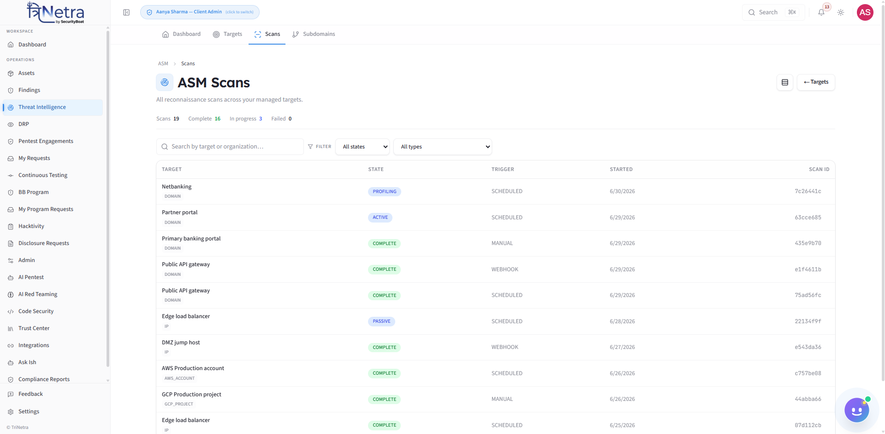
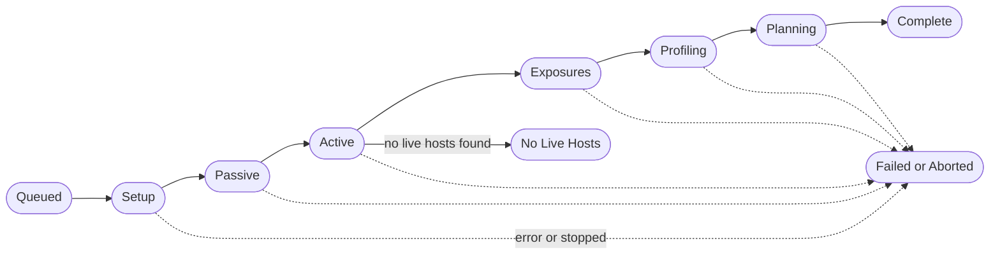

# ASM Scans

> **Who can view:** Client Admin, Client TPM, Client Viewer. **Who starts scans:** SecurityBoat, or the monitoring schedule you set on an Active target.

The **Scans** tab (**ASM Scans**) is the record of every scan run against your targets. Open a scan to see everything it discovered.

---

## How a scan runs

Scans are not started from the client side. A scan begins when:

- an **Active** target reaches its next **DAILY**, **WEEKLY**, or **MONTHLY** scheduled time, or
- SecurityBoat starts a scan on demand.

Each scan moves through a pipeline of stages:

| Stage | What happens |
|-------|--------------|
| **Queued** | Waiting for a free slot. |
| **Setup** | The target is validated and the scan is prepared. |
| **Passive** | Discovery from public sources, without sending traffic to your systems. |
| **Active** | Probing hosts, scanning ports, and crawling endpoints. |
| **Exposures** | Scanning for vulnerabilities and auditing TLS. |
| **Profiling** | Classifying assets and scoring business risk. |
| **Planning** | Working out likely attack paths and priorities. |
| **Complete** | The scan finished and results are available. |
| **No Live Hosts** | The scan ended early because nothing live was found on the target. |
| **Failed / Aborted** | The scan hit an error or was stopped. |

Cloud scans skip the Passive and Active stages and run a single cloud scan stage instead.

---

## The scans list

| Element | What it shows |
|---------|---------------|
| **Tallies** | **Scans**, **Complete**, **In progress**, and **Failed** |
| **Target** | The target scanned, with a type chip |
| **State** | The current stage or final outcome (e.g. *Complete*, *No Live Hosts*) |
| **Trigger** | **Manual**, **Scheduled**, or **Webhook** |
| **Started** | When the scan began |
| **Scan ID** | The first characters of the scan ID, for reference |

Filters: a search box (*Search by target or organization…*), **All states**, **All types**, and **Clear**. Click a row to open the scan. If you arrive from a target, the title becomes **Scans · *target*** and only that target's scans are shown.

Empty state: *No scans yet.* Scans appear after a target is approved and scanned.

---

## Scan results

Opening a scan shows a summary header, a **phase stepper** that tracks the scan's progress, and tab groups. The top row is the group; the row beneath it shows the group's tabs.

| Group | Tabs | What you see |
|-------|------|--------------|
| **Overview** | Overview | Key metrics — threat score, open findings, assets discovered — and scan timing |
| **Attack Surface** | Subdomains, Hosts, IPs, Tech | Everything discovered, by category |
| **Infrastructure** | DNS Map, WHOIS, Ports, Port Map, Services | DNS records, registration data, open ports, and the services behind them |
| **Web Exposure** | Endpoints, Paths, WAF, Screenshots | Web endpoints and paths, firewall detection, and page screenshots |
| **Exposures** | Vulnerabilities, TLS | Verified vulnerabilities by severity (Critical, High, Medium, Low, Info) and certificate and protocol issues |
| **Dark Web** | Dark Web | Exposed URLs, emails, and other mentions found on the dark web |
| **Attack Paths** | Attack Flows | Visual chains showing how weaknesses could be combined |
| **Drift** | Drift | What changed since the previous scan |

**Cloud scans** use a single tab bar instead of groups, with the findings table, a compliance chart mapped to security frameworks, a drift panel, a service heatmap, and an attack-paths panel.

> **Subdomain takeovers** — dangling DNS records pointing at abandoned services — appear among the vulnerabilities and in the Dashboard's **Subdomain Takeovers** tile.

Triage actions such as marking a result a false positive, pushing it to Jira, and viewing secrets are handled by SecurityBoat and are not available on client accounts.

---

## Troubleshooting

| Symptom | Cause / Fix |
|---------|-------------|
| **No scans yet** | Your target is still **Pending review**, or it has not reached its first scheduled scan. |
| **A scan says No Live Hosts** | Nothing live was found on that target. Check the target value, or ask your CSM. |
| **A scan Failed** | Contact your CSM. SecurityBoat can re-run it. |
| **I want a scan now** | Clients can't start scans. Ask your CSM to run one, or set a tighter monitoring schedule. |
| **A scan shows no vulnerabilities** | That is a good result. Check the Overview for the threat score. |

---

← Previous: [Targets](targets.md) | Next: [Subdomains →](subdomains.md)
