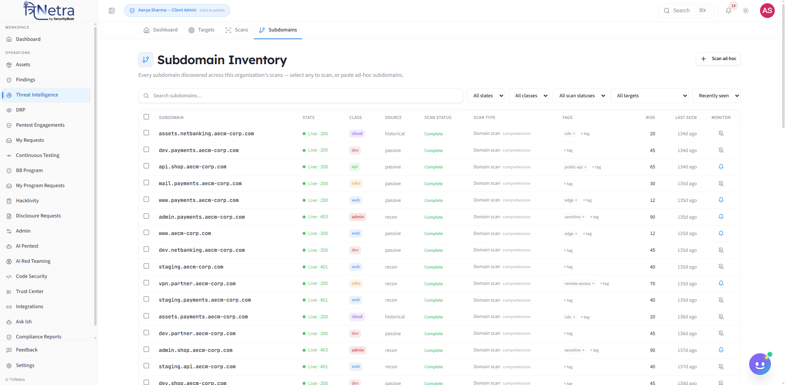
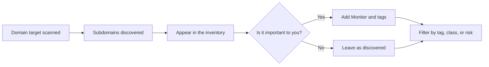

# ASM Subdomains

> **Who can view:** Client Admin, Client TPM, Client Viewer. **Who can mark a subdomain as monitored and add tags:** Client Admin and Client TPM.

The **Subdomains** tab (**Subdomain Inventory**) lists every subdomain discovered across your targets, in one deduplicated, organisation-wide view. Use it to see your real web footprint and keep track of the hosts that matter most.

Every subdomain belongs to a parent **Domain** target. Subdomains appear here after a scan of that target discovers them.

---

## The inventory table

| Column | What it shows |
|--------|---------------|
| **Subdomain** | The host name |
| **State** | **Live** (with the HTTP response code, e.g. *Live · 200*) or **Not live** |
| **Class** | What kind of host it looks like: `web`, `api`, `admin`, `dev`, `infra`, or `cloud` |
| **Source** | How it was discovered (for example public DNS records, certificate transparency logs, or active discovery) |
| **Scan status** | Whether a scan of this subdomain is **In progress**, or how the last one ended — **Complete**, **No live hosts**, **Failed**, or **Aborted** |
| **Scan type** | **Domain scan**, **Subdomain scan**, **Subdomain sweep**, or **New subdomains** |
| **Tags** | Your own labels |
| **Risk** | A numeric risk score from the exposures found, or "—" |
| **Last seen** | When the subdomain was last observed |
| **Monitor** | A bell icon: monitored or not |

### Search, filter, and sort

- **Search subdomains…**
- **State:** **All states**, **Live only**, **Not live**
- **Class:** **All classes** or one class
- **Scan status:** **All scan statuses**, **In progress**, **Complete**, **No live hosts**, **Failed**, **Aborted**
- **Target:** **All targets** or one target
- **Sort:** **Recently seen**, **Highest risk**, or **A–Z**

Empty state: *No subdomains yet — run a domain scan to populate the inventory.*

---

## Organising your inventory (Client Admin and Client TPM)

| Action | How |
|--------|-----|
| **Monitor / Stop monitoring** | Click the **bell** on a row to mark the subdomain as one you want kept under watch. |
| **Add a tag** | Click **+ tag** on the row and enter a label such as `production` or `testing`. A subdomain can have up to 20 tags. |

Client Viewer can see monitoring and tags but cannot change them.

---

## About scanning subdomains

The Subdomains tab also shows **Scan ad-hoc** and **Scan selected** controls. **Scans are started by SecurityBoat, not by client accounts**, so a client request from those controls is not accepted. To have particular subdomains scanned, send the list to your CSM, or tag and monitor the ones that matter so they stay in view.

---

## Best practices

- **Review Live subdomains with a high Risk score first.**
- **Look for forgotten hosts.** Classes such as `dev` and `admin` that are live on the internet deserve a second look.
- **Tag by environment or owner** so you can filter quickly.
- **Compare with your asset inventory.** Anything unexpected may be shadow IT.

## Troubleshooting

| Symptom | Cause / Fix |
|---------|-------------|
| **The inventory is empty** | No Domain target has completed a scan yet. |
| **I can't toggle Monitor or add tags** | You are Client Viewer, which is read-only. |
| **A subdomain I expect is missing** | It may not have been discovered yet. It appears after a scan sees it. |
| **Scan ad-hoc doesn't work** | Scans are started by SecurityBoat. Ask your CSM. |

---

← Previous: [Scans](scans.md) | Next: [Bug Bounty →](../bug-bounty/overview.md)
