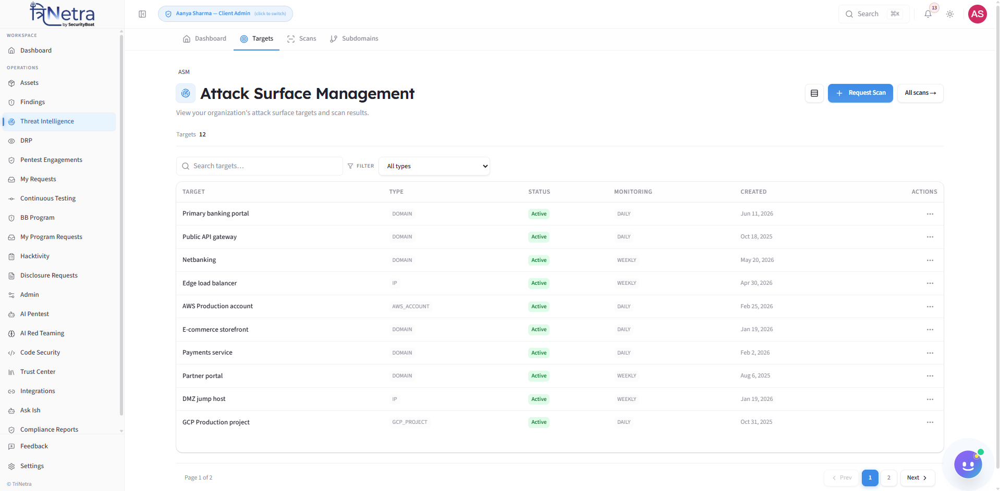
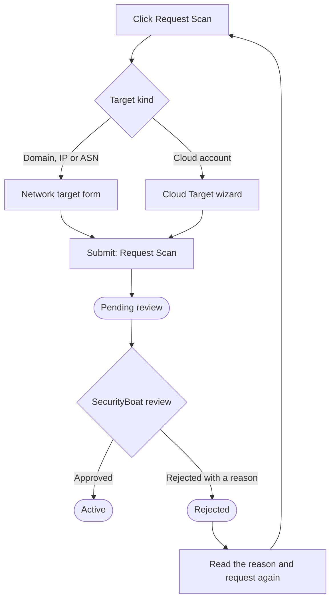
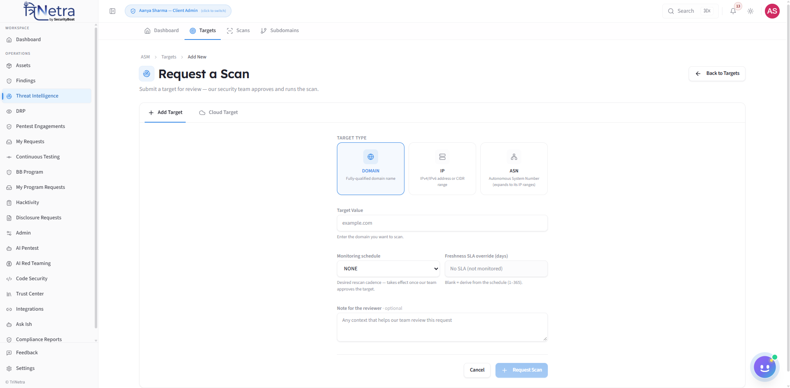
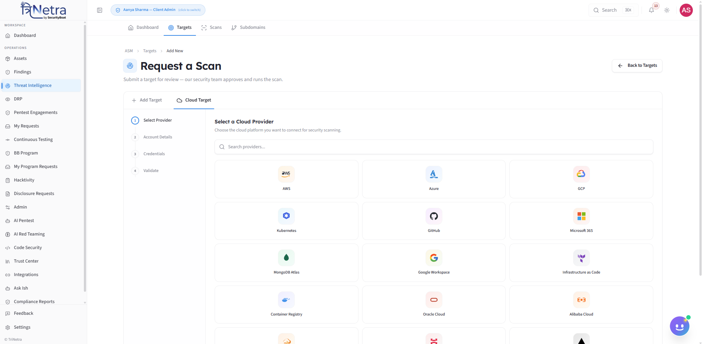
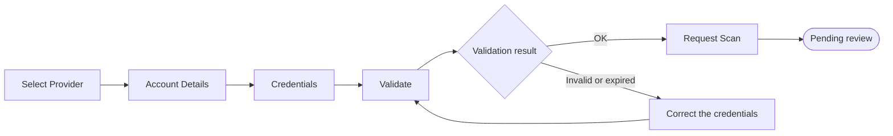

# ASM Targets

> **Who can view:** Client Admin, Client TPM, Client Viewer. **Who can request and edit targets:** Client Admin only.

A **target** is something you want SecurityBoat to monitor: a domain, an IP address or range, an ASN, or a cloud account. The **Targets** tab lists them, shows whether each has been approved, and is where a Client Admin requests new ones.

---

## The targets list

The page is titled **Attack Surface Management** — *"View your organization's attack surface targets and scan results."*

| Column | What it shows |
|--------|---------------|
| **Target** | The label if one was set, otherwise the target value |
| **Type** | Domain, IP, ASN, or the cloud provider |
| **Status** | **Pending review**, **Active**, or **Rejected** (see below) |
| **Monitoring** | The recurring schedule |
| **Created** | When the target was added |
| *(Actions menu)* | **Edit** — Client Admin only |

- **Search targets…** and a type filter (**All types**) narrow the list. **Clear** resets them.
- A **Targets** count sits above the table. The list shows 10 targets per page.
- Click a row to open that target's scans.
- Before you have any targets: *No targets yet — No targets have been scanned for your organization yet.*

### Target statuses

| Status | Meaning |
|--------|---------|
| **Pending review** | You requested it. SecurityBoat has not reviewed it yet. It is not scanned and its schedule is dormant. |
| **Active** | Approved. It is scanned on its schedule and on demand. |
| **Rejected** | SecurityBoat declined it. **Hover over the badge to read the reason.** |

Only **Active** targets can be scanned.

---

## Requesting a target

Only a **Client Admin** can request targets. Other roles who open the request page see *Access denied — Your role does not have permission to add attack surface targets. You have read-only access to your organization's targets and scan results.*

1. Go to **Attack Surface → Targets** and click **Request Scan**.
2. The **Request a Scan** page offers two options: network targets, or **Cloud Target**.
3. Fill in the form and submit.
4. You see **Scan request submitted for review**, and the target appears as **Pending review**.

### Network targets (Domain, IP, ASN)

| Field | Required | What to enter |
|-------|:--------:|--------------|
| **Target Type** | ✅ | **Domain** — a fully-qualified domain name (e.g. `example.com`). **IP** — an IPv4/IPv6 address or a CIDR range (e.g. `192.168.1.1` or `10.0.0.0/24`). **ASN** — an Autonomous System Number, which expands to its IP ranges (e.g. `AS13335`). |
| **Target Value** | ✅ | The domain, IP/range, or ASN. Up to 255 characters; letters, digits, and `. _ : / -` are allowed. |
| **Monitoring schedule** | — | The recurring rescan cadence: **NONE** (on-demand only), **DAILY**, **WEEKLY**, or **MONTHLY**. *"Desired rescan cadence — takes effect once our team approves the target."* |
| **Freshness SLA override (days)** | — | A number from 1 to 365: how old results may get before they are flagged as stale. Leave blank to derive it from the schedule. Disabled when the schedule is NONE. |
| **Note for the reviewer** | — | Up to 500 characters of context for SecurityBoat. |

### Cloud targets

Switch to the **Cloud Target** tab. The wizard has four steps: **Select Provider**, **Account Details**, **Credentials**, and **Validate**.

1. **Select Provider** — pick your cloud or SaaS provider (for example AWS, Azure, GCP, Kubernetes, GitHub, Cloudflare, Microsoft 365, or Okta).
2. **Account Details** — enter the account identifier, a **Scan Name (optional)** (it defaults to *Provider - Organisation name*), the scan scope, and an optional note for the reviewer.
3. **Credentials** — provide the credentials in the format the provider uses.
4. **Validate** — run the credential check before you submit.

If the check fails you see *Credentials could not be verified. Check them and try again.* Fix the credentials and validate again. Credentials are stored encrypted and are never shown back to you.

> **Review step:** whether the target is network or cloud, nothing is scanned until SecurityBoat approves it.

---

## Editing a target

A Client Admin can open **Edit** from the row's Actions menu. The page is titled **Edit Target**.

| You can change | Notes |
|----------------|-------|
| **Monitoring schedule** and **Freshness SLA override** | Any time. A new schedule takes effect once the target is Active. |
| **Label** and **Note for the reviewer** | Any time. |
| **Target type and value** | Only while the target is **Pending review**. After approval they are fixed. |

To remove a target, or to change its type or value after approval, ask your CSM. Clients cannot delete targets.

---

## Monitoring and freshness

| Setting | What it does |
|---------|--------------|
| **NONE** | The target is scanned only when SecurityBoat runs a scan on demand. It counts as *unmonitored*. |
| **DAILY / WEEKLY / MONTHLY** | The target is rescanned automatically every day, week, or month once it is Active. |
| **Freshness SLA** | How long a scan result stays "fresh". By default it is a little longer than the rescan interval; set an override to tighten or relax it. When results go stale the target is flagged on the Dashboard's **Coverage SLA** panel. |

---

## Troubleshooting

| Symptom | Cause / Fix |
|---------|-------------|
| **No Request Scan button, or Access denied** | Only Client Admin can request targets. |
| **My target is still Pending review** | SecurityBoat has not approved it yet. Add detail in the reviewer note, or ask your CSM. |
| **My target was Rejected** | Hover over the badge to read the reason, then submit a corrected request. |
| **I can't change the target value** | It is fixed once the target is approved. Request a new target instead. |
| **Cloud validation keeps failing** | Re-check the credentials and permissions, and confirm they have not expired. |
| **"ASM Module Not Enabled"** | ASM is not enabled for your organisation. Contact your CSM. |

---

← Previous: [Dashboard](dashboard.md) | Next: [Scans →](scans.md)
