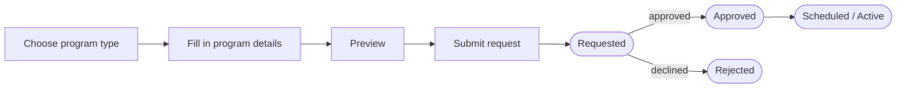
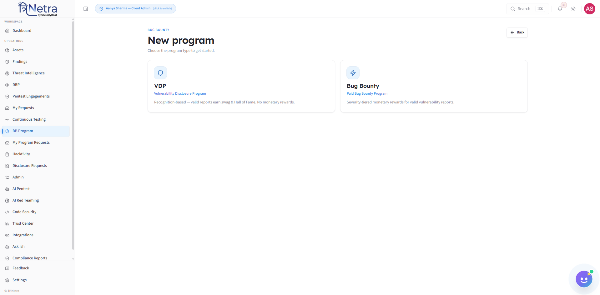
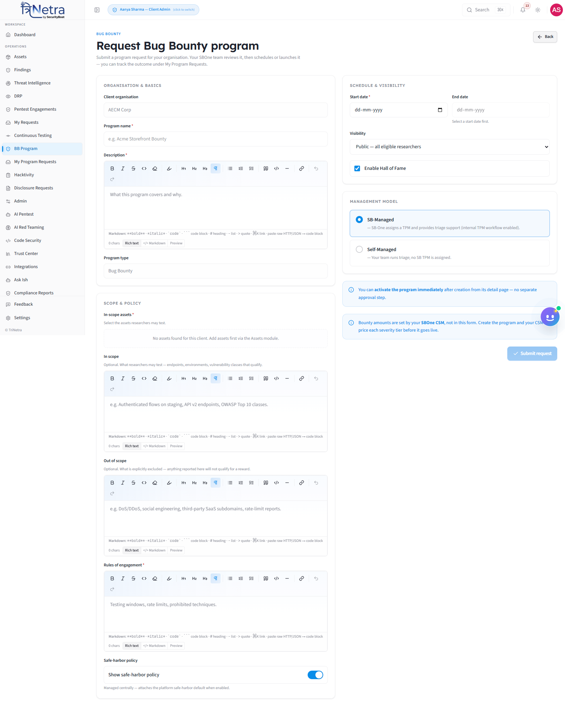
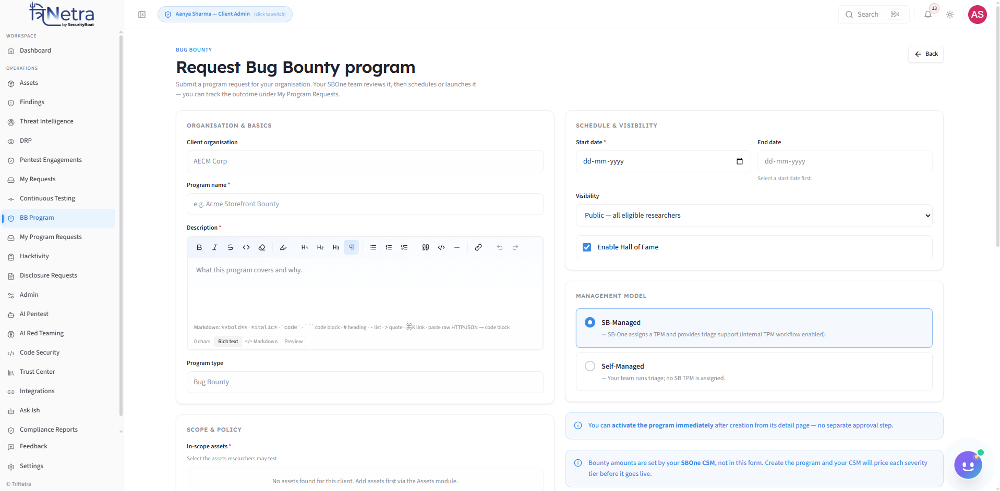

# Request a Bug Bounty Program

> **Who can do this:** Client Admin only. Client TPM and Client Viewer do not see the **New program** button.

Clients **request** a program rather than launching one directly. You fill in the program details and submit a request. SecurityBoat reviews it, sets the reward amounts for paid programs, and then schedules or activates it. You can follow every request under [My Program Requests](my-program-requests.md).

---

## Step 1 — Choose the program type

Go to **BB Program** in the sidebar and click **New program** (or **Request a program** on the **My Program Requests** page).

| Card | Choose when… |
|------|-------------|
| **VDP — Vulnerability Disclosure Program** | You want a responsible-disclosure channel. Researchers earn recognition (swag + Hall of Fame), not money. |
| **Bug Bounty — Paid Bug Bounty Program** | You want severity-tiered cash rewards. Marked **Paid plan**. |

> **Free plan:** the Bug Bounty card is visible but disabled, with the note *"Not available on the Free plan — Bug Bounty is a Paid-tier capability."* Free-plan organisations can request VDP programs. Contact your CSM to upgrade.

The program type cannot be changed after the request is submitted.

---

## Step 2 — Fill in the program details

The page is titled **Request Bug Bounty program** (or **Request VDP program**). Fields marked with a red asterisk (`*`) are required.

### Organisation & Basics

| Field | Required | What to enter |
|-------|:--------:|--------------|
| **Program name** | ✅ | A clear, descriptive name (e.g., *Acme Storefront Bounty*). At least 3 characters. |
| **Description** | ✅ | What the program covers and why. Researchers read this first. |
| **Program type** | — | Filled in from Step 1. Read-only. |

> **About the editor:** Description and the other long-text fields use a rich-text editor with a formatting toolbar (bold, italic, headings, lists, quotes, code blocks, links). You can switch to **Markdown** mode or use **Preview** to check the result.

### Scope & Policy

| Field | Required | What to enter |
|-------|:--------:|--------------|
| **In-scope assets** | ✅ | Select one or more of your **active** assets. Only assets registered in the **Assets** module appear. If the list is empty, add assets there first. |
| **In scope** | — | What researchers may test on those assets — endpoints, environments, and vulnerability classes that qualify. Example: *Authenticated flows on staging, API v2 endpoints, OWASP Top 10 classes.* |
| **Out of scope** | — | What is explicitly excluded. Reports about these items do not qualify for a reward. Example: *DoS/DDoS, social engineering, third-party SaaS subdomains, rate-limit reports.* |
| **Rules of engagement** | ✅ | Testing windows, rate limits, and prohibited techniques. |
| **Safe-harbor policy** | — | A **Show safe-harbor policy** toggle. The policy text itself is the platform's standard safe-harbor statement, managed centrally by SecurityBoat. When the toggle is on, the program shows a **Safe Harbor** badge and the policy on its Scope tab. |

> **Why scope matters:** researchers can only be held to rules you have written down. Clear in-scope and out-of-scope notes reduce noise and disputes.

### Schedule & Visibility

| Field | Required | What to enter |
|-------|:--------:|--------------|
| **Start date** | ✅ | When the program should open. |
| **End date** | — | Disabled until you pick a start date. Leave blank for a continuous program. It must be on or after the start date. |
| **Visibility** | — | **Public — all eligible researchers** or **Private — invite-only researchers**. |
| **Enable Hall of Fame** | — | Shows the top researchers on the program's Overview tab. Recommended. |

### Management Model

| Option | What it means |
|--------|--------------|
| **SB-Managed** | SecurityBoat assigns a TPM and provides triage support. Requires a Paid plan. |
| **Self-Managed** | Your team runs triage. No SecurityBoat TPM is assigned. |

### Rewards

- **Bug Bounty:** you do not enter reward amounts. A banner explains that bounty amounts are set by your SecurityBoat CSM, who prices each severity tier (P1–P5) before the program goes live.
- **VDP:** a banner explains that VDP programs are recognition-based — valid reports earn swag and Hall of Fame placement, with no monetary reward table.

---

## Step 3 — Preview and submit

1. Click **Preview** to see how the program page will look once approved. The preview shows the same header, KPI tiles, and tabs as a real program. Nothing is submitted until you click **Submit request**.
2. Click **Close** to return to the form, or **Submit request** to send it.

The **Preview** and **Submit request** buttons stay disabled until you have entered a program name and selected at least one in-scope asset.

---

## What happens next

1. Your request appears under **My Program Requests** with the status **Requested** — *"Awaiting review by your SecurityBoat team."*
2. SecurityBoat reviews the request. For Bug Bounty programs, your CSM also sets the reward amounts.
3. The request is either:
    - **Approved** — the program page becomes available. It is then **Scheduled** (goes live on the start date) or **Active**.
    - **Rejected** — the reviewer's reason is shown under My Program Requests. Adjust the details and submit a new request.
4. Once **Active**:
    - **Public** programs are open to all eligible researchers.
    - **Private** programs are open to invited researchers. On a **Self-Managed** Private program, a Client Admin can invite researchers from the [Team tab](detail/team.md). On an SB-Managed program, SecurityBoat handles invitations.
5. Monitor the [Findings tab](detail/findings.md) as reports arrive.

---

## Troubleshooting

| Symptom | Cause / Fix |
|---------|-------------|
| **No "New program" button** | Only Client Admin can request programs. |
| **The Bug Bounty card is disabled** | Your organisation is on the Free plan. Choose VDP or contact your CSM to upgrade. |
| **SB-Managed is disabled** | SB-Managed requires a Paid plan. Choose Self-Managed or contact your CSM. |
| **The asset list is empty** | You have no active assets. Add or reactivate an asset in the **Assets** module first. |
| **End date cannot be selected** | Pick a start date first. |
| **Submit request stays disabled** | Enter a program name and select at least one in-scope asset. |

---

← Previous: [Overview](overview.md) | Next: [My Program Requests →](my-program-requests.md)
