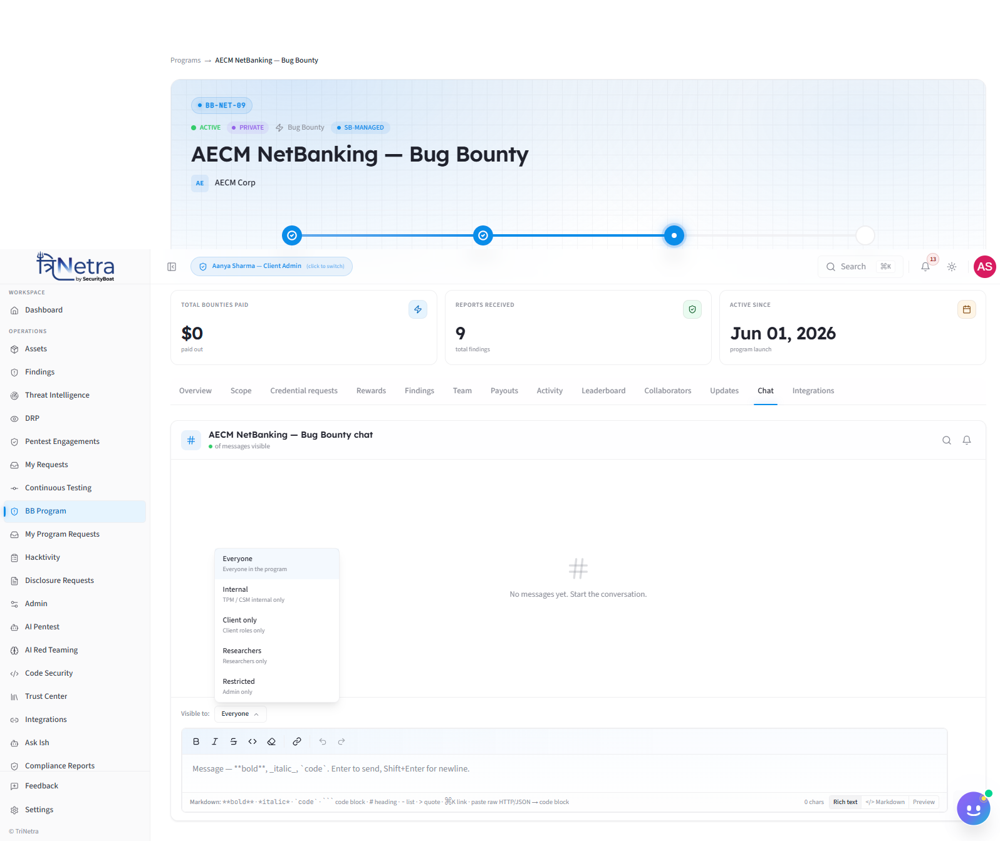

# Program Chat

> **Who can read:** Client Admin, Client TPM, Client Viewer. **Who can send:** Client Admin and Client TPM. Client Viewer is read-only.

The **Chat** tab is a messaging channel for this program. Your team, SecurityBoat staff, and (on Private programs) invited researchers can communicate in one place instead of over email.

> On **Public** programs, researchers do not have access to the program Chat. It is used by your team and SecurityBoat.

---

## Choosing who sees a message

Before sending, pick the audience. As a client you can choose:

| Audience | Who can read it | When to use |
|----------|-----------------|-------------|
| **Everyone** | Everyone in this chat — your team, SecurityBoat staff, and researchers who have chat access | Scope clarifications and program-wide announcements |
| **Client only** | Your team plus SecurityBoat staff (SB Admin, CSM, TPM). Researchers cannot see it | Discussing findings, payouts, or changes you do not want researchers to see |

Each message shows a badge with its audience, plus the sender's name, role, and time. You always see your own messages. Messages from audiences your role cannot read are not shown to you.

---

## Mentioning people

Type **@** in the message box to mention a participant. Only people who can read the message can be mentioned, and they are notified.

---

## How to send a message

1. Open the **Chat** tab on the program.
2. Choose the audience: **Everyone** or **Client only**.
3. Type your message. The editor supports rich text and Markdown, with a **Preview** option.
4. Send. The chat updates in real time.

---

## Best practices

- **Use Everyone for program-wide updates** so invited researchers are informed.
- **Use Client only for internal discussion** with SecurityBoat — researchers will not see it.
- **Do not share sensitive details with Everyone.**
- **Use @mentions** to get a specific person's attention.

---

## Troubleshooting

| Symptom | Cause / Fix |
|---------|-------------|
| **I cannot send messages** | You are Client Viewer (read-only). |
| **A researcher cannot see my message** | It was sent as **Client only**, or the program is Public (researchers have no Chat on Public programs). |
| **I cannot @mention someone** | They cannot read a message with the selected audience. |
| **The chat is not updating** | Refresh the page. The chat reconnects automatically in most cases. |

---

← Previous: [Collaborators](collaborators.md) | Next: [Changing a Program →](../edit-bug-bounty.md)
