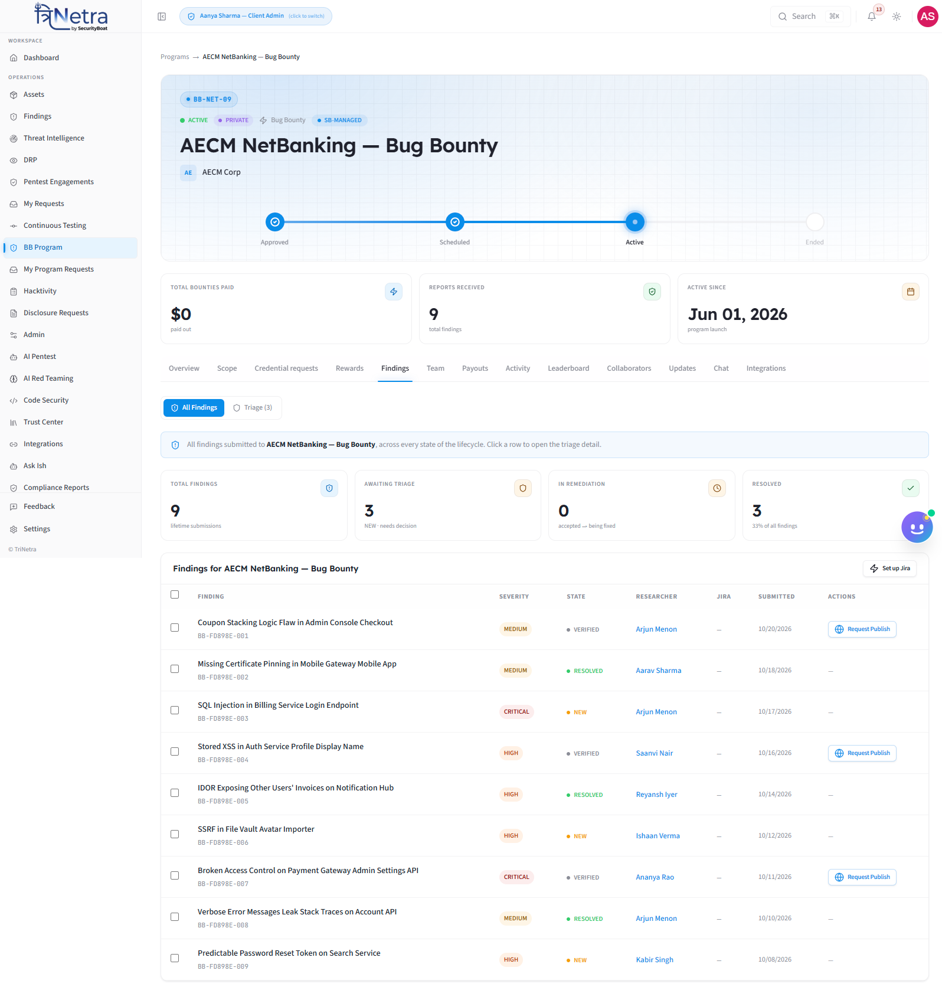
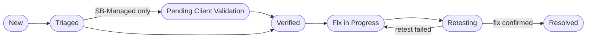

# Program Findings

> **Who can view:** Client Admin, Client TPM, Client Viewer. **Who can act on findings:** Client Admin and Client TPM.

The **Findings** tab lists every report submitted to this program, across every state of the lifecycle. Click a row to open the finding.

> You can also see Bug Bounty findings across all your programs in the main **Findings** module. This tab is scoped to one program.

---

## KPI overview and sub-tabs

| Tile | What it counts |
|------|---------------|
| **Total findings** | All reports submitted to this program |
| **Awaiting triage** | New reports that need a triage decision |
| **In remediation** | Accepted findings that are being fixed |
| **Resolved** | Fixed findings, with the percentage of all findings |

Two sub-tabs sit above the table: **All Findings** and **Triage (n)**, which shows only reports still awaiting triage.

## Findings table

| Column | Description |
|--------|-------------|
| **Finding** | Title and finding ID |
| **Severity** | P1 Critical to P5 Informational |
| **State** | Current lifecycle state, plus a closure label (e.g. Duplicate, Not Applicable) when one applies |
| **Researcher** | Who submitted the report |
| **Jira** | The linked Jira issue, if synced |
| **Submitted** | Submission date |
| **Actions** | Disclosure status: **Requested** while a disclosure request is under review, or **Published** once it is live on Hacktivity |

A **Client Admin** whose organisation has connected Jira can select findings with the checkboxes and sync them to the mapped Jira project. If the program is not mapped yet, use **Set up Jira**.

---

## When you see a finding

Bug Bounty findings are visible to your team **from the moment a researcher submits them** (state **New**). You never see a researcher's unsubmitted **Draft**.

---

## The finding lifecycle

A report can also be closed from any open state as **Duplicate** or **Not Applicable**, and may end as **Informative** or **Spam**.

| State | What it means |
|-------|---------------|
| **New** | Submitted and awaiting initial review. |
| **Triaged** | Initial review done; awaiting detailed validation. |
| **Pending Client Validation** | *SB-Managed programs only.* SecurityBoat has referred the report to your team to confirm. |
| **Verified** | Confirmed as a legitimate, reproducible security issue. |
| **Fix in Progress** | Your team is working on the fix. |
| **Retesting** | Your fix is deployed and awaiting verification. |
| **Resolved** | Fixed and successfully retested. |
| **Duplicate** | Already reported, or covered by an existing report. |
| **Not Applicable** | Does not show a valid security issue within the program's scope or acceptance criteria. |
| **Informative** | Useful information that does not qualify for remediation or a reward. |
| **Spam** | Irrelevant, abusive, or not a legitimate submission. |

---

## Who does what

The steps depend on the program's management model.

| Step | SB-Managed program | Self-Managed program |
|------|-------------------|----------------------|
| **Mark as triaged** (New → Triaged) | SecurityBoat | Client Admin / Client TPM |
| **Refer to client for validation** (Triaged → Pending Client Validation) | SecurityBoat | *Not used* |
| **Confirm as verified** (Pending Client Validation → Verified) | Client Admin / Client TPM | *Not used* |
| **Verify finding** (Triaged → Verified) | SecurityBoat | Client Admin / Client TPM |
| **Acknowledge and start fixing** (Verified → Fix in Progress) | Client Admin / Client TPM | Client Admin / Client TPM |
| **Submit fix for retesting** (Fix in Progress → Retesting) | Client Admin / Client TPM | Client Admin / Client TPM |
| **Confirm fix verified (resolve)** (Retesting → Resolved) | SecurityBoat | Client Admin / Client TPM |
| **Retest failed — send back to fix** (Retesting → Fix in Progress) | SecurityBoat | Client Admin / Client TPM |
| **Request more information** / **Close as duplicate** / **Close as not applicable** / **Reopen (clear closure)** | SecurityBoat | Client Admin / Client TPM |
| **Provide requested information** | Client Admin / Client TPM, the researcher, or SecurityBoat | Same |

Client Viewer can read findings but has no actions.

Actions are taken from the **State actions** panel on the finding detail page. See [Findings](../../05-findings.md#5-the-finding-detail-page) for how the panel works. Closing as duplicate, closing as not applicable, reopening, and sending a failed retest back need a comment of at least 20 characters. Requesting or providing information needs at least 10 characters.

---

## Disclosure

Once a finding is **Resolved** (or closed as **Not Applicable**), the researcher who submitted it can request public disclosure. The request is reviewed by the TPM and then by your team under [Disclosure Requests](../../18-disclosure-requests.md). The **Actions** column shows **Requested** while it is under review and **Published** once it is live.

---

## Troubleshooting

| Symptom | Cause / Fix |
|---------|-------------|
| **A researcher says they submitted a finding but I cannot see it** | It is still a **Draft** on their side. Drafts are visible only to the researcher. |
| **I have no State actions** | You are Client Viewer, or no action is available to your role in the finding's current state (for example, triage on an SB-Managed program is done by SecurityBoat). |
| **There is no Pending Client Validation step** | The program is Self-Managed. Your team verifies findings directly. |
| **No Jira column or checkboxes** | Only Client Admin manages Jira, and Jira must be connected and mapped to this program. |

---

← Previous: [Rewards](rewards.md) | Next: [Team →](team.md)
