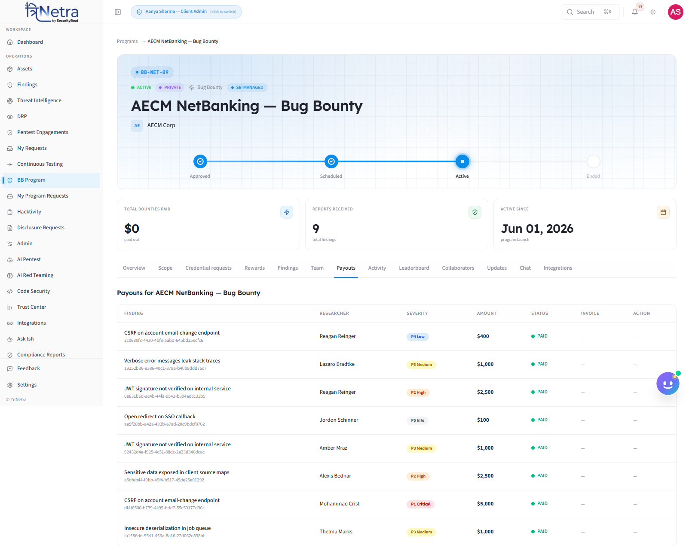
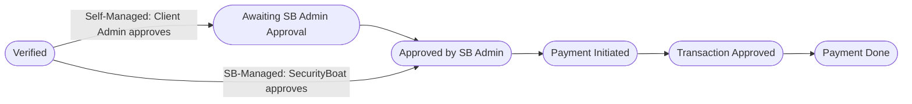

# Program Payouts

> **Who can view:** Client Admin, Client TPM, Client Viewer. **Who approves:** depends on the management model (see below).

The **Payouts** tab tracks the reward for every payable finding on the program. Findings appear here once they are verified. For VDP programs, the tab shows reputation points instead of money.

---

## Bug Bounty programs

The tab header reads **Payouts for *program name*** with a running **Total**. A line underneath explains who approves on this program.

### Who approves

| Management model | How a reward is approved |
|------------------|--------------------------|
| **SB-Managed** | SecurityBoat sets the reward amount and approves it. Your team does not need to act. |
| **Self-Managed** | Your team sets the reward amount when it verifies the finding, and a **Client Admin** approves first. SecurityBoat then gives the final approval. |

### Reward status flow

| Status | What it means |
|--------|---------------|
| **Verified** | The finding is verified and the reward is waiting for approval. |
| **Awaiting SB Admin Approval** | *Self-Managed only.* Your Client Admin approved the reward; SecurityBoat's final approval is pending. |
| **Approved by SB Admin** | The reward is approved. The invoice becomes available. |
| **Payment Initiated** | SecurityBoat has started the payment to the researcher. |
| **Transaction Approved** | The payment transaction is approved. |
| **Payment Done** | The researcher has been paid. |
| **TDS** | Tax deducted at source has been recorded for the payment. |
| **Needs review** | The payout needs attention from SecurityBoat. |

### Payouts table

| Column | Description |
|--------|-------------|
| **Finding** | Finding title and ID |
| **Researcher** | Who submitted it |
| **Severity** | P1 Critical to P5 Info |
| **Amount** | The reward amount |
| **Status** | The current reward status (see above) |
| **Invoice** | Invoice number with a download link, once the reward is approved |
| **Action** | *Client Admin on Self-Managed programs:* an **Approve** button while the reward is awaiting your approval |

### Approving a reward (Client Admin, Self-Managed programs)

1. Make sure the finding has a reward amount. A reward with no amount cannot be approved.
2. Click **Approve** on the row.
3. In the **Approve reward** dialog, check the amount and researcher, and enter a reason (10–500 characters). The reason is kept with the payout history.
4. Click **Approve payout**. The status changes to **Awaiting SB Admin Approval**.

---

## VDP programs

VDP programs have no monetary payouts. The tab is titled **Points for *program name*** and shows the **reputation points** each accepted finding earned, with a total. Points per severity are set platform-wide by SecurityBoat.

---

## Best practices

- **Approve rewards promptly** on Self-Managed programs. Rewards waiting too long frustrate researchers.
- **Check the severity before approving** — the amount follows the program's reward table.
- **Keep invoice records** for your finance and compliance needs.

---

## Troubleshooting

| Symptom | Cause / Fix |
|---------|-------------|
| **I cannot see the Approve button** | The program is SB-Managed (SecurityBoat approves), you are not Client Admin, or the reward is already past your approval step. |
| **Approve is disabled** | The reward has no amount yet. Set it when verifying the finding, or contact your CSM. |
| **"No payouts yet"** | No findings on this program are verified yet. |
| **The amount seems wrong** | Check the [Rewards](rewards.md) tab and the finding's severity. Contact your CSM before approving if it needs correcting. |

---

← Previous: [Team](team.md) | Next: [Leaderboard →](leaderboard.md)
