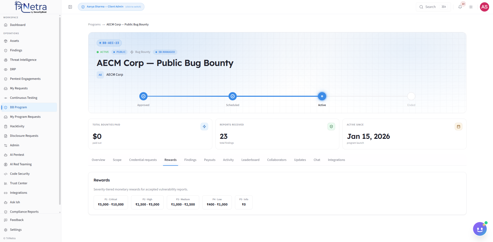

# Program Rewards

> **Who can view:** Client Admin, Client TPM, Client Viewer. **Who sets rewards:** SecurityBoat.

The **Rewards** tab shows what researchers earn for valid reports. The content depends on whether the program is a Bug Bounty or VDP.

---

## Bug Bounty programs

The Rewards tab shows a severity-tiered reward table:

| Severity | Label | Typical examples |
|----------|-------|------------------|
| **P1** | Critical | Remote code execution, SQL injection, authentication bypass |
| **P2** | High | Access control bypass, stored XSS on critical endpoints, SSRF |
| **P3** | Medium | CSRF, sensitive information disclosure, reflected XSS |
| **P4** | Low | Minor configuration flaws |
| **P5** | Informational | Best-practice suggestions, low-risk observations |

Each tier shows a single amount or a range (for example *100 - 1000*) in the program's currency (INR, USD, EUR, or GBP).

> **Who sets the amounts:** when you request a Bug Bounty program, you do not enter reward amounts. Your SecurityBoat CSM prices each severity tier before the program goes live. Ask your CSM if you want the amounts changed.

### How a reward is paid

The reward for a finding is set when the finding is verified, based on its severity and the program's reward table. It then moves through the approval steps described in [Payouts](payouts.md).

---

## VDP programs

VDP programs do not offer money. Valid reports earn:

- **Swag** — merchandise as a token of appreciation
- **Hall of Fame placement** — recognition on the program
- **Reputation points** — platform-wide points that build a researcher's standing

VDP reputation points are set platform-wide by SecurityBoat and are the same for every program. They are not editable per program.

---

## Best practices

- **Competitive P1–P3 rewards** attract higher-quality submissions.
- **P5 can be zero** — informational findings are worth acknowledging but rarely justify a cash reward.
- **Review rewards periodically** with your CSM as your program matures.

---

← Previous: [Scope](scope.md) | Next: [Findings →](findings.md)
