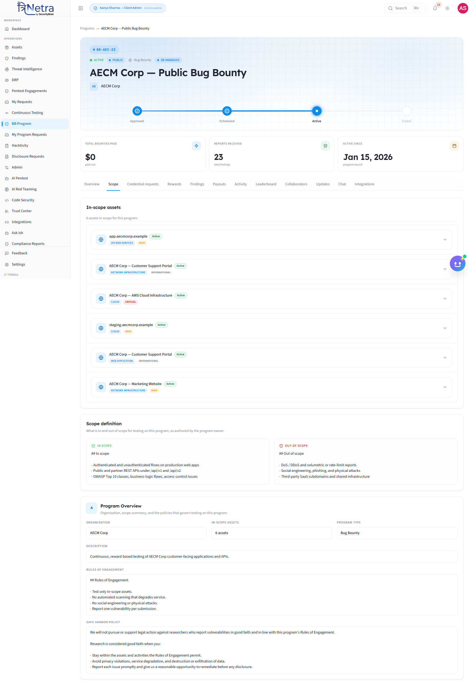
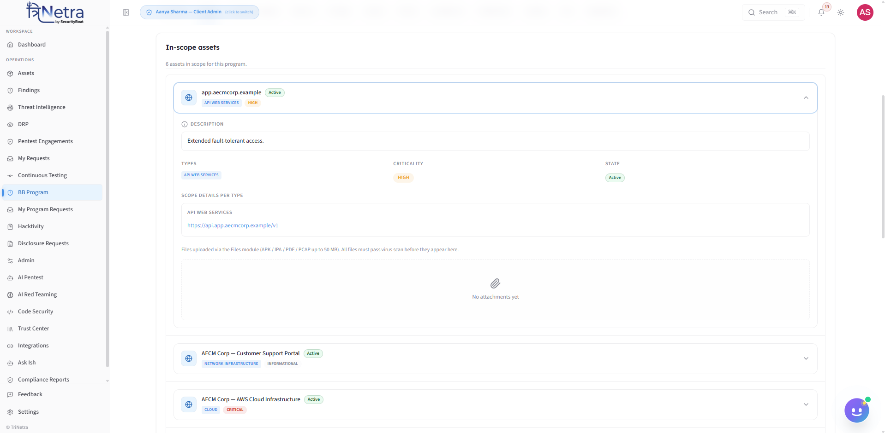
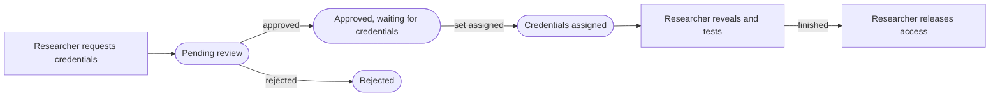

# Program Scope

> **Who can view:** Client Admin, Client TPM, Client Viewer. **Who can change it:** SecurityBoat (see [Changing a Program](../edit-bug-bounty.md)).

The **Scope** tab defines exactly what researchers are authorised to test under this program. Researchers must stay within this boundary.

---

## What you will see

### In-scope assets

Every asset linked to the program is shown as an expandable card. The card header shows the asset name, an **Active** or **Inactive** badge, the asset types (e.g. WEB APPLICATION, API WEB SERVICES), and the asset's criticality. Click a card to expand it.

The expanded card shows the asset details researchers work from:

| Section | What it contains |
|---------|------------------|
| **Overview** | Description, types, criticality, and state of the asset |
| **Scope** | The targets registered on the asset — URLs, IP ranges, API endpoints, app identifiers, or other details for its type |
| **Attachments** | Files attached to the asset (read-only here) |

If no assets are linked, the tab reads *"No assets in scope."*

> Only assets registered in the **Assets** module can be in scope. Testing anything outside these assets is out of scope.

### Scope definition

| Field | What it means |
|-------|---------------|
| **In scope** | What researchers may test on the in-scope assets — endpoints, environments, and vulnerability classes that qualify |
| **Out of scope** | What is explicitly excluded. Reports about these items do not qualify for a reward |

### Program overview

| Field | Description |
|-------|-------------|
| **Organisation** | Your organisation name |
| **In-scope assets** | Number of linked assets |
| **Program type** | VDP or Bug Bounty |
| **Description** | What the program covers |
| **Rules of engagement** | Testing windows, rate limits, prohibited techniques |
| **Safe harbor policy** | The platform's safe-harbor statement, when the program shows one. These programs also carry a **Safe Harbor** badge in the header |

---

## Test credentials and credential requests

Some assets offer **test accounts** for researchers. Researchers request them from the Scope tab, and each request is reviewed before credentials are shared.

The program's **Credential requests** tab lists those requests (with views for pending requests, assignees, reported issues, requests waiting for credentials, and all requests).

| Program type | What client roles can do |
|--------------|--------------------------|
| **Self-Managed** | Client Admin and Client TPM can approve or reject requests and manage assignments. Client Viewer can view only. |
| **SB-Managed** | All client roles can view. SecurityBoat handles the requests. |

Researchers never see credentials until a request is approved and a credential set is assigned. Revealed credentials hide automatically after a short time.

---

## Why scope matters

- **Less noise:** clear scope tells researchers where to focus.
- **Legal clarity:** the safe-harbor policy and rules of engagement protect both parties.
- **Asset alignment:** only registered assets can become test targets.

---

## Troubleshooting

| Symptom | Cause / Fix |
|---------|-------------|
| **Asset list is empty** | No assets are linked. Ask your CSM to add assets to the program. |
| **An asset shows Inactive** | The asset was marked inactive in the Assets module. Reactivate it there, or ask your CSM to remove it from scope. |
| **A researcher tested something out of scope** | Out-of-scope reports are closed during triage. Make sure the **Out of scope** notes list what is excluded. |
| **No approve/reject buttons on Credential requests** | The program is SB-Managed, or you are Client Viewer. |

---

← Previous: [Program Detail](../program-detail.md) | Next: [Rewards →](rewards.md)
