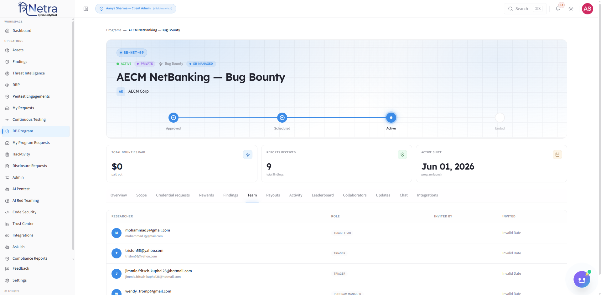
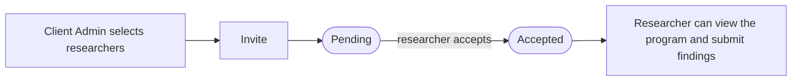

# Program Team

> **Visibility:** This tab appears on **Private** programs only. Public programs are open to every eligible researcher, so no invitations are needed.
>
> **Who can view:** Client Admin, Client TPM, Client Viewer. **Who can invite and remove researchers:** Client Admin on a **Self-Managed** Private program. On an **SB-Managed** program, SecurityBoat manages the team.

The **Team** tab shows which researchers have been invited to this private program and whether they have accepted.

---

## The team list

| Column | Description |
|--------|-------------|
| **Researcher** | Name and email |
| **Role** | Researcher or Lead Researcher |
| **Status** | **Pending** (invitation sent, not yet accepted) or **Accepted** |
| **Invited by** | Who sent the invitation |
| **Invited** | Date the invitation was sent |

Researchers see the program and can submit findings once they accept the invitation. If nobody has been invited yet, the tab reads: *"No researchers invited yet. Invite researchers to give them access to this private program."*

---

## Inviting researchers (Client Admin, Self-Managed programs)

The **Invite researchers** card sits at the top of the tab.

1. Open the **Select researchers to invite…** list.
2. Type in the search box to find researchers **by name or email**.
3. Tick one or more researchers. You can invite several at once. Researchers already on the program are not listed.
4. Click **Invite** (the button shows the count, e.g. **Invite (3)**, when several are selected).

Each invited researcher receives an invitation and appears in the list with the status **Pending** until they accept it from their **Invites** page.

## Removing a researcher

1. Click **Remove** on the researcher's row.
2. A **Remove researcher?** dialog explains that the researcher will lose access to submit findings and view program details. You can re-invite them later if needed.
3. Click **Remove** to confirm, or **Cancel**.

A removed researcher can no longer open the program. Findings they already submitted stay on the program.

---

## Team vs. Collaborators

| Tab | Shows |
|-----|-------|
| **Team** | Researchers **invited** to a Private program, whether or not they have submitted anything |
| **Collaborators** | Researchers who have actually **submitted** findings (all programs) |

---

## Troubleshooting

| Symptom | Cause / Fix |
|---------|-------------|
| **No Invite researchers card** | You are not Client Admin, or the program is SB-Managed. Ask your CSM to invite researchers on SB-Managed programs. |
| **A researcher stays Pending** | They have not accepted the invitation yet. |
| **A researcher is missing from the picker** | They are already on the program, or their account is inactive. |

---

← Previous: [Findings](findings.md) | Next: [Payouts →](payouts.md)
