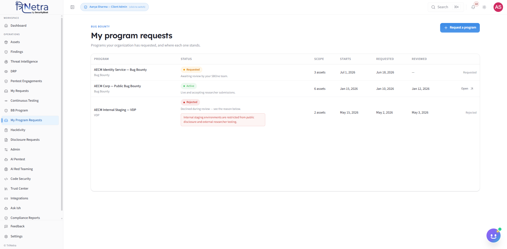
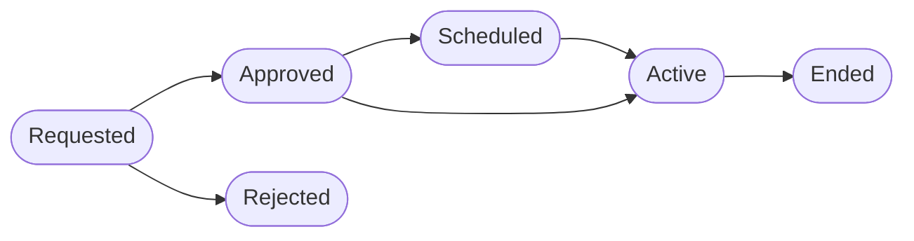

# My Program Requests

> **Who can view:** Client Admin, Client TPM, Client Viewer. **Who can request a program:** Client Admin.

**My Program Requests** shows every Bug Bounty and VDP program your organisation has requested and where each one stands. It is the only place that shows the reviewer's reason when a request is declined, because a requested or declined program does not have a program page yet.

To open it, click **My Program Requests** in the sidebar.

---

## The requests table

| Column | What it shows |
|--------|---------------|
| **Program** | The program name, with **VDP** or **Bug Bounty** underneath. |
| **Status** | The program state badge, a one-line explanation, and the reviewer's reason if the request was declined. |
| **Scope** | The number of in-scope assets. |
| **Starts** | The requested start date. |
| **Requested** | When the request was submitted. |
| **Reviewed** | When SecurityBoat reviewed it. |
| *(last column)* | **Open** once the program page is available. Before that, it shows the state name. |

Client Admins also see a **Request a program** button at the top of the page. The table shows 10 requests per page.

---

## What each status means

| Status | Explanation shown on the page | What you can do |
|--------|------------------------------|-----------------|
| **Requested** | Awaiting review by your SecurityBoat team. | Wait for the review. The program page opens once the request is approved. |
| **Rejected** | Declined during review — see the reason below. | Read the reason, adjust, and submit a new request. |
| **Scheduled** | Approved. It goes live on the start date. | Click **Open** to review the program page. |
| **Active** | Live and accepting researcher submissions. | Click **Open** to follow findings. |
| **Approved** / **Deactivated** | Approved but not currently accepting submissions. | Click **Open**. Contact your CSM if you expected it to be live. |
| **Ended** | This program has finished. | Click **Open** to read its history and findings. |

---

## Troubleshooting

| Symptom | Cause / Fix |
|---------|-------------|
| **"No program requests yet"** | Nobody in your organisation has requested a program yet. |
| **No Open button** | The request is still **Requested**, or it was **Rejected**. The program page opens only after approval. |
| **No Request a program button** | Only Client Admin can request programs. |

---

← Previous: [Request a Program](create-bug-bounty.md) | Next: [Program Detail →](program-detail.md)
