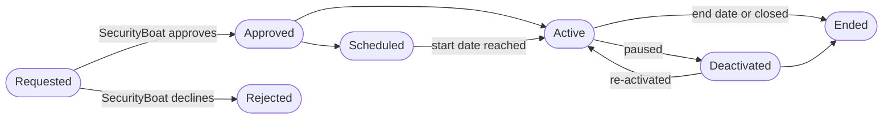
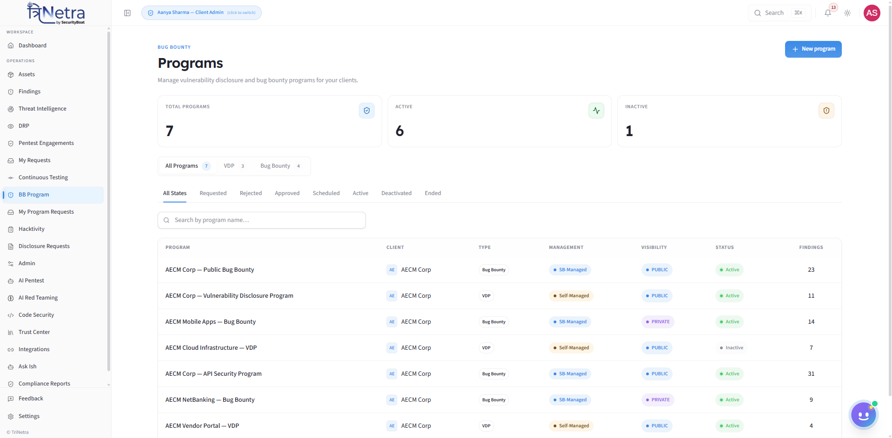
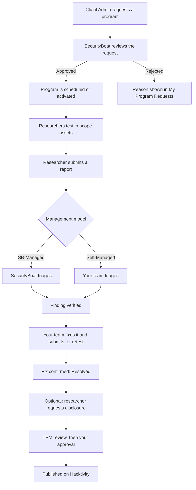

# Bug Bounty — Overview

> **Availability:** The Bug Bounty module is **subscription-gated**. The **BB Program**, **My Program Requests**, **Hacktivity**, and **Disclosure Requests** entries appear in your sidebar only if your organisation has been onboarded for Bug Bounty. If they are missing, contact your Customer Success Manager (CSM).

---

## What is Bug Bounty?

A **Bug Bounty program** invites SecurityBoat's vetted community of security researchers to continuously test your assets and submit discovered vulnerabilities — typically in exchange for a reward.

Unlike a scheduled pentest where a fixed team tests within a defined window, a Bug Bounty program is **ongoing and crowd-sourced**: many researchers, working continuously, are paid or recognised per valid finding.

### Program types

| Type | What it means for you | Researcher incentive |
|------|----------------------|---------------------|
| **VDP** — Vulnerability Disclosure Program | Opens a responsible-disclosure channel so researchers can report issues. A good starting point for crowd-sourced security. | Recognition only — swag, Hall of Fame listing, and reputation points. No monetary reward. |
| **Bug Bounty** | A paid program with defined scope and severity-tiered monetary rewards. Attracts deeper testing. | Cash reward per valid finding, scaled to severity (P1–P5). |

### Program visibility

| Visibility | Who can find and join |
|------------|----------------------|
| **Public** | Any eligible researcher on the platform can see and participate. |
| **Private** | Only invited researchers can see and participate. Better for sensitive assets or early-stage programs. |

### Management model

Every program shows a **management badge** in the program list, on the program page, and on each finding. Hover over the badge to read what it means.

| Badge | Who triages findings |
|-------|---------------------|
| **SB-Managed** | SecurityBoat's team reviews and manages the findings for this program. A SecurityBoat TPM is assigned. |
| **Self-Managed** | Your own team reviews and manages the findings. SecurityBoat is not involved in triage. |

### Plan: Paid vs Free

What you can request depends on your organisation's plan:

| | Paid plan | Free plan |
|---|:---:|:---:|
| VDP programs | ✅ | ✅ |
| Bug Bounty (paid reward) programs | ✅ | ❌ |
| Public and Private visibility | ✅ | ✅ |
| SB-Managed programs | ✅ | ❌ |
| Self-Managed programs | ✅ | ✅ |

On the Free plan the **Bug Bounty** card is still shown when you create a program, but it is disabled with a note that Bug Bounty is a Paid-plan capability. Contact your CSM to upgrade.

---

## How it differs from a Pentest

|  | PTaaS Pentest | Bug Bounty |
|---|---|---|
| **Duration** | Fixed window (e.g., 2 weeks) | Ongoing — no end date required |
| **Researchers** | Assigned team | Open or invited crowd |
| **Scope** | Defined per engagement | Defined per program |
| **When you see findings** | After SecurityBoat verifies them | As soon as a researcher submits them (from **New** onward) |
| **Cost model** | Engagement fee | Per valid finding (or recognition-based) |

> Bug Bounty findings also appear in your unified **Findings** list with the source **BUG BOUNTY**.

---

## What each client role can do

| Action | **Client Admin** | **Client TPM** | **Client Viewer** |
|--------|:---:|:---:|:---:|
| View programs, program detail tabs, and Hacktivity | ✅ | ✅ | ✅ |
| View **My Program Requests** | ✅ | ✅ | ✅ |
| **Request** a new program | ✅ | ❌ | ❌ |
| Invite / remove researchers on a **Self-Managed Private** program | ✅ | ❌ | ❌ |
| Act on findings (confirm, start fixing, submit for retest) | ✅ | ✅ | ❌ |
| Triage findings on a **Self-Managed** program | ✅ | ✅ | ❌ |
| Approve rewards on a **Self-Managed** Bug Bounty program | ✅ | ❌ | ❌ |
| View **Disclosure Requests** | ✅ | ✅ | ❌ |
| Approve or reject a disclosure request | ✅ | ❌ | ❌ |
| Send messages in program Chat | ✅ | ✅ | ❌ |

> **Program settings are managed by SecurityBoat.** Clients request a program and SecurityBoat reviews, approves, schedules, and edits it. If a live program needs a change (scope, dates, rewards), ask your CSM.

---

## The program lifecycle

A program you request moves through these states. The same lifecycle applies to Bug Bounty and VDP programs.

| State | What it means for you |
|-------|----------------------|
| **Requested** | You submitted the request. SecurityBoat is reviewing it. |
| **Rejected** | The request was declined. The reviewer's reason is shown under **My Program Requests**. |
| **Approved** | SecurityBoat approved the request. The program exists but is not accepting submissions yet. |
| **Scheduled** | The program goes live automatically on its start date. |
| **Active** | Live. Researchers can test and submit findings. |
| **Deactivated** | Paused. Existing findings, scope, and updates stay readable, but new findings are not accepted. |
| **Ended** | The program has finished (on its end date, or closed by SecurityBoat). Read-only. |

> Only **Active** programs accept new findings. Only **Active Public** programs are listed in the public program directory.

---

## Bug Bounty Programs list

Click **BB Program** in the sidebar to open the **Programs** list.

| Element | What it shows |
|---------|---------------|
| **KPI tiles** | **Total programs**, **Active**, and **Awaiting review** (requests still being reviewed). |
| **Type tabs** | **All Programs**, **VDP**, **Bug Bounty**. |
| **State filter** | **All States** plus one pill per state (Requested, Rejected, Approved, Scheduled, Active, Deactivated, Ended). |
| **Search** | Search by program name. |
| **Table columns** | Program, Client, Type, **Management** (SB-Managed / Self-Managed), Visibility, Status, Findings. |
| **New program** | Client Admin only. Opens the program request form. |

Your filters and page number are kept in the page address, so opening a program and pressing **Back** returns you to the same filtered page. The list shows 10 programs per page.

Other Bug Bounty pages in the sidebar:

- **My Program Requests** — every program your organisation has requested and where it stands. See [My Program Requests](my-program-requests.md).
- **Hacktivity** — the public feed of disclosed, resolved reports.
- **Disclosure Requests** — researcher requests to publicly disclose a finding (Client Admin and Client TPM).

---

## How it all fits together

---

## Best practices

- **Start with a VDP** if you are new to crowd-sourced security. It opens a disclosure channel without monetary commitments.
- **Use Private visibility** for new programs or sensitive assets.
- **Define scope clearly** — fill in the **In scope** and **Out of scope** fields so researchers know what qualifies.
- **Act on verified findings promptly** — move them to **Fix in Progress** and then submit them for retest.
- **Review disclosure requests promptly** — timely disclosure builds researcher trust.

---

## Troubleshooting

| Symptom | Cause / Fix |
|---------|-------------|
| **No Bug Bounty entries in the sidebar** | Your organisation is not onboarded for Bug Bounty. Contact your CSM. |
| **No "New program" button** | Only **Client Admin** can request programs. |
| **The Bug Bounty card is disabled when creating a program** | Your organisation is on the Free plan, which supports VDP programs only. Contact your CSM to upgrade. |
| **My requested program has no page to open** | A program page opens only after the request is approved. Track it under **My Program Requests**. |
| **There is no Edit button on the program** | Program settings are edited by SecurityBoat. Contact your CSM with the change you need. |
| **Researchers say they cannot submit findings** | The program is not **Active** (it may be Approved, Scheduled, Deactivated, or Ended). |

---

## In this section

| Guide | What it covers |
|-------|---------------|
| [Request a Program](create-bug-bounty.md) | Step-by-step guide to requesting a VDP or Bug Bounty program |
| [My Program Requests](my-program-requests.md) | Tracking your requests and reading review outcomes |
| [Program Detail](program-detail.md) | Header, lifecycle stepper, KPIs, tab navigation, and the Overview tab |
| [Scope](detail/scope.md) | In-scope assets, scope notes, rules of engagement, safe harbor, and test credentials |
| [Rewards](detail/rewards.md) | Severity-tiered reward structure and recognition model |
| [Findings](detail/findings.md) | Findings submitted to this program and their lifecycle |
| [Team](detail/team.md) | Invited researchers on Private programs |
| [Payouts](detail/payouts.md) | Reward approvals, statuses, and invoices |
| [Leaderboard](detail/leaderboard.md) | Researcher ranking by reputation |
| [Collaborators](detail/collaborators.md) | Every researcher who has contributed to this program |
| [Chat](detail/chat.md) | Messaging channel for program communication |
| [Changing a Program](edit-bug-bounty.md) | How program changes are handled |

---

← Previous: [ASM Subdomains](../asm/subdomains.md) | Next: [Request a Program →](create-bug-bounty.md)
