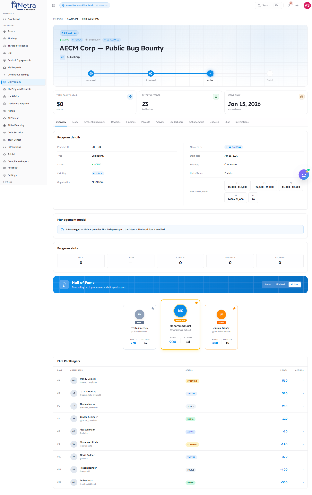
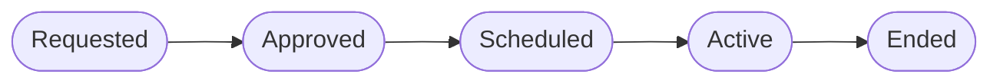
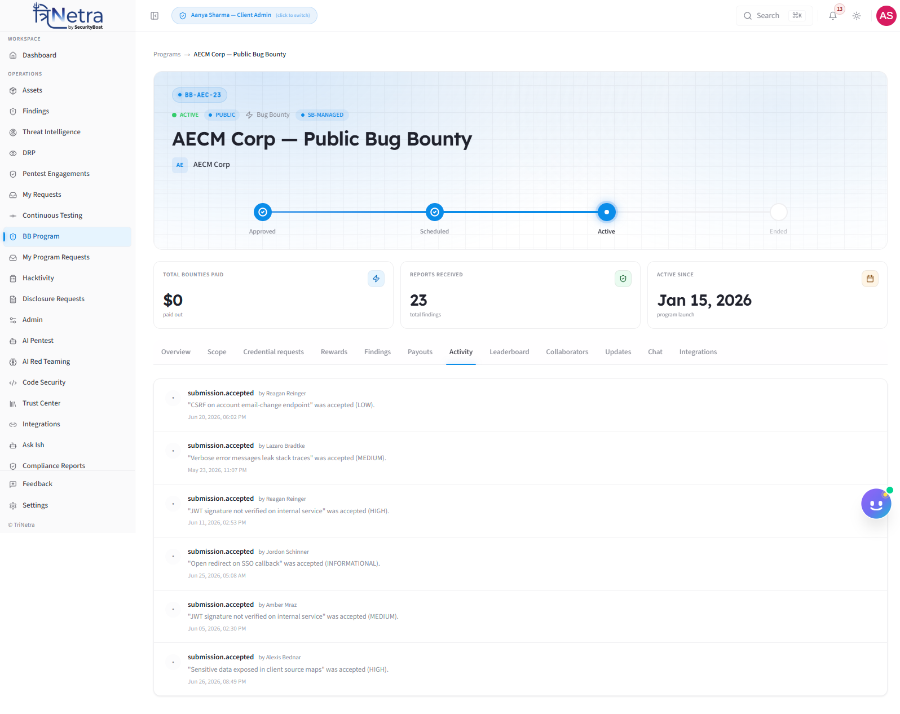
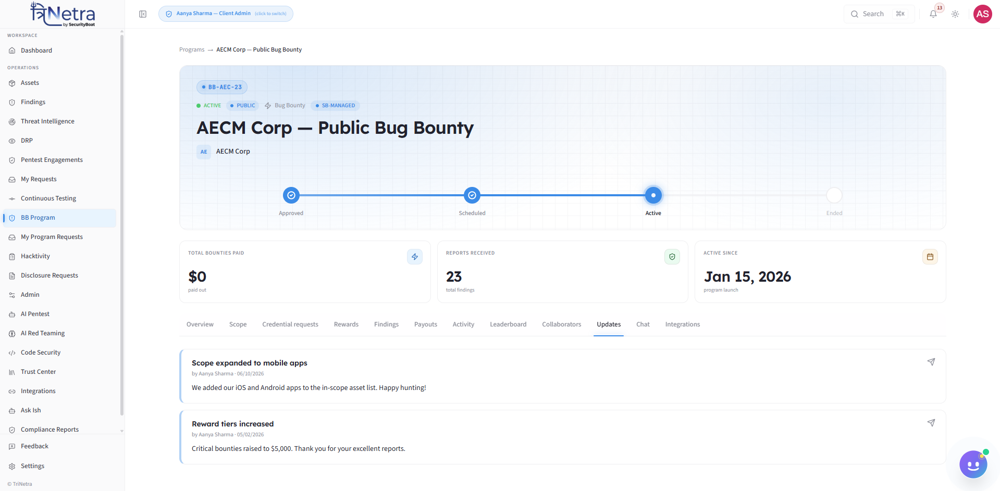
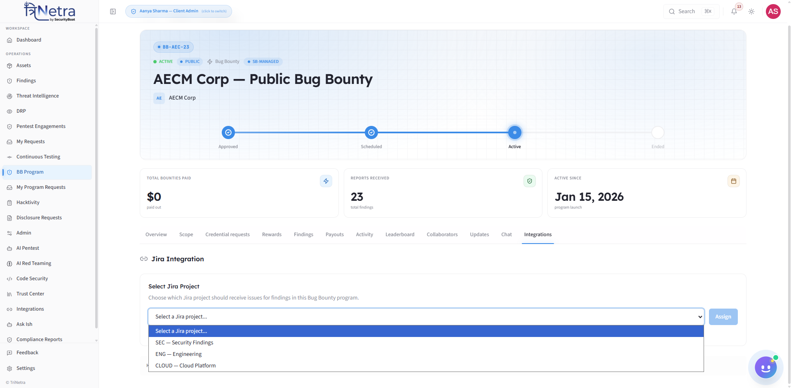

# Program Detail

The program detail page is your command centre for a Bug Bounty or VDP program. It shows the program's lifecycle, configuration, findings, rewards, and team in one place.

To open a program, go to **BB Program** in the sidebar and click any program in the list. You can also click **Open** next to an approved request under [My Program Requests](my-program-requests.md).

---

## Page header

The header identifies the program at a glance:

| Element | What it shows |
|---------|---------------|
| **Program code** | A short reference code in a pill badge (e.g. `BB-ACS-01` or `VDP-ACS-01`). |
| **Status** | The current state: Requested, Approved, Scheduled, Active, Deactivated, Ended, or Rejected. |
| **Visibility** | **Public** or **Private**. |
| **Type** | **VDP** (shield icon) or **Bug Bounty** (lightning icon). |
| **Management badge** | **SB-Managed** or **Self-Managed**. Hover or focus the badge to read what it means. |
| **Safe Harbor badge** | Shown when the program displays a safe-harbor policy. |
| **Program name** and **Organisation** | The full program name and your organisation. |

> There is no **Edit** button for client roles. Program settings are edited by SecurityBoat — see [Changing a Program](edit-bug-bounty.md).

### Lifecycle stepper

Below the header, a full-width stepper shows where the program is in its lifecycle:

- Completed steps are checked and the current step is highlighted.
- If the request was declined, the first step reads **Rejected**, and a **Request declined** box under the stepper shows who declined it and why.
- If the program is paused, the Active step reads **Deactivated** and is shown in amber.

### Deactivated or ended programs

When a program is **Deactivated** or **Ended**, a notice appears under the header:

> *This program is deactivated.* (or *This program is closed.*) *New findings are not being accepted. Existing findings, scope and updates remain available.*

### KPI tiles

| Tile | Bug Bounty shows | VDP shows |
|------|-----------------|-----------|
| **Total bounties paid** | Cumulative amount paid out | **Recognition** — VDP — swag + HoF |
| **Reports received** | Total findings submitted to this program | Same |
| **Active since** | Program start date | Same |

---

## Tab navigation

Click any tab to switch views. The selected tab is kept in the page address, so you can share a direct link to it.

| Tab | Who sees it | Guide |
|-----|------------|-------|
| **Overview** | All client roles | This page |
| **Scope** | All client roles | [Scope →](detail/scope.md) |
| **Credential requests** | All client roles (actions only on Self-Managed programs) | [Scope → Test credentials](detail/scope.md#test-credentials-and-credential-requests) |
| **Rewards** | All client roles | [Rewards →](detail/rewards.md) |
| **Findings** | All client roles | [Findings →](detail/findings.md) |
| **Team** | Private programs only | [Team →](detail/team.md) |
| **Payouts** | All client roles | [Payouts →](detail/payouts.md) |
| **Activity** | All client roles | This page |
| **Leaderboard** | All client roles | [Leaderboard →](detail/leaderboard.md) |
| **Collaborators** | All client roles | [Collaborators →](detail/collaborators.md) |
| **Updates** | All client roles | This page |
| **Chat** | All client roles | [Chat →](detail/chat.md) |
| **Integrations** | All client roles (Jira setup: Client Admin) | This page |

---

## Overview tab

### Program details

| Field | Description |
|-------|-------------|
| **Program ID** | The program's reference code |
| **Type** | VDP or Bug Bounty |
| **Status** | The current state |
| **Visibility** | Public or Private |
| **Organisation** | Your organisation name |
| **Managed by** | SB-Managed or Self-Managed |
| **Start date** | When the program opens |
| **End date** | Close date, or **Continuous** if open-ended |
| **Hall of Fame** | Enabled or Disabled |
| **Reward structure** | P1–P5 reward chips (Bug Bounty), or *VDP — swag & Hall of Fame recognition* |

### Management model

A card repeats the management badge with a one-line explanation:

- **SB-Managed** — *SecurityBoat's team reviews and manages the findings for this program.*
- **Self-Managed** — *The client's own team reviews and manages the findings. SecurityBoat is not involved in triage.*

### Program stats

A five-cell grid counts the program's findings:

| Cell | What it counts |
|------|---------------|
| **Total** | All findings submitted |
| **Triage** | Findings awaiting review |
| **Accepted** | Findings confirmed valid and being remediated |
| **Resolved** | Findings that have been fixed |
| **Discarded** | Findings closed as invalid, duplicate, or not applicable |

### Hall of Fame *(if enabled)*

The top three researchers appear as podium cards. Filter by **Today**, **This Week**, or **All Time**. Until findings are accepted, the section reads: *"No researchers on the leaderboard yet. Top contributors will appear once findings are accepted."*

---

## Activity tab

The **Activity** tab is a chronological log of everything that happens on the program, with the time and the person who did it. Events include:

- The request being submitted, approved, or declined
- State changes (scheduled, activated, deactivated, ended)
- Scope changes
- Team invitations and removals
- Finding submissions and state changes
- Payout approvals

When there is no activity yet, the tab reads: *"No activity yet. Events will appear here as the program is managed."*

---

## Updates tab

The **Updates** tab holds program announcements posted by SecurityBoat — scope changes, reward changes, testing-window restrictions, and policy updates. Each update shows its title, author, date, and content.

> Clients can read updates but not post them. Ask your CSM if you want an announcement posted.

---

## Integrations tab

If your organisation has connected Jira, a **Client Admin** can map this program to a Jira project (**Set up Jira**) and then sync selected findings from the Findings tab.

If Jira is not connected yet, connect it first under **Integrations** in the sidebar. See the [Integrations guide](../10-integrations.md).

---

← Previous: [My Program Requests](my-program-requests.md) | Next: [Scope →](detail/scope.md)
