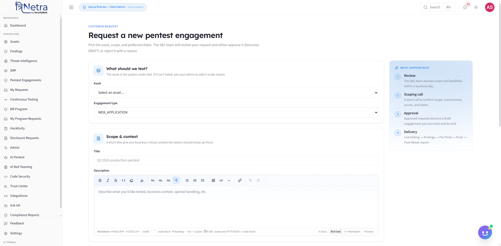
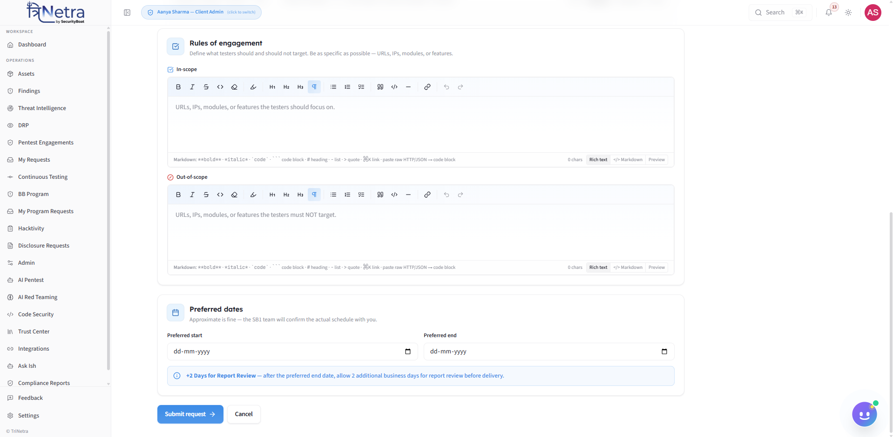
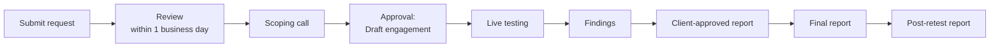

## Create Engagement

From **Pentest Engagements** (or **My Requests**) click **New engagement** to open the pentest request form, titled **Request a new pentest engagement**. This is available to **Client Admin** and **Client TPM**.

> *"Pick the asset, scope, and preferred dates. The SecurityBoat team will review your request and either approve it or reject it with a reason."*

---

### 1. The request form — section by section

#### What should we test?

*The asset is the system under test. If it isn't listed, ask your admin to add it under Assets.*

| Field | Required | What to provide |
|-------|:---:|-----------------|
| **Asset** | ✅ | The system to be tested. Only your organisation's active assets appear here. |
| **Engagement type** | ✅ | The kind of test — Web Application, API / Web Services, Mobile, Network Infrastructure, Cloud, Hardware, IoT, and more. |

#### Scope & context

*A short title plus any business-critical context the testers should know up-front.*

| Field | Required | What to provide |
|-------|:---:|-----------------|
| **Title** | ✅ | 3–255 characters, e.g. "Q3 2026 production pentest". |
| **Description** | — | Business context, special handling notes, or anything the testers should know. |

#### Rules of engagement

*Define what testers should and should not target. Be as specific as possible — URLs, IPs, modules, or features.*

| Field | Required | What to provide |
|-------|:---:|-----------------|
| **In-scope** | — | URLs, IPs, modules, or features the testers should focus on. |
| **Out-of-scope** | — | URLs, IPs, modules, or features the testers must **not** target. |

These notes appear on the engagement's [Brief tab](engagement-details/brief.md) under **Rules of engagement**.

#### Preferred dates

*Approximate is fine — the SecurityBoat team will confirm the actual schedule with you.*

| Field | Required | What to provide |
|-------|:---:|-----------------|
| **Preferred start** | — | The earliest date you'd like testing to begin. |
| **Preferred end** | — | Your ideal end date. Disabled until you pick a start date, and it cannot be before the start date. |

---

### 2. What happens after you submit

The **What happens next** panel beside the form summarises the flow:

1. **Review** — SecurityBoat reviews scope and feasibility within 1 business day.
2. **Scoping call** — a short call to confirm scope, environment, access, and dates.
3. **Approval** — an approved request becomes a **Draft** engagement you can track end to end. A rejected request comes back with a reason.
4. **Delivery** — Live testing → findings → report review → Final → Post-Retest report.

After you click **Submit request**, you're taken to the new engagement's page. Its state shows **Requested** until SecurityBoat reviews it. You can also follow it under [My Requests](../07-my-requests.md).

---

### 3. After approval

Once approved, use the engagement **Chat** to share anything the testers need — test accounts, VPN access, allow-listing details, or preferred testing hours. Test credentials can also be stored on the asset itself, where they are shared only with the testing team.

---

### Best practices

- **Fill in the rules of engagement** — clear in-scope and out-of-scope notes prevent testers from touching systems you care about.
- **Give rich context in the Description** to shorten the scoping call.
- **Make sure the asset is current** before submitting.
- **Allow reasonable lead time** (5+ business days) for team availability.

### Troubleshooting

| Symptom | Cause / Fix |
|---------|-------------|
| **Asset dropdown is empty** | Your organisation has no active asset. Add or reactivate one under **Assets**. |
| **No "New engagement" button** | You're a **Client Viewer** (read-only). |
| **Preferred end can't be selected** | Pick a preferred start date first. |
| **Request was rejected** | Read the reason, adjust the details, and submit a new request. |

---

← Previous: [Overview](overview.md) | Next: [Engagement Detail →](engagement-details/engagement-detail.md)
