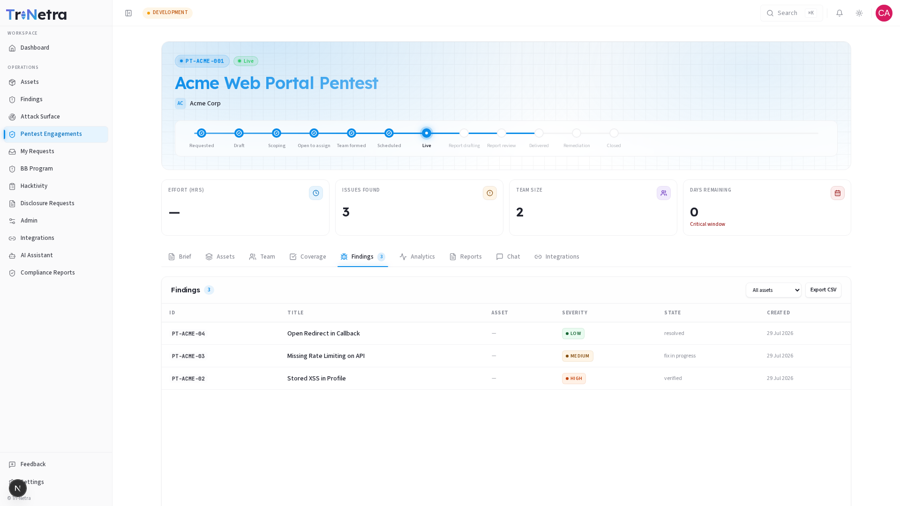
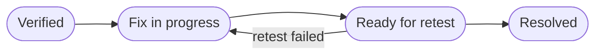

## Findings

The Findings tab lists every verified finding raised on this engagement — the same data you'd see in the platform-wide **Findings** module, pre-filtered to this engagement.

> **Who can view:** all client roles. Clients cannot create or edit findings; Client Admin and Client TPM move findings through remediation from the finding's detail page.

---

### 1. Findings table

| Column | Description |
|--------|-------------|
| **ID** | The finding's reference code. Quote it when discussing a finding. |
| **Title** | A short description. Click to open the full finding. |
| **Asset** | The asset the finding was discovered on, or "—". |
| **Severity** | Critical, High, Medium, Low, or Informational. |
| **State** | Verified, Fix in progress, Ready for retest, Accepted risk, or Resolved. |
| **Created** | When the finding was submitted. |

---

### 2. Filters

| Filter | Use |
|--------|-----|
| **Severity** | Show only Critical, High, etc. |
| **State** | Show only findings in one state — for example everything awaiting retest. |
| **Asset type** | Narrow multi-asset engagements to one asset type. |

---

### 3. Export CSV

Click **Export CSV** to open the **Export findings to CSV** dialog. Choose which states to include and tick the columns you want. The default columns are Finding ID, Title, Severity, State, Vulnerability type, CVSS score, CWE ID, CVE ID, Endpoint URL, Description, Impact, Remediation, Submitter, and Created at. See [Exporting findings to CSV](../../05-findings.md#4-exporting-findings-to-csv) for the full list of fields.

---

### 4. Finding detail and remediation

Click any finding row to open its detail page: description, evidence, CVSS score, remediation guidance, comments, and the state timeline.

From the **State actions** panel, Client Admin or Client TPM can **Acknowledge and start fixing** and then **Submit fix for retest**. The testing team confirms the fix. A Client Admin can also **Accept risk formally**. See the [Findings guide](../../05-findings.md) for the full lifecycle.

---

### Best practices

- **Filter by severity** — handle Critical and High first.
- **Filter by state = Ready for retest** to see what is waiting on the testers.
- **Export before meetings** with only the columns your audience needs.

### Troubleshooting

| Symptom | Cause / Fix |
|---------|-------------|
| **Findings tab shows 0 results** | Testing may not have started, or nothing has been verified yet. Check the [Coverage](coverage.md) tab. |
| **Expected finding isn't visible** | Pentest findings appear only after the testing team verifies them. |
| **CSV export doesn't include a finding** | Check the state selection in the export dialog and your active filters. |

---

← Previous: [Coverage](coverage.md) | Next: [Analytics →](analytics.md)
