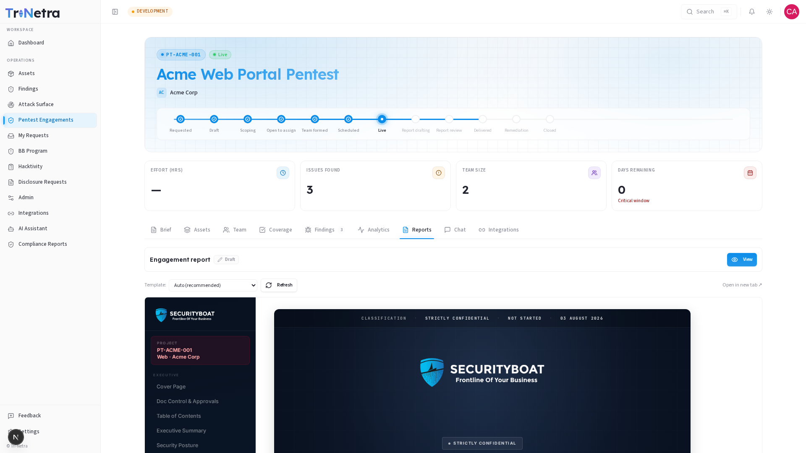
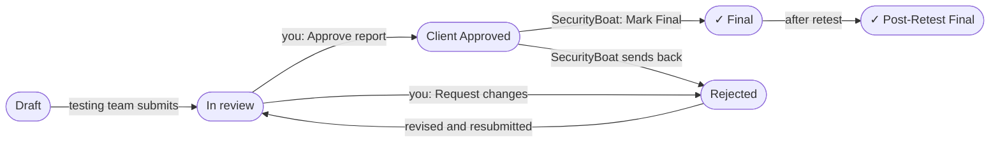

## Reports

---

The Reports tab is where you review and receive the engagement's deliverable — the penetration test report. Your team signs the report off first, then SecurityBoat completes a final review and releases it for download.

---

### 1. The report approval lifecycle

| Status | What it means for you |
|--------|------------------------|
| **Draft** | The testing team is writing the report. You can preview the current version. |
| **In review** | The report is ready for **your** review. Client Admin or Client TPM approves it or requests changes. |
| **Rejected** | Changes were requested. The testing team revises and resubmits it. |
| **Client Approved** | You approved the report. SecurityBoat is completing its final review. |
| **✓ Final** | The report is released — **you can now download the PDF**. |
| **✓ Post-Retest Final** | The report was re-issued after a retest confirmed your fixes. Also downloadable. |

A coloured badge at the top of the Reports tab always shows the current status, and a banner tells you what happens next.

---

### 2. What you can do

| Action | Client Admin | Client TPM | Client Viewer |
|--------|:---:|:---:|:---:|
| **Preview the report** | ✅ | ✅ | ✅ |
| **Approve report** (while In review) | ✅ | ✅ | ❌ |
| **Request changes** (while In review) | ✅ | ✅ | ❌ |
| **Download the PDF** | ✅ (Final / Post-Retest Final) | ✅ (Final / Post-Retest Final) | ✅ (Final / Post-Retest Final) |

---

### 3. Reviewing the report (Client Admin / Client TPM)

When the report reaches **In review**, you are notified and the tab shows:

> ⏳ *Ready for your review — sent (time). Approve the report or request changes.*

1. Read the inline preview — executive summary, scope, findings, and recommendations.
2. Choose one:
    - **Approve report** — records your approval and sends the report for SecurityBoat's final review. The download unlocks once that review is complete.
    - **Request changes** — sends the report back to the testing team with your feedback.
3. In the dialog, enter a **Description of Changes** (at least 5 characters) — your approval note or the changes you want. It is recorded in the report's document-control history.

After you approve, the tab reads:

> ✓ *You approved this report. SecurityBoat is completing the final review — the download will unlock once that is done.*

If a report waits for review for more than 3 days, your team and your TPM receive a reminder.

---

### 4. Downloading the final PDF

Once the report reaches **✓ Final** or **✓ Post-Retest Final**, the tab reads *"✓ Final (time) — the report is ready to download."*

1. Open the **Reports** tab.
2. Click **Download PDF**.

> **Report title:** every report has a title, and the scheduled month and year are added to it automatically (for example *"— Oct — 2026"*).

> **Post-Retest Final:** after you remediate findings and they are retested, SecurityBoat may re-issue the report as Post-Retest Final. It confirms which findings were resolved and is the authoritative post-remediation record.

---

### Best practices

- **Review promptly** — testing is not complete for you until the report is signed off.
- **Request changes with specifics** — name the section and what is wrong (scope URL, contact name, severity wording).
- **Wait for the Final badge** before sharing the report externally.
- **Keep both versions** if a Post-Retest Final is issued.

### Troubleshooting

| Symptom | Cause / Fix |
|---------|-------------|
| **No Approve / Request changes buttons** | The report isn't **In review**, or you are Client Viewer. |
| **Download PDF is greyed out after I approved** | SecurityBoat's final review is still pending. The download unlocks at **Final**. |
| **Report preview is empty** | The testing team hasn't started the narrative yet. This is normal during Live testing. |

---

← Previous: [Analytics](analytics.md) | Next: [Chat →](chat.md)
