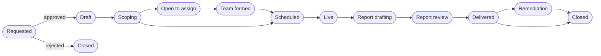
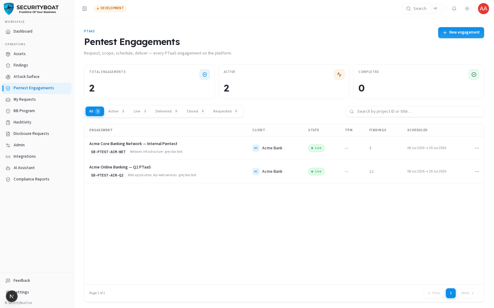

## Engagements — Overview

### 1. What an engagement is and how the PTaaS model works

An **engagement** is a scheduled penetration test of one of your assets, run by SecurityBoat's security team. "PTaaS" (Penetration Testing as a Service) means the whole lifecycle — requesting, scoping, testing, reporting, and retesting — happens on this platform instead of over email and PDFs.

Every engagement moves through the states below. The **lifecycle stepper** on each engagement shows where it stands.

| State | What's happening |
|-------|------------------|
| **Requested** | You submitted a pentest request; SecurityBoat is reviewing it. |
| **Draft** | Your request was approved and became an engagement. |
| **Scoping** | SecurityBoat is confirming scope, environment, access, and dates with you. |
| **Open to assign** | SecurityBoat is assembling the testing team. |
| **Team formed** | The testers are confirmed. |
| **Scheduled** | Testing dates are locked. |
| **Live** | Active testing is underway — verified findings appear as they are confirmed. |
| **Report drafting** | The testing team is writing the engagement report. |
| **Report review** | The report is with your team for sign-off, then SecurityBoat's final review. |
| **Delivered** | The final report has been issued to you. |
| **Remediation** | You're fixing issues; retests may follow. |
| **Closed** | The engagement is complete (or a request was closed before testing). |

> Engagement states are moved by SecurityBoat. Your part is to submit the request, provide access and context, review and approve the report, and fix and retest findings. Track requests that have not gone Live yet under **My Requests**.

---

### 2. What each client role can do

| Action | Client Admin | Client TPM | Client Viewer |
|--------|:---:|:---:|:---:|
| View your organisation's engagements | ✅ | ✅ | ✅ |
| Open engagement detail (Brief, Findings, Reports…) | ✅ | ✅ | ✅ |
| Submit a new pentest **request** | ✅ | ✅ | ❌ |
| Send messages in engagement Chat | ✅ | ✅ | ❌ |
| **Approve the report** or **Request changes** | ✅ | ✅ | ❌ |
| Download the final report PDF | ✅ | ✅ | ✅ |
| Export findings to CSV | ✅ | ✅ | ✅ |
| Configure Jira integration on an engagement | ✅ | ❌ | ❌ |

> **Why you "request" rather than "create":** scope, testers, and scheduling all need SecurityBoat review. You file a **request**; once approved, it becomes a tracked engagement that progresses through to delivery.

### Navigation

Click **Pentest Engagements** in the main sidebar menu.

---

### 3. The Engagements list

The page is titled **Pentest Engagements** — *"Request, scope, schedule, deliver — every PTaaS engagement on the platform."*

**Summary tiles:** **Total engagements** · **Live** · **Completed** (Delivered plus Closed).

**Filter pills:** each pill shows a live count.

| Pill | What it shows |
|------|---------------|
| **All** | Every engagement visible to your organisation. |
| **Live** | Engagements where testing is actively happening. |
| **Scheduled** | Engagements with confirmed dates, waiting to start. |
| **Delivered** | Report issued; includes engagements in Remediation. |
| **Closed** | Completed engagements. |
| **Requested** | Requests you or your colleagues submitted that are still being reviewed. |
| **Archived** | Engagements SecurityBoat has archived. Their chat becomes read-only. |

There's also a **search** box — *Search by project ID or title…*

**Table columns:** Engagement (title + Project ID + testing type) · Client · State · TPM (your SecurityBoat project manager) · Findings (count) · Scheduled (start → end). Click any row to open it. The list shows 10 rows per page.

**New engagement button** (Client Admin / Client TPM only): opens the pentest request form — see [Create Engagement](create-engagement.md).

---

### Best practices

- **Use the filter pills** to find what needs attention — **Live** and **Requested** show work in flight.
- **Keep your asset inventory current** before requesting a pentest.
- **Use the engagement Chat** for questions during testing instead of email.
- **Review the report promptly** when it reaches you — you are reminded if it waits more than 3 days.

### Troubleshooting

| Symptom | Cause / Fix |
|---------|-------------|
| **I can't find an engagement** | Check the **Archived** or **Closed** pill, or clear the search. Pre-Live requests are also listed under **My Requests**. |
| **No "New engagement" button** | You're a **Client Viewer** (read-only). Ask a Client Admin or Client TPM to submit the request. |

---

Next: [Create Engagement →](create-engagement.md)
