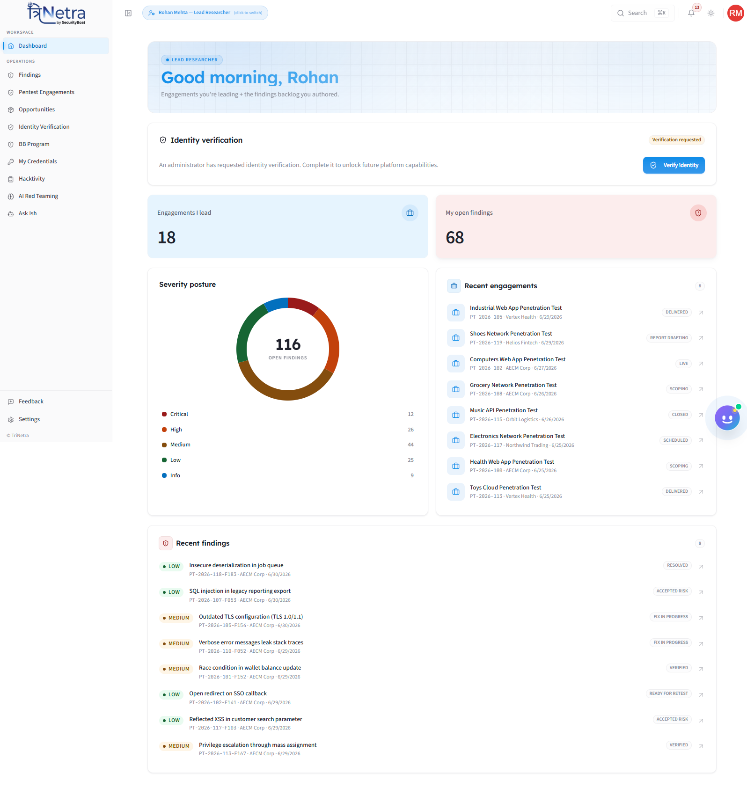

# Dashboard

### 1. What the Dashboard is for

The Researcher **Dashboard** is your personal work hub. It shows only what's yours — the engagements you're on, the findings you've authored, the programs you work on, and your earnings — so you can jump straight into testing. It answers:

- **What am I working on right now?** (live engagements)
- **What findings do I still own?** (my open findings)
- **How am I doing?** (performance, disclosed findings, earnings)

Every card links into the module where you act.

### 2. How to reach it

- Loads automatically after login.
- Click **Dashboard** at the top of the left sidebar, or the **Tri-Netra** logo.

### 3. The Dashboard, top to bottom

#### a. Greeting banner

Your first name and role, with the subtitle *"Your engagements, findings and security research activity."*

#### b. Identity Verification card *(conditional)*

If SecurityBoat has requested identity verification from you, a card appears prompting you to complete it. See the **Identity Verification** chapter.

#### c. KPI tiles

| Tile | Meaning |
|------|---------|
| **Live engagements** | Engagements you're on that are being tested now. |
| **My open findings** | Findings you authored that are not yet resolved. |
| **Disclosed findings** | Your findings published on Hacktivity. |
| **Total earnings (own scope)** | Your total earnings. **This is your figure only.** |

#### d. Action Needed, Quick status, and My Performance

- **Action Needed** — items waiting on you.
- **Quick status** — shortcuts to pre-filtered Findings pages: **Verified findings**, **Resolved findings**, **BB findings**, **PTaaS findings**.
- **My Performance** — your activity, including *Findings submitted over the last 6 months*.

#### e. Recent work

- **Recent Engagements** and **Recent BB Programs** side by side.
- **Recent Findings** (tabs **All**, **BB**, **PTaaS**) and **Recommended Programs** side by side.

Sections for a module you don't have access to (PTaaS or Bug Bounty) are hidden.

### 4. Lead Researcher differences

A **Lead Researcher** sees *"Engagements you're leading + the findings backlog you authored."* with the tiles **Engagements I lead** and **My open findings**.

### 5. How to use it day to day

1. **Complete the verification card** if it's shown.
2. **Open Live engagements** to continue testing.
3. **Use Quick status** to jump to verified or resolved findings.
4. **Check Recommended Programs** for new Bug Bounty work.

### Troubleshooting

| Symptom | Cause / Fix |
|---------|-------------|
| **No engagements shown** | You aren't on any engagement yet — check **Opportunities** and **Invites**. |
| **Earnings show zero** | You have no recorded earnings yet. |
| **Verification card won't go away** | Your verification isn't complete — open it and finish the steps. |

---

← Previous: [Login](02-login.md) | Next: [Opportunities →](04-opportunities.md)
