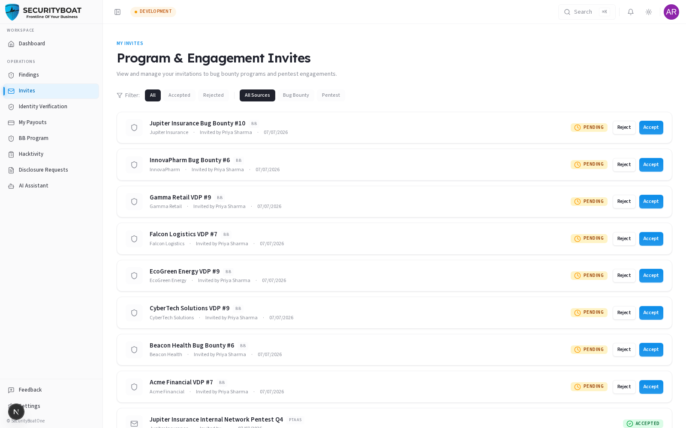
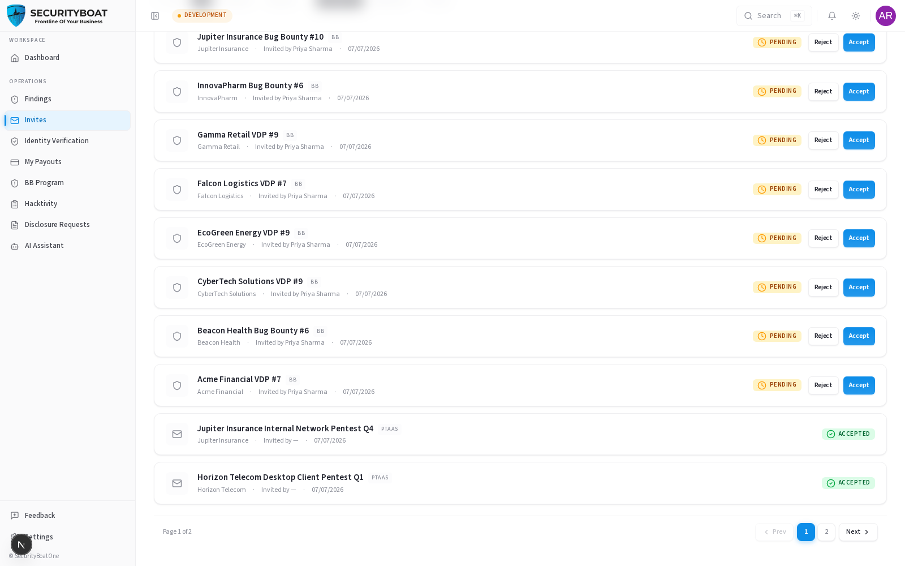
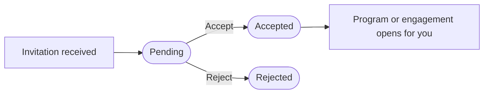

# Invites

### 1. What Invites are

**Invites** are direct invitations to join a private **Bug Bounty / VDP program** or a **pentest engagement** — as opposed to the open **Opportunities** marketplace where you apply. If someone wants *you* specifically, it shows up here.

The page is titled **Program & Engagement Invites** — *"View and manage your invitations to bug bounty programs and pentest engagements."*

### Navigation

Click **Invites** in the sidebar (Researcher / Lead Researcher only). Invitation notifications also open this page.

---

### 2. The Invites list

**Filters:**

- **Status:** `All`, `Pending`, `Accepted`, `Rejected`
- **Source:** `All Sources`, `Bug Bounty`, `Pentest`

Each invite shows:

| Field | Meaning |
|-------|---------|
| **Name** | The program or engagement you are invited to. |
| **Source badge** | **BB** (Bug Bounty / VDP) or **PTaaS** (pentest engagement). |
| **Organisation** | The organisation the program or engagement belongs to. |
| **Invited by & date** | Who invited you — a SecurityBoat team member, or a client admin for a client-run private program — and when. Shown for pentest invites too. |
| **Status** | **Pending** (amber; awaiting your response), **Accepted** (green), or **Rejected** (red). |

---

### 3. Responding to invitations

For **Pending Bug Bounty** invitations you get two actions:

- **Accept** — opens the **Accept Invite** dialog, where you can add an optional note for the program manager. Once accepted, the program opens for you.
- **Reject** — opens the **Reject Invite** dialog, where you can give an optional reason (e.g. *"Schedule conflict"*).

> **Pentest invites** are informational. Your place on a pentest team is confirmed by SecurityBoat (usually through an application on **Opportunities**), so pentest rows have no Accept / Reject buttons.

> If you are later removed from a private program, you lose access to it.

---

### Best practices

- **Respond promptly** — program teams rely on your confirmation.
- **Add a short note when rejecting** — it helps the team keep you in mind for future work.

---

### Troubleshooting

| Symptom | Cause / Fix |
|---------|-------------|
| **"No invites found"** | No invites match the selected filters. Switch both filters to **All**. |
| **I accepted but can't see the program** | The program may not be Active yet, or you were removed later. Check the program's status in **BB Program**. |
| **No Accept / Reject on a pentest invite** | Expected — pentest team membership is managed by SecurityBoat. |

---

← Previous: [Opportunities](04-opportunities.md) | Next: [Engagements →](engagements/overview.md)
