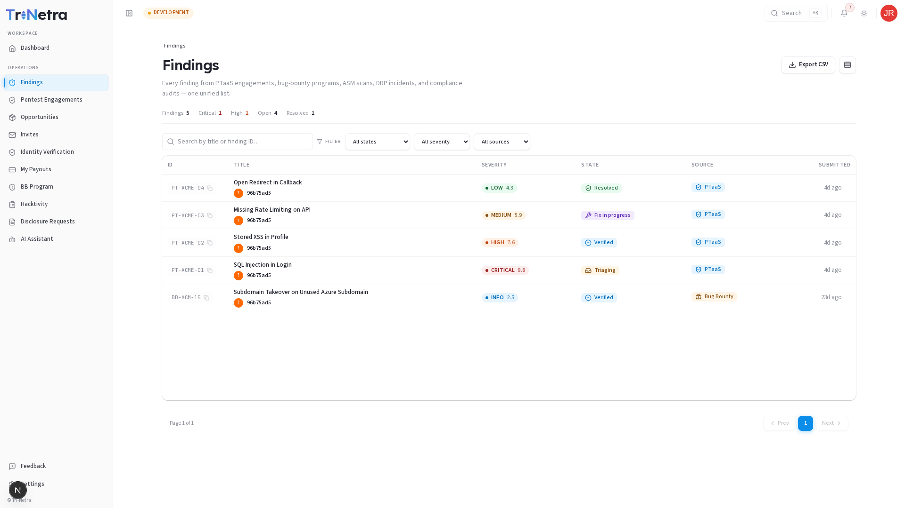
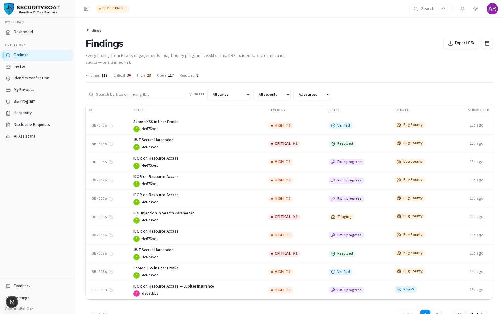
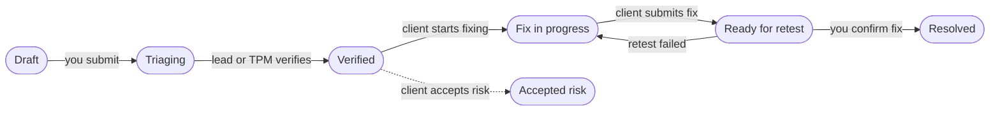
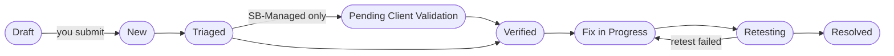

# Findings

### 1. Findings are your deliverable

A **finding** is a documented vulnerability you discover. Findings are your primary deliverable and what drives rewards and payouts. You author them inside a pentest engagement or a Bug Bounty program, provide clear proof-of-concept evidence, and submit them for triage.

> **Note:** There is no "New finding" button on the Findings page. Findings are created from the engagement's or program's **Findings** tab, so each one is automatically linked to the right scope.

---

### 2. What a researcher can do

| Action | Researcher | Lead Researcher |
|--------|:---:|:---:|
| Submit findings on your engagements and on Active Bug Bounty programs | ✅ | ✅ |
| See your own **Draft** findings | ✅ | ✅ (plus drafts on engagements you lead) |
| Edit your own **pentest** findings (until Resolved) | ✅ | ✅ (any finding on engagements you lead) |
| Edit a **Bug Bounty** report after you submit it | ❌ | ❌ |
| Verify pentest findings on engagements you lead | ❌ | ✅ |
| Confirm a pentest fix after retest | ✅ (your own findings) | ✅ |
| Change Bug Bounty triage states | ❌ | ❌ |

### Navigation

Click **Findings** in the main sidebar to browse findings across your engagements and programs. To see one engagement or program, use its **Findings** tab.

---

### 3. Your findings list

| Control / Column | Meaning |
|------------------|---------|
| **Summary counts** | Findings, Critical, High, Open, Resolved. |
| **Search** | *Search by title or finding ID…* |
| **Filters** | **All states** (including **Draft**), **All severity**, **All sources** — saved in the page address. |
| **ID**, **Title**, **Severity**, **State**, **Source**, **Submitted** | One row per finding. Click to open it. |
| **Export CSV** | Choose the columns and download the findings you can see. |

When you filter by **New**, a popover explains the difference: for pentests the state is shown as **Triaging**; for Bug Bounty and VDP it is shown as **New** (awaiting initial review).

---

### 4. Submitting a finding

Click **Submit finding** on the engagement's or program's **Findings** tab. A drawer opens with the finding form.

#### Title & classification
- **Title** — short, specific summary (up to 255 characters). *Required.*
- **Asset type** — Web Application, API & Web Services, Mobile iOS / Android, Cloud, Network, Source Code, AI/LLM, and more. It decides whether endpoint fields are required.
- **Vulnerability type (OWASP)** — pick the OWASP category, or **Other** and describe it. *Required.*
- **VRT category (Bugcrowd taxonomy)** — *required*. Selecting one pre-fills the CWE.
- **CWE** — format `CWE-79`. *Required.*
- **CVE (optional)** and **MITRE ATT&CK (optional)**.

#### Severity & CVSS v4.0
- Complete **all 11 CVSS v4.0 metrics**. Severity is derived from the score and cannot be set by hand.

#### Writeup
- **Background**, **Description**, **Steps to reproduce**, **Impact**, **Remediation** — each at least 20 characters. Drag screenshots or PoC files into the editor.

#### CIA triad impact
- Impact level and a description (at least 10 characters) for **Confidentiality**, **Integrity**, and **Availability**.

#### OWASP risk rating
- **Likelihood (0-9)** and **Impact (0-9)** — *required*. They place the finding on the report's risk heat matrix.

#### References
- At least one reference URL (vendor advisory, OWASP page, etc.). *Required.*

#### Endpoint and evidence
- **Method** and **URL** — *required for web, API, and mobile assets*; otherwise the form shows "Not required for the selected asset type".
- **Parameter (optional)**, **Raw request (optional)** (Burp / curl format), **Request** and **Response**.
- **Tool used (optional)** and **Environment (optional)** (browser, OS, device, region).

#### Saving and submitting

1. Click **Create finding**. The finding is saved as a **Draft** — *"Saved as Draft. Promote to NEW for triage from the detail page."* If anything is missing, the form lists it under *"Please fix the following before submitting:"*.
2. Open the draft, choose the submit action in the **State actions** panel, and click **Confirm transition**:
    - Pentest: **Submit DRAFT for triage**
    - Bug Bounty: **Submit report for triage**

---

### 5. Editing a finding

| Source | When you can edit | Notes |
|--------|-------------------|-------|
| **Pentest (PTaaS)** | From Draft until the finding is **Resolved** | Use **Edit finding** on the detail page. Severity and CVSS are locked once the finding is **Verified**. A Researcher edits only their own findings; a Lead Researcher can edit any finding on engagements they lead. |
| **Bug Bounty / VDP** | Only while it is a **Draft** | Once submitted, the report is locked. Add clarifications as comments. |

---

### 6. Finding lifecycles

#### Pentest (PTaaS) findings

| State | Meaning for you |
|-------|-----------------|
| **Draft** | Only you, your lead, and SecurityBoat can see it. |
| **Triaging** | Submitted; the lead researcher or TPM is validating severity, reproducibility, and scope. They may **Request more information**, or mark it as declined, duplicate, or out of scope with a reason. |
| **Verified** | Confirmed valid and now visible to the client. |
| **Fix in progress** | The client is fixing it. |
| **Ready for retest** | The client says the fix is deployed. Re-test it. |
| **Resolved** | You (or your lead) confirmed the fix with **Confirm fix verified**. |
| **Accepted risk** | The client formally accepted the risk instead of fixing it. |

#### Bug Bounty findings

Bug Bounty reports can also be closed as **Duplicate**, **Not Applicable**, **Informative**, or **Spam**. Triage and retesting are done by SecurityBoat (SB-Managed programs) or the client's team (Self-Managed programs), not by researchers. See [Bug Bounty Findings](bug-bounty/detail/findings.md).

---

### 7. The finding detail page

- **Header and stepper** — severity, CVSS, state, source, and a stepper showing the current stage with a description.
- **Main column** — Background, Description, Affected endpoint, Business impact, Remediation, HTTP request / response, Proof of concept, **Comments**, and the **Timeline** of state changes (10 per page, newest first).
- **Right column** — **State actions**, the engagement or program card, Dates, Retest SLA, CVSS score, Classification, Risk assessment, OWASP Risk Rating, References, and Test context.

#### Comments
- Your comments are visible to **Everyone** on the finding.
- Type **@** to mention a participant.
- You can edit your own comment for 15 minutes after posting, and delete it.
- On a **Resolved** Bug Bounty finding, comments are locked for researchers.

---

### 8. From finding to payout

A finding that is **Verified** on a paid program, or a completed pentest engagement, leads to a payout. Track it under [Payouts](09-payouts.md).

---

### Best practices

- **Provide clear HTTP requests and responses** — they speed up verification.
- **Complete all 11 CVSS metrics** carefully — severity follows from them.
- **Double-check Bug Bounty reports before submitting** — you cannot edit them afterwards.
- **Check for duplicates** in the program's findings and Hacktivity before filing.
- **Retest promptly** when a pentest finding reaches Ready for retest.

### Troubleshooting

| Symptom | Cause / Fix |
|---------|-------------|
| **No Submit finding button** | The engagement is not in a testing state, or the Bug Bounty program is not **Active**. |
| **"Please fix the following before submitting"** | A required field is missing or too short. The list names each one. |
| **Severity field disabled** | Intentional; severity comes from the CVSS v4.0 metrics. |
| **No Edit finding button** | Bug Bounty reports lock once submitted; pentest findings lock once Resolved. |
| **Can't change severity on a pentest finding** | Severity and CVSS lock once the finding is Verified. |
| **My finding is stuck at New / Triaging** | Awaiting triage — add a polite comment if it has been a while. |
| **Marked duplicate** | Someone reported it first; check the comments. |

---

← Previous: [Engagements](engagements/overview.md) | Next: [Payouts →](09-payouts.md)
