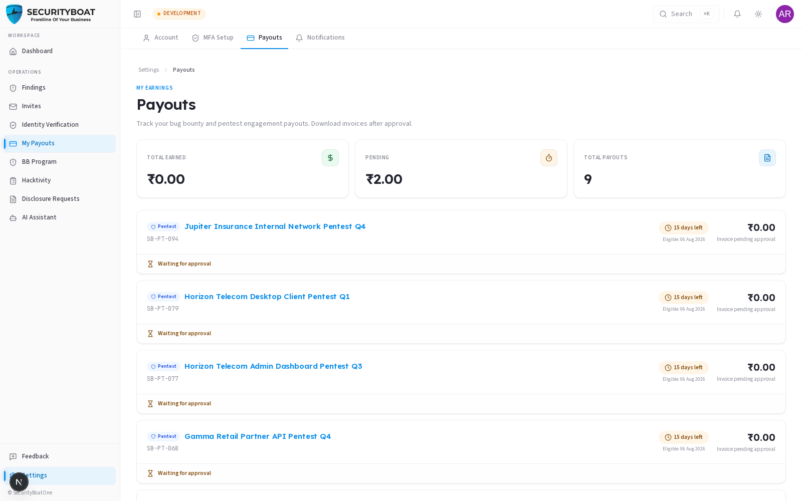
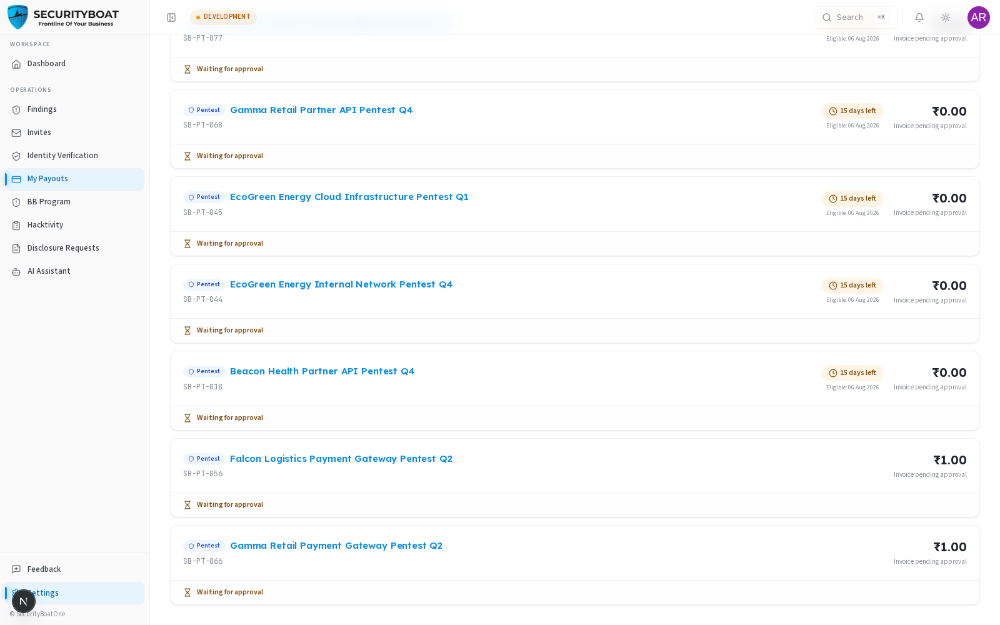
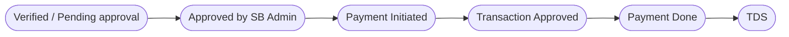

# Payouts

### 1. Where you get paid

**Payouts** is your personal earnings page. It combines both sources of income:

- **Bug Bounty** — a reward per verified finding on a paid program.
- **Pentest engagements** — your researcher payout per engagement.

It tracks each payout from verification to payment and lets you download invoices. Statuses are view-only for researchers.

### Navigation

Click **My Payouts** in the sidebar (or **Settings → Payouts**).

---

### 2. Earnings summary

| Tile | Meaning |
|------|---------|
| **Total Earned** | Sum of payouts that have been paid. |
| **Pending** | Sum of payouts not yet paid (excluding rejected ones). |
| **Total Payouts** | Number of payout records. |

Use the tabs **All**, **Bug Bounty**, and **PTaaS** (each with a count) to filter the table.

---

### 3. The payouts table

| Column | Meaning |
|--------|---------|
| **Source** | **BB** (Bug Bounty) or **PT** (pentest). |
| **Description** | The finding title and ID (with severity and program), or the engagement title and Project ID. Click it for the payout detail page. |
| **Amount** | The payout amount and currency. |
| **Days Left** | For pentest payouts, the days until the payout becomes eligible, with the eligible date; **Eligible** once reached; "—" after payment. |
| **Status** | The current status (see below), with the approval date once approved. |
| **Invoice** | The invoice number with a download link once the payout is approved; **After approval** before that. |

---

### 4. Payout statuses

| Status | Meaning |
|--------|---------|
| **Verified** *(Bug Bounty)* | Your finding is verified and the reward is waiting for approval. On Self-Managed programs the client approves first, then SecurityBoat. |
| **Pending approval** *(Pentest)* | The payout is waiting for SecurityBoat's approval. Pentest payouts become eligible **30 days after the engagement went live**. |
| **Approved by SB Admin** | Approved. Your invoice can be downloaded. |
| **Payment Initiated** | SecurityBoat has started the payment. |
| **Transaction Approved** | The bank transaction is approved. |
| **Payment Done** | You have been paid. |
| **TDS** | Tax deducted at source (10%) has been recorded. The row shows *"TDS will be credited"* — the TDS amount is credited to you on the date SecurityBoat communicates. |
| **Rejected** | The payout was rejected. Check the payout detail page or contact SecurityBoat. |

> **Before you can be paid:** complete your **bank details** in **Settings → Account** and finish **Identity Verification**.

---

### Best practices

- **Complete Identity Verification and bank details early.**
- **Download invoices** for your tax records as soon as they are available.

---

### Troubleshooting

| Symptom | Cause / Fix |
|---------|-------------|
| **"No payouts yet"** | You have no verified paid findings or completed pentest payouts yet. |
| **Invoice shows "After approval"** | The payout is not approved yet. |
| **Pentest payout shows days left** | Pentest payouts become eligible 30 days after the engagement went live. |
| **Payment delayed** | Check your bank details and that your identity is **Verified**. |

---

← Previous: [Findings](07-findings.md) | Next: [Identity Verification →](10-verification.md)
