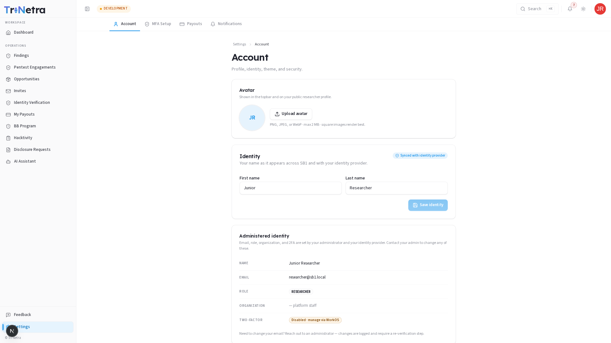
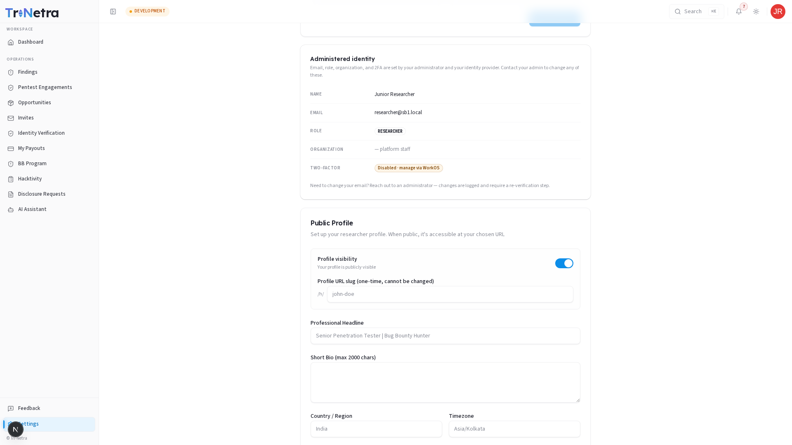
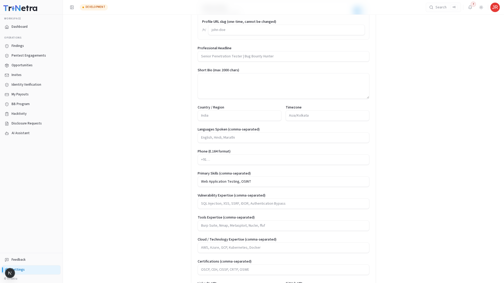
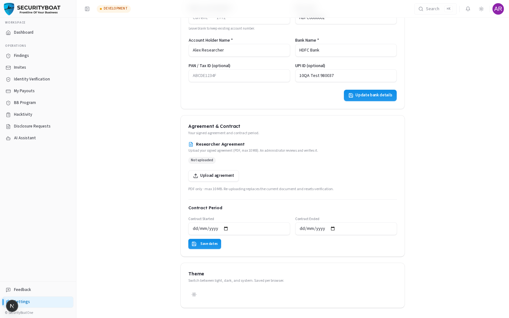
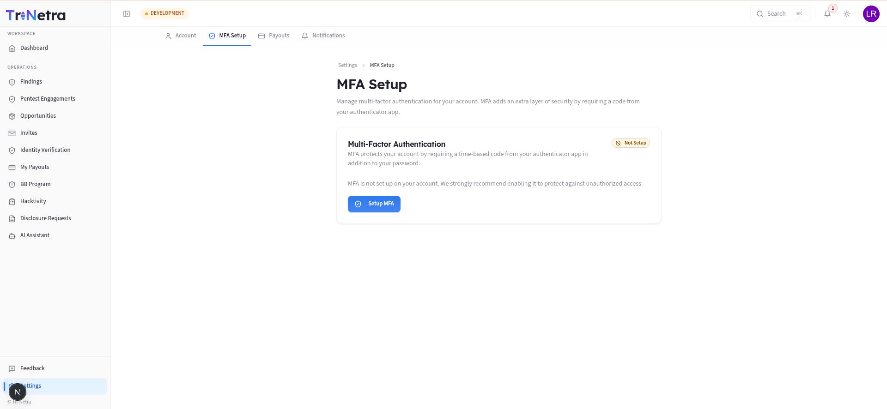

# Settings

### 1. Overview

**Settings** is your personal account area. For researchers it has more than other
roles because it holds the **payment and contract** details needed to work and get
paid. Tabs: **Account**, **MFA Setup**, **Payouts**, **Availability**, **Notifications**.

### Navigation

Click **Settings** (bottom of the sidebar) → opens on **Account**.

---

### 2. Account (researcher-specific)

| Section | What you can do |
|---------|-----------------|
| **Avatar** | Upload a photo — shown on your public researcher profile. |
| **Identity (name)** | Edit your first/last name. **Locked after identity verification** (see below). |
| **Administered identity** | **Read-only** — email, role, and 2FA status (managed by administrator). |
| **Public Profile** *(researchers)* | Your public researcher profile (see below). |
| **Bank details** *(researchers)* | Your payout account. **Sensitive fields are encrypted** (e.g. account number and IFSC code). Required to receive payments. |
| **Agreement & Contract** *(researchers)* | Your signed agreement upload and contract period. |
| **Theme** | Light / Dark / System (saved per browser). |

> **The three things that unblock payouts:** complete **bank details**, finish
> **identity verification** (see the Verification guide), and have an active
> agreement/contract. Do these early.

#### Name lock after verification

Once your identity is verified, your first and last name can no longer be changed
from Account settings. The card shows **Synced with identity provider** and explains:
*"Your name is locked because your identity has been verified. The name on file is
the one matched against your government ID, so it can no longer be changed from
Account Settings. To update it, contact an administrator."*

#### Public Profile

| Field | Notes |
|-------|-------|
| **Profile visibility** | Toggle between *"Your profile is publicly visible"* and *"Your profile is private"*. Public is the default. Only **public** profiles are listed in the Researchers directory that clients can browse. |
| **Profile URL slug** | Your profile address (`/h/your-slug`). Set it once — it cannot be changed. |
| **Professional Headline**, **Short Bio** | How you introduce yourself. |
| **Country / Region**, **Timezone**, **Languages Spoken**, **Phone (E.164 format)** | Location and contact details. |
| **Primary Skills** | Tick the checkboxes that apply (see the list below). Clients can search researchers by skill. |
| **Vulnerability Expertise**, **Tools Expertise**, **Cloud / Technology Expertise**, **Certifications** | Comma-separated lists. |
| **LinkedIn URL**, **GitHub URL**, **Personal Website**, **X / Twitter URL**, **Discord / Community Handle** | Links shown on your profile. |
| **Tri-Netra Join Date** | When you joined Tri-Netra, used for your profile's tenure. |

Click **Save profile** to apply changes.

**Primary Skills options:** Web Application Testing · Mobile Application Testing (iOS) ·
Mobile Application Testing (Android) · API Security Testing · Cloud Security
(AWS/Azure/GCP) · Network Penetration Testing · Active Directory · Wireless Security ·
Social Engineering · IoT/Embedded · Reverse Engineering · Source Code Review ·
DevSecOps / CI-CD Security · Red Team Operations · Threat Modeling · OSINT ·
Vulnerability Research · Smart Contract / Blockchain · SCADA/ICS

---

### 3. MFA Setup

Manage multi-factor authentication (MFA) to secure your account. Because your profile carries sensitive findings, signed contracts, and bank payout details, maintaining active MFA is highly recommended.

#### How to Enroll in MFA
1. **Open Setup**: Navigate to **Settings → MFA Setup** and click **Setup MFA**.
2. **Scan QR Code**: Open your preferred authenticator app (e.g., Google Authenticator, Authy, Microsoft Authenticator, or 1Password) and scan the displayed QR code. If your device cannot scan the code, click **Show** to reveal the secret key and enter it manually.
3. **Save/Copy Key**: You can also click the copy icon to securely copy the configuration key to your clipboard.
4. **Complete Enrollment**: Once you have scanned or entered the code into your authenticator app, click the **Done — I've added it to my app** button. The app will confirm your enrollment, and you will be prompted for your MFA verification code during your next login attempt.

#### Disabling or Resetting MFA
If you currently have MFA enabled and need to re-key or disable it:

1. Navigate to **Settings → MFA Setup**.
2. Click the red **Reset MFA** button.
3. Confirming this action removes all active MFA factors from your account immediately. You can now log in using only your email and password, or begin the enrollment flow again.

#### Recovery & Lost Authenticator Access
If you lose access to your authenticator app, you can reset your MFA using the self-service flow:

*   **Request recovery**: Click the **Reset MFA** link on the login page, enter your registered email, and follow the link sent to your inbox.
*   **Administrative assistance**: If you cannot access your email, contact the SecurityBoat support team to verify your identity and manually reset your MFA settings from the administration panel.

---

### 4. Payouts

The **Payouts** tab is your earnings dashboard — see the dedicated
[Payouts guide](09-payouts.md).

---

### 5. Availability

The **Availability** tab (**My availability**) is where you tell SecurityBoat when you
can take pentest work: *"Mark the date ranges you are available for pentest work. Any
day you have not marked is treated as unavailable."*

1. Pick a **From** and **To** date. Past dates cannot be selected — the earliest date is today.
2. Add an optional **Note**.
3. Save the range.

The calendar shows a rolling two-month window from today. Days you marked show as
**Available**; everything else is **Unavailable**. Recent past days appear greyed out
for context only.

---

### 6. Notifications

Choose which notifications reach you and how. Keep invite/finding/payout
notifications on so you don't miss opportunities, verification requests, or payment
updates. Critical security alerts may bypass these settings.

---

### Best practices

- **Complete bank details + verification first** — nothing pays out without them.
- **Keep skills/certifications current** — they drive marketplace matches and your
  public profile.
- **Enable MFA.**

---

### Troubleshooting

| Symptom | Cause / Fix |
|---------|-------------|
| **Payout blocked** | Bank details incomplete or identity not verified — finish both. |
| **Can't edit email/role** | Admin/IdP-managed by design. |
| **Profile not on the directory** | Ensure your profile is complete and **Profile visibility** is public. |
| **Can't edit my name** | Your identity is verified, which locks the name. Contact an administrator. |
| **Can't pick a past date in Availability** | Expected — availability starts from today. |

---

← Previous: [Team Feedback](19-team-feedback.md) | Back to [Researcher Guide index](RESEARCHER_Guide.md)

