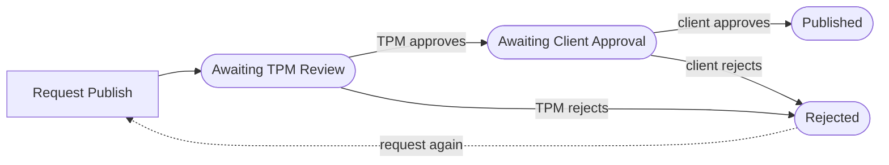

# Disclosure Requests (Researcher View)

A **disclosure request** asks for one of your resolved Bug Bounty or VDP findings to be published on the public **Hacktivity** feed.

> Researchers do not have a Disclosure Requests page in the sidebar. You request disclosure from the program's **Findings** tab, and you are notified when your request is reviewed. The review itself is handled by the TPM and the client.

---

## Which findings can be disclosed

- Only **your own** findings.
- Only findings that are **Resolved** (or closed as **Not Applicable**). Open, verified, or in-progress findings cannot be disclosed.
- Only one active request per finding. If a request is rejected, you can request again.

---

## Requesting disclosure

1. Open the program and go to its **Findings** tab.
2. Find your resolved finding. In the **Actions** column, click **Request Publish**.
3. You'll see *"Publish request submitted — awaiting review"*, and the column changes to **Requested**.

---

## The request lifecycle

| Status | What you see in the Actions column |
|---|---|
| **Awaiting TPM Review** / **Awaiting Client Approval** | **Requested** |
| **Published** | **Published** — click it to open the public disclosure page |
| **Rejected** | **Request Publish** appears again so you can resubmit |

---

## Tips

- **Be patient** — the request is reviewed by two parties.
- **Don't take rejection personally** — clients may have confidentiality or regulatory reasons.
- **Check Hacktivity** to see your published disclosures.

---

← Previous: [Hacktivity](17-hacktivity.md) | Next: [Agentic Pentest →](14-agentic-pentest.md)
