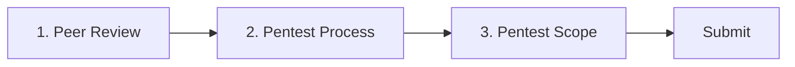

# Team Feedback

**Team Feedback** is where you rate the researchers you worked with and the pentest itself, once a pentest is complete — *"Rate the researchers you worked with on completed pentests. Your feedback is private — only you and platform admins can see it."*

> This is different from the **Feedback** button at the bottom of the sidebar, which sends product feedback to SecurityBoat. See [Feedback](18-feedback.md).

### Navigation

Click **Team Feedback** in the sidebar (Researcher / Lead Researcher). The page lists your pentests that are **Delivered**, in **Remediation**, or **Closed**. Click one to open its feedback wizard.

---

## The three-step wizard

### Step 1 — Peer Review

Rate each teammate on five parameters, from 1 to 5 stars:

| Parameter | What you are rating |
|-----------|---------------------|
| **Responsiveness** | How promptly and reliably they responded and followed up. |
| **Vulnerability Quality** | The quality of their findings and write-ups. |
| **Technical Expertise** | Their technical depth on this pentest. |
| **Engagement Delivery** | How well they delivered their part of the engagement. |
| **Communication & Professionalism** | How clearly and professionally they communicated. |

- All five parameters must be scored before you can save.
- Add a comment — *"Share what your peer could improve and what worked well"*. A comment is **required** if any score is 4 or below.
- Saved feedback shows a **Feedback given** badge. You can update or delete it later.

### Step 2 — Pentest Process

Rate the pentest process overall, pick what **went well** and what **to improve** from the suggested points (a point can only be in one list), and add a note. **Continue** is enabled once you have given a rating.

### Step 3 — Pentest Scope

The wizard shows the scope from the brief — the asset, its types, and the in-scope and out-of-scope notes — and asks: *"Did the scope outlined in the brief accurately reflect the actual testing performed?"* Answer **underscoped** (more testing was needed), **accurately scoped**, or **overscoped** (the brief claimed more than was relevant), and add an optional note. Then submit steps 2 and 3 together.

---

## Privacy

- Your feedback is visible only to you and SecurityBoat platform administrators.
- You never see feedback that other researchers wrote about you.

---

← Previous: [Feedback](18-feedback.md) | Next: [Settings →](13-settings.md)
