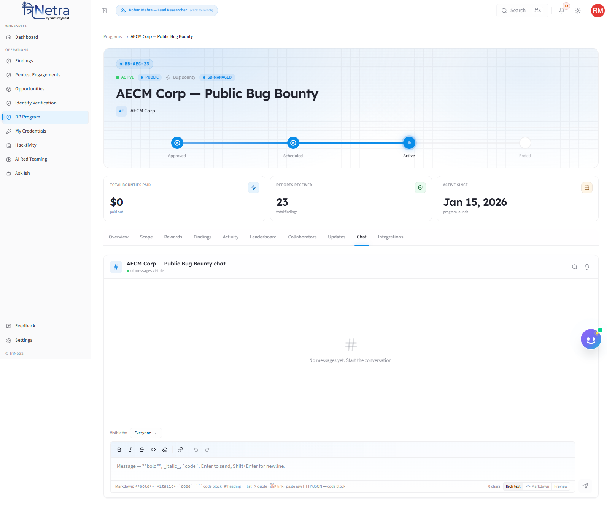

# Chat

The **Chat** tab is a messaging channel between you, the client's team, and SecurityBoat.

> **Private programs only.** Researchers see the Chat tab on **Private** programs they have joined. Public programs have no Chat tab for researchers — use the **Updates** tab for announcements.

---

## Sending messages

- Your messages are always posted to **Everyone** (everyone in this chat).
- Type **@** to mention a participant. They get a notification.
- The client and SecurityBoat can also post messages for their own audiences, which you do not see.

---

## Chat guidelines

| Guideline | Rule |
| :--- | :--- |
| **Do not share findings** | Never paste vulnerability details, PoC code, or exploits in chat. Submit them through **Submit finding**. |
| **Use it for scope questions** | Ask before testing anything you are unsure about. |
| **Be professional** | Keep a polite, professional tone. |
| **Keep it relevant** | Short questions about the program's scope and testing. |

---

← Previous: [Updates](updates.md) | Next: [Integrations →](integrations.md)
