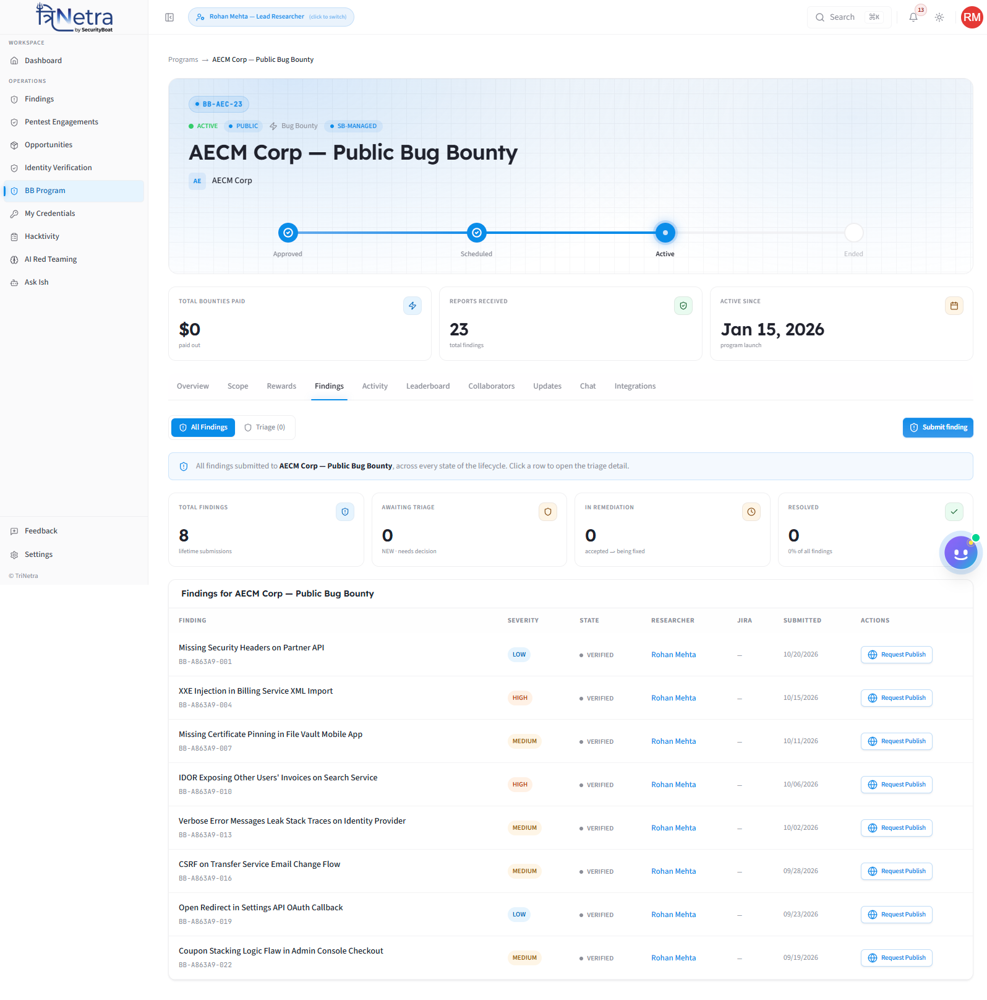
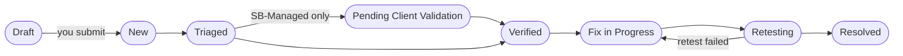
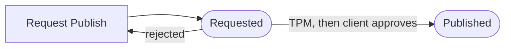

# Findings

The **Findings** tab lists your own submissions to this program. It is also where you open the **Submit finding** drawer.

---

## Your submissions

Four tiles summarise your reports: **Total findings**, **Awaiting triage**, **In remediation**, and **Resolved**. Use the **All Findings** and **Triage (n)** sub-tabs to switch between everything and reports still awaiting triage.

| Column | Description |
| :--- | :--- |
| **Finding** | Title and finding ID. |
| **Severity** | Critical, High, Medium, Low, or Informational. |
| **State** | Current lifecycle state, plus a closure label (e.g. Duplicate, Not Applicable) when one applies. |
| **Researcher** | You. |
| **Jira** | The client's linked Jira issue, if any. |
| **Submitted** | Submission date. |
| **Actions** | **Request Publish** for disclosure-eligible findings, or the disclosure status. |

Click a row to open the finding's detail page.

---

## How to submit a finding

The **Submit finding** button appears only while the program is **Active**.

1. Click **Submit finding**. A drawer opens — *"Report a vulnerability to (program name)"*.
2. Fill in the form (the same form used for pentests; see [Findings → Submitting a finding](../../07-findings.md#4-submitting-a-finding)). Required fields include the title, vulnerability type, VRT category, CWE, all 11 CVSS v4.0 metrics, the writeup sections, CIA impact, OWASP likelihood and impact, the endpoint (for web, API, and mobile assets), and at least one reference URL.
3. Click **Create finding**. The finding is saved as a **Draft** — the footer reads *"Saved as Draft. Promote to NEW for triage from the detail page."*
4. Open the draft and use **State actions → Submit report for triage** to send it.

!!! warning "Submitted reports are locked"
    You can edit a Bug Bounty report only while it is a **Draft**. Once you submit it for triage, you can no longer change its content. Add clarifications as comments instead.

---

## The report lifecycle

A report can also be closed from any open state as **Duplicate** or **Not Applicable**, and may end as **Informative** or **Spam**.

| State | Meaning for you |
| :--- | :--- |
| **Draft** | Only you can see it. Edit freely, then submit. |
| **New** | Submitted and awaiting initial review. |
| **Triaged** | Initial review done; detailed validation in progress. |
| **Pending Client Validation** | *SB-Managed programs:* referred to the client to confirm. |
| **Verified** | Confirmed as a legitimate, reproducible issue. Rewards are based on this. |
| **Fix in Progress** | The client is fixing it. |
| **Retesting** | The fix is being verified by the triage team. |
| **Resolved** | Fixed and retested. You can now request disclosure. |
| **Duplicate** / **Not Applicable** / **Informative** / **Spam** | Closed without a reward. Check the comments for the reason. |

Triage is done by SecurityBoat on **SB-Managed** programs and by the client's team on **Self-Managed** programs. If the triager asks for more information, use **Provide requested information** in the State actions panel.

On a **Resolved** report, comments are locked for researchers.

---

## Requesting disclosure

When your finding is **Resolved** (or closed as **Not Applicable**), a **Request Publish** button appears in the Actions column.

- **Requested** — your request is under review: first by the TPM, then by the client.
- **Published** — the disclosure is live on Hacktivity. Click it to open the public page.
- If a request is rejected, you can request again.

You are notified when your request is reviewed.

---

← Previous: [Rewards](rewards.md) | Next: [Payouts →](payouts.md)
