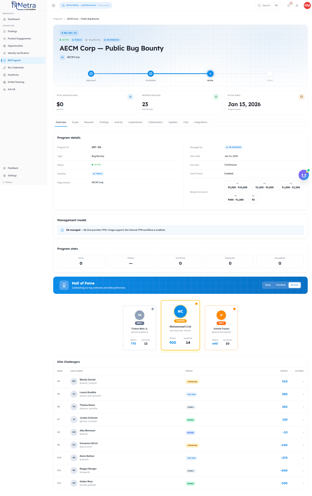
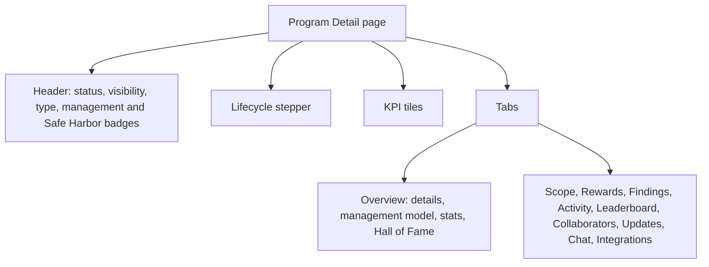

# Program Detail Overview

When you open a Bug Bounty or VDP program, you land on the **Program Detail** view — your portal for testing and tracking submissions for that program.

---

## Page layout

---

## Header

| Element | Description |
| :--- | :--- |
| **Program code** | A short reference in a pill badge (e.g. `BB-ACS-01`). |
| **Status** | **Active**, **Scheduled**, **Deactivated**, or **Ended**. |
| **Visibility** | **Public** or **Private**. |
| **Type** | **VDP** or **Bug Bounty**. |
| **Management badge** | **SB-Managed** (triaged by SecurityBoat) or **Self-Managed** (triaged by the client's team). Hover for the explanation. |
| **Safe Harbor badge** | Shown when the program publishes a safe-harbor policy. The policy text is on the Scope tab. |
| **Program name** and **organisation** | The full name and the owning organisation. |

Below the header, a **lifecycle stepper** shows the program's progress (Approved → Scheduled → Active → Ended).

If the program is **Deactivated** or **Ended**, a notice explains that new findings are not being accepted, while existing findings, scope, and updates remain available.

### KPI tiles

| Tile | Description |
| :--- | :--- |
| **Total bounties paid** | Cumulative cash paid out (Bug Bounty), or **Recognition** — VDP — swag + HoF. |
| **Reports received** | Total findings submitted to the program by all researchers. |
| **Active since** | The program's start date. |

---

## Tabs

Your selected tab is kept in the page address.

| Tab | What it contains |
| :--- | :--- |
| **Overview** | Program details, management model, stats, and the Hall of Fame. |
| **Scope** | In-scope assets, scope notes, rules of engagement, safe harbor, and **test credential** requests. |
| **Rewards** | Reward ranges (P1–P5) or recognition rules. |
| **Findings** | Your submissions to this program and the **Submit finding** button. |
| **Activity** | Program milestones (scope updates, state changes). |
| **Leaderboard** | Top researchers on this program. |
| **Collaborators** | Researchers who have submitted findings to the program. |
| **Updates** | Official announcements from the program team. |
| **Chat** | *Private programs only.* Messaging with the program team. |
| **Integrations** | Connected integrations such as Jira (information only). |

> Researchers do not see the **Team** or **Payouts** tabs. Track your rewards under **My Payouts** in the sidebar.

---

## Overview tab

### Program details

| Field | Description |
| :--- | :--- |
| **Program ID**, **Type**, **Status**, **Visibility**, **Organisation**, **Managed by** | Identification of the program. |
| **Start date** / **End date** | The program window. End date reads **Continuous** if open-ended. |
| **Hall of Fame** | Enabled or Disabled. |
| **Reward structure** | P1–P5 reward chips, or the VDP recognition note. |

### Management model

A card repeats the badge with a one-line explanation of who triages your reports.

### Program stats

| Cell | Description |
| :--- | :--- |
| **Total** | All findings submitted to the program. |
| **Triage** | Findings awaiting review. |
| **Accepted** | Confirmed vulnerabilities being remediated. |
| **Resolved** | Fixed findings. |
| **Discarded** | Reports closed as duplicate, not applicable, or invalid. |

### Hall of Fame

If enabled, a podium shows the top three researchers. Filter by **Today**, **This Week**, or **All Time**. Until findings are accepted, it reads: *"No researchers on the leaderboard yet. Top contributors will appear once findings are accepted."*

---

← Previous: [Bug Bounty Overview](../overview.md) | Next: [Scope →](scope.md)
