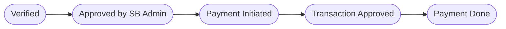

# Payouts

Researchers do **not** have a **Payouts** tab on the program page. That tab is used by the client and SecurityBoat to approve rewards.

Your rewards from every program appear in **My Payouts** in the sidebar (also under **Settings → Payouts**). See the [Payouts guide](../../09-payouts.md).

---

## How a Bug Bounty reward reaches you

- **Verified** — your finding is verified and the reward is waiting for approval. On a **Self-Managed** program, the client approves first and then SecurityBoat; on an **SB-Managed** program, SecurityBoat approves.
- **Approved by SB Admin** — the reward is approved and your invoice can be downloaded.
- **Payment Initiated** → **Transaction Approved** → **Payment Done** — the payment is being made and then completed.

VDP programs award reputation points instead of money. They appear on the program's **Leaderboard**.

---

← Previous: [Findings](findings.md) | Next: [Activity →](activity.md)
