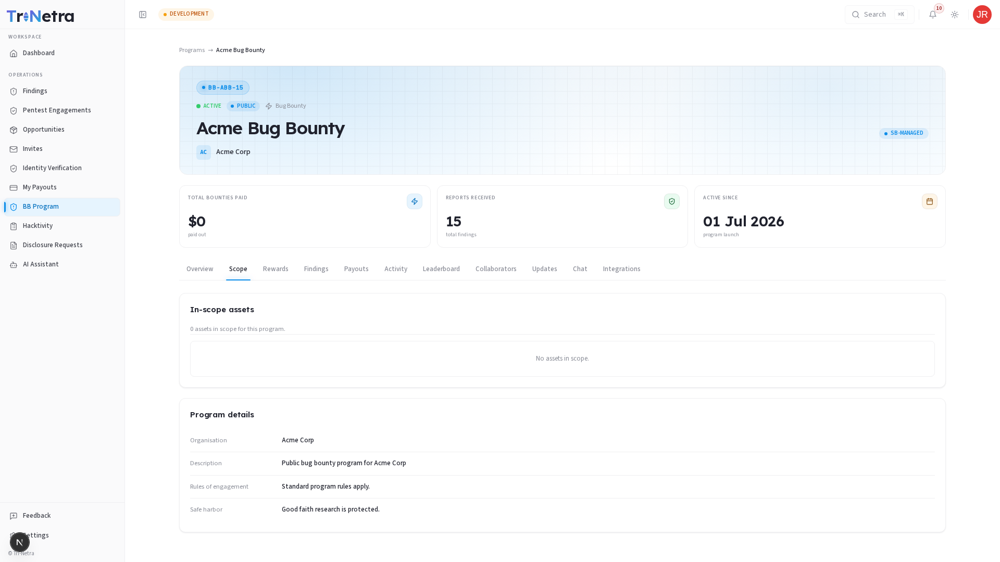
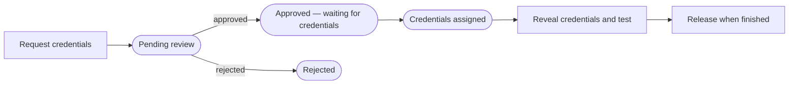

# Scope

The **Scope** tab is the formal contract between you and the client organisation. It defines exactly what you are authorised to test and what is off-limits.

---

## In-scope assets

Each in-scope asset is an expandable card. The header shows the asset name, an **Active** or **Inactive** badge, the asset types, and its criticality. Expand a card to see:

| Section | Description |
| :--- | :--- |
| **Overview** | Description, types, criticality, and state of the asset. |
| **Scope** | The registered targets — domains, URLs, IP ranges, API endpoints, app identifiers, and any testing notes. |
| **Attachments** | Supporting files such as API specs or scope documents. |
| **Test credentials** | Request a test account for this asset (see below). |

## Scope definition

| Field | Description |
| :--- | :--- |
| **In scope** | What you may test — endpoints, environments, and vulnerability classes that qualify. |
| **Out of scope** | What is explicitly excluded. Reports on these items do not qualify for a reward. |

!!! warning "Testing out-of-scope targets is a violation of platform guidelines."

## Program overview

Organisation, number of in-scope assets, program type, **Description**, **Rules of engagement**, and the **Safe harbor policy** (when the program publishes one).

---

## Test credentials

Some assets offer test accounts. Each asset card has a **Test credentials** panel — *"Request a test account for this asset. An admin reviews every request."*

1. Click **Request credentials** on the asset.
2. In the dialog, enter a **Reason** explaining what you plan to test (for example, *"Testing authorization between tenant roles on the billing module."*). A character counter shows the minimum and maximum length.
3. Click **Submit request**. The panel shows the request status, with a **View request** link.
4. When a credential set is assigned, the panel shows **Credentials assigned** with a **Reveal credentials** button and a **Manage** link.
5. Revealed credentials hide automatically after a short time, and when you switch away from the tab. Reveal them again when you need them.

Credential requests open only while the program is **Active**. If an asset does not offer test accounts, the panel says so. Manage all your assignments and requests under [My Credentials](../my-credentials.md).

---

## Rules of engagement and testing guidelines

| Guideline | Requirement |
| :--- | :--- |
| **Researcher identification** | Use any identification header or account the program asks for, so the client can identify your traffic. |
| **Rate limiting** | Keep scanning speeds within the limits in the rules of engagement. |
| **Data preservation** | Never modify, delete, or exfiltrate customer or organisational data. Stop and report once an exploit is confirmed. |
| **No disruptive testing** | No denial of service, credential brute-forcing, or social engineering unless the program explicitly allows it. |
| **Credentials** | Use only accounts assigned to you. Never share them, and release them when you finish. |

---

## Troubleshooting

| Problem | Cause / Solution |
| :--- | :--- |
| **No Request credentials button** | The program is not Active, the asset doesn't offer test accounts, or you already have an open request for it. |
| **Credentials cannot be viewed** | The program is paused, your access ended, or you no longer have access to the program. Check **My Credentials**. |
| **Unsure if a subdomain is in scope** | Wildcard entries (e.g. `*.acme.test`) include subdomains; a flat list includes only the exact domains. When in doubt, ask in **Chat** (private programs) before testing. |

---

← Previous: [Program Details Overview](overview.md) | Next: [Rewards →](rewards.md)
