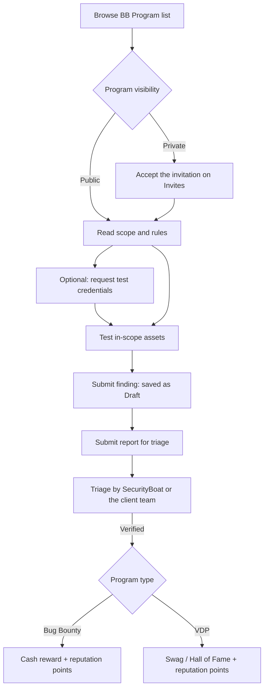
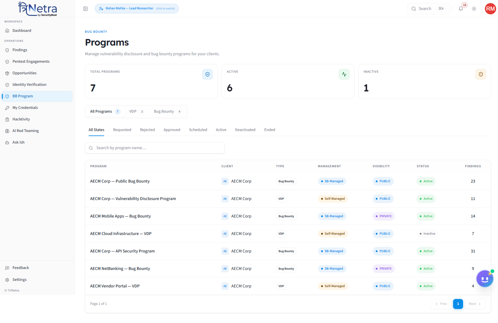

# Bug Bounty & VDP Overview

Welcome to the **Bug Bounty & VDP** module on the Tri-Netra platform. This guide helps you find programs, test within scope, and submit vulnerability reports.

Bug Bounty testing is self-directed and continuous, complementing scheduled, team-based pentest engagements. You browse programs, review their policies, test in-scope targets, submit reports, and earn rewards or reputation points.

> **Access:** the **BB Program**, **My Credentials**, and **Hacktivity** entries appear in your sidebar when Bug Bounty is enabled for your account.

---

## Testing workflow

---

## Program types

### Bug Bounty
- **Incentives:** severity-tiered cash rewards (P1–P5) plus reputation points.

### VDP (Vulnerability Disclosure Program)
- **Incentives:** recognition — swag, Hall of Fame placement, and reputation points. No cash reward.

### Who triages: the management badge

Every program shows a **management badge**. Hover over it to read what it means.

| Badge | Who reviews your reports |
|-------|--------------------------|
| **SB-Managed** | SecurityBoat's team reviews and manages the findings. |
| **Self-Managed** | The client's own team reviews and manages the findings. SecurityBoat is not involved in triage. |

---

## Program visibility and access

- **Public programs:** open to all eligible researchers. You can start testing in-scope assets without an invitation.
- **Private programs:** invite-only. Invitations appear on your **Invites** page with the status **Pending**. Once you accept, the program opens for you.

If you are removed from a private program, you lose access to the program and can no longer submit findings to it.

---

## Program states

| State | What you can do |
|-------|-----------------|
| **Active** | Testing is live. Review the scope, test, and submit findings. |
| **Scheduled** | Approved and going live on its start date. Submissions open when it becomes Active. |
| **Deactivated** | Paused. You can read the program and your past findings, but new findings are not accepted. |
| **Ended** | The program has finished. Read-only. |

Only **Active** programs accept new findings.

---

## Browsing programs

Click **BB Program** in the main sidebar.

| Element | What it shows |
|---------|---------------|
| **KPI tiles** | Total programs, Active, and Awaiting review |
| **Type tabs** | **All Programs**, **VDP**, **Bug Bounty** |
| **State filter** | **All States** plus one pill per state |
| **Search** | *Search by program name…* |
| **Table** | Program, Client, Type, Management, Visibility, Status, Findings |

Your filters and page are kept in the page address, so **Back** returns you to the same view.

!!! note
    Click a program to open its **Program Detail** view and its tabs.

---

## Best practices

- **Complete Identity Verification** early. It is required for paid work and payouts.
- **Read the Scope tab carefully**, including the **In scope** and **Out of scope** notes. Out-of-scope reports earn no reward or points.
- **Check Hacktivity and the program Leaderboard** to avoid duplicates.
- **Read the Updates tab** for scope changes or reward announcements.

---

## Troubleshooting

| Symptom | Cause / Solution |
| :--- | :--- |
| **Cannot see a specific program** | It is Private and you have not been invited, your invitation is still Pending, or you were removed. Check **Invites**. |
| **No Submit finding button** | The program is not **Active** (Scheduled, Deactivated, or Ended). |
| **No monetary reward shown** | The program is a **VDP**. Rewards are swag, points, and Hall of Fame. |

---

← Previous: [Identity Verification](../10-verification.md) | Next: [Program Details Overview →](detail/overview.md)
