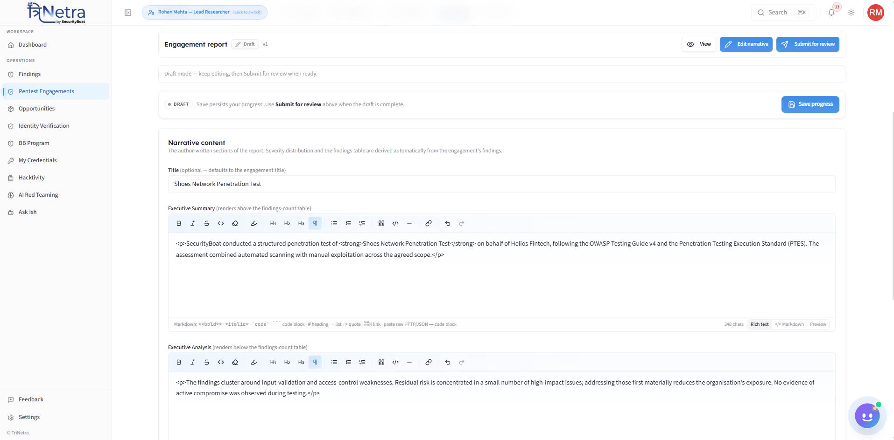

# Edit Narrative

The **Edit Narrative** workspace allows authorized authors to draft and refine the key qualitative sections of the engagement report.

---

## Editor Access & Role Delegation

Edit capability is strictly delegated to ensure quality control and clear segregation of duties:

| Role Type | Edit Capability | Role Description & Control |
| :--- | :--- | :--- |
| **Lead Researcher** | **Authorized** | The primary author responsible for writing the technical findings, summary of recommendations, and scope details. |
| **Technical Project Manager** | **Authorized** | Can edit the narrative during drafting or review to refine language, format structure, or fix description errors. |
| **Customer Success Manager** | **Authorized** | Can edit sections to align executive summaries and business contexts with customer expectations. |
| **Platform Administrator** | **Authorized** | Holds complete editing permissions and serves as the final arbiter for formatting and scope details. |
| **Client / Customer** | **None** | Cannot edit. The client previews the report, then approves it or requests changes once it is submitted for review. |
| **Standard Researcher** | **None** | Excluded from editing and report preview access. Standard testing team members focus strictly on findings and coverage logs. |

---

## Key Narrative Components

Authorized authors use a rich-text editor to configure five core sections:

### 1. Title Page Configuration
*   **Report Title** *(required)*: The title printed on the report cover. The scheduled month and year are added automatically (for example *"— Oct — 2026"*), so enter the title without a date. You cannot save the narrative without a title — the save button shows *"Enter a report title before saving"* and the form shows *"A report title is required."*

### 2. Executive Summary
*   **Purpose**: A brief, high-level summary of the assessment goals, timeline, and results.
*   **Audience**: Designed for executive stakeholders who need a quick summary of the security outcome.

### 3. Executive Analysis
*   **Purpose**: Deep-dive analysis highlighting root causes, technical vulnerability trends, and residual risk.
*   **Audience**: Designed for security managers and directors to understand broader risk patterns.

### 4. Summary of Recommendations
*   **Purpose**: A structured summary of the top remediation priorities.
*   **Audience**: Actionable guidance for the client engineering and operations teams.

### 5. Assessment Limitations

*   **Purpose**: Documents any testing constraints (e.g. time limits, restricted testing windows, or system downtime).
*   **Audience**: Provides context for the final coverage results.

---

## Prefill Templates

To accelerate report drafting, the platform automatically generates prefill templates when editing begins. These templates pull metadata from the engagement context to dynamically populate:

*   The client organization name.
*   The target asset title.
*   The total number of researchers assigned.
*   The scheduled start and end dates.

---

## Saving vs. Submitting

*   **Saving Progress**: Clicking **Save Progress** writes the latest narrative updates. It does not change the report status. Editing and saving are possible only while the engagement is **Live** or in **Report drafting**.
*   **Submitting for Review**: Once drafting is finished, the Lead Researcher clicks **Submit for review**. This works only when the engagement is in **Report drafting** and methodology coverage is 100%. The report then goes to the client for sign-off, followed by SecurityBoat's final review. See [Reports](reports.md).

---

← Previous: [Reports](reports.md) | Next: [Chat →](chat.md)
