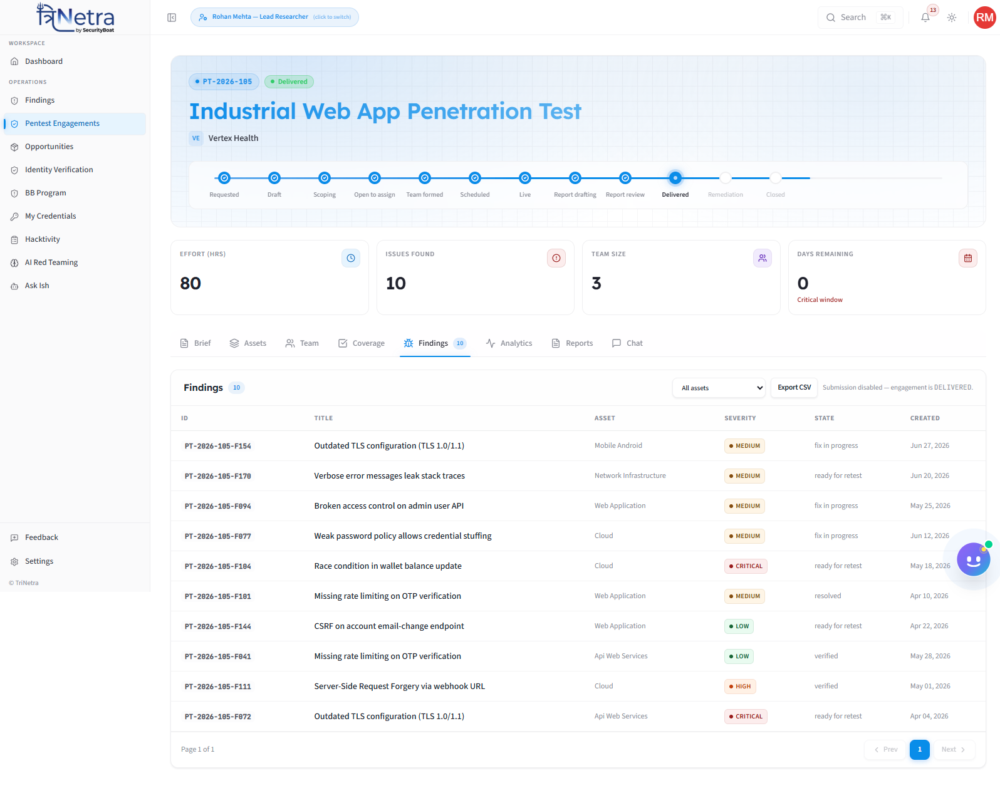
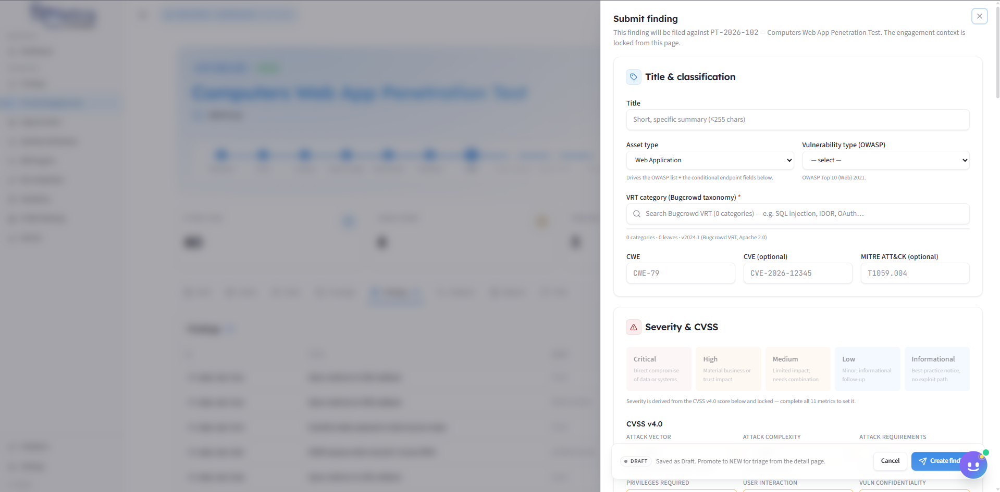
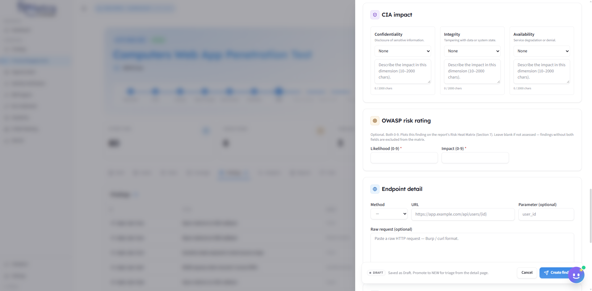
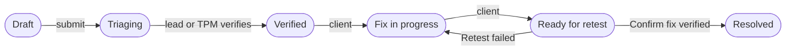

# Findings

The **Findings** tab shows the security issues found during the engagement. It is your workspace for submitting new findings and tracking existing ones.

---

## Findings list

| Column | Description |
| :--- | :--- |
| **Finding ID** | Reference ID (e.g. `PT-ACME-01`). |
| **Title** | Vulnerability summary. |
| **Severity** | Derived from the CVSS v4.0 score. |
| **State** | Draft, Triaging, Verified, Fix in progress, Ready for retest, Accepted risk, or Resolved. |
| **Asset** | The asset where the issue was found. |

Use the **severity** and **state** filters to narrow the list (for example, state = Ready for retest to see what you need to re-test). **Export CSV** lets you choose the columns to download.

Click a row to open the finding's detail page to read comments, see triage feedback, or edit the finding.

---

## Submitting a finding

While the engagement is **Live**, click **Submit finding** at the top right of the tab. A drawer opens with the finding form.

The form covers title and classification (asset type, OWASP vulnerability type, VRT category, CWE, optional CVE and MITRE ATT&CK), the 11 CVSS v4.0 metrics, the writeup (Background, Description, Steps to reproduce, Impact, Remediation), CIA impact, OWASP likelihood and impact, references, and the endpoint and HTTP evidence.

1. Click **Create finding**. The finding is saved as a **Draft**.
2. Open it and use **State actions → Submit DRAFT for triage** → **Confirm transition**.

See [Findings → Submitting a finding](../../07-findings.md#4-submitting-a-finding) for every field and its rules.

---

## Editing a finding

Pentest findings stay editable after submission. Open the finding and click **Edit finding**.

- A **Researcher** can edit findings they submitted. A **Lead Researcher** can edit any finding on the engagement.
- Editing is possible until the finding is **Resolved**.
- **Severity and CVSS are locked** once the finding is **Verified**.

---

## Lifecycle and retesting

- **Triage:** the Lead Researcher or TPM uses **Verify finding (disclose to client)**, or declines it, marks it as a duplicate, or marks it out of scope with a reason. They can also **Request more information**.
- **Retest:** when the client moves a finding to **Ready for retest**, the original researcher or the Lead Researcher re-runs the reproduction steps:
    - Fixed → **Confirm fix verified** → **Resolved**.
    - Still vulnerable → **Retest failed — send back to fix** with a comment (at least 20 characters) → **Fix in progress**.
- The **Retest SLA** card on the finding shows the time left while a retest is pending.

---

← Previous: [Coverage](coverage.md) | Next: [Analytics →](analytics.md)
