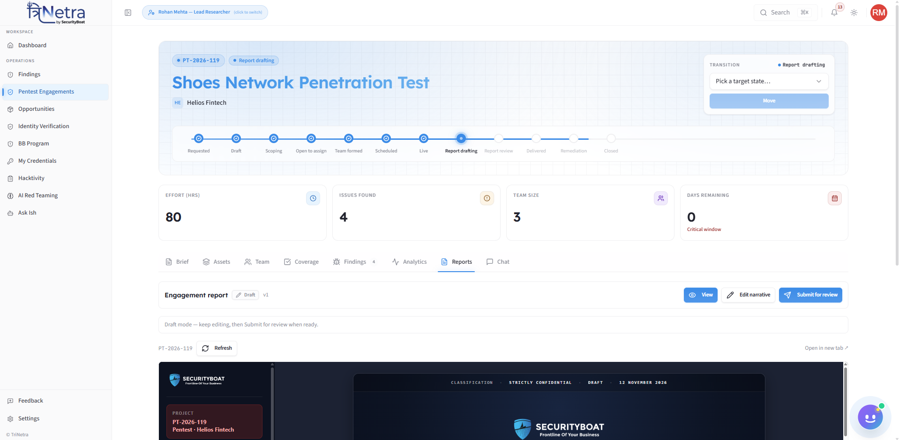
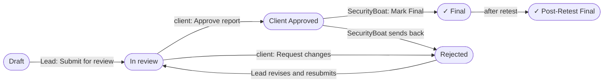
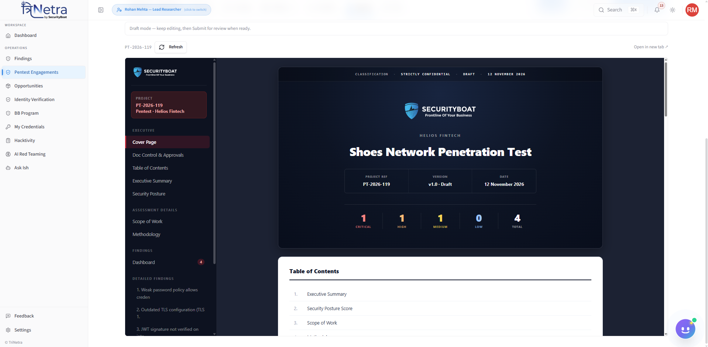

# Reports

The **Reports** tab is the workspace for the engagement report. It is visible to the **Lead Researcher**, the client, and SecurityBoat staff.

!!! important "Role restriction"
    Standard **Researchers** do not see this tab. The **Lead Researcher** writes and submits the report.

---

## Report lifecycle

The report is signed off in two stages: first by the client, then by SecurityBoat.

| Status | What it means |
| :--- | :--- |
| **Draft** | The Lead Researcher is writing the narrative. |
| **In review** | Submitted. The client (Client Admin or Client TPM) reviews it. |
| **Rejected** | Changes were requested. Revise and resubmit. |
| **Client Approved** | The client approved it; SecurityBoat is doing the final review. |
| **✓ Final** | Released to the client for download. |
| **✓ Post-Retest Final** | Re-issued after findings were retested. |

---

## Who can do what

| Action | Who | When |
| :--- | :--- | :--- |
| **Preview** the report | Lead Researcher, client, SecurityBoat | Any status |
| **Edit narrative** and **Save progress** | Lead Researcher, SecurityBoat | While the engagement is **Live** or in **Report drafting** |
| **Submit for review** | Lead Researcher, SecurityBoat | Report is Draft or Rejected, the engagement is in **Report drafting**, and methodology coverage is 100% |
| **Approve report** / **Request changes** | Client Admin, Client TPM | Report is In review |
| **Mark Final** | SecurityBoat | Report is Client Approved |
| **Re-issue (post-retest)** | SecurityBoat | Report is Final |
| **Download PDF** | Client and SecurityBoat | Clients from Final onward. The Lead Researcher previews but does not download. |

### Submit-for-review checks

**Submit for review** is always shown on a Draft or Rejected report, but it only works when:

1. **The engagement is in Report drafting.** Otherwise you see: *"A report can only be submitted while the engagement is in Report Drafting."*
2. **Methodology coverage is 100%.** The tab shows *"✓ Methodology coverage 100% … Ready to submit for review."* when every required item on the **Coverage** tab is marked; otherwise it asks you to mark every item first.

Outside Live and Report drafting, **Edit narrative** and **Submit for review** are shown blurred with a tooltip explaining why.

---

## Narrative sections

| Section | Renders in | Guidelines |
| :--- | :--- | :--- |
| **Title** | Report cover | **Required.** The scheduled month and year are added automatically (e.g. *"— Oct — 2026"*), so don't type them. |
| **Executive Summary** | Summary section | What was tested, when, and the headline outcome. |
| **Executive Analysis** | Summary section | Vulnerability trends, root causes, and risk themes. |
| **Assessment Limitations** | Constraints section | Optional. Hidden if empty. |
| **Summary of Recommendations** | Priority recommendations | The top remediation priorities for the client. |

See [Edit Narrative](edit-narrative.md) for the editor.

---

## Scope tables

The Lead Researcher also maintains the **scope tables**, which map assets to their environments. The environment can be Production, UAT, Staging, QA, or Development.

| Asset type | Columns |
| :--- | :--- |
| **Web Application** | URL, Environment |
| **API / Web Services** | Base URL, Environment |
| **Mobile Application** | App Name/Binary, Bundle ID, Platform, Environment |
| **Cloud Infrastructure** | Account / Subscription ID, Region, Environment |
| **Thick Client** | App Name, Version, Environment |
| **IoT / Embedded** | Device Name, Firmware Version, Environment |
| **Other** | Name, Notes |

---

## Document control

Every action (submit, approve, request changes, mark final, re-issue) asks for a **Description of Changes** of at least 5 characters. The note is saved to the version history and printed in the report's document-control log.

If a report waits more than 3 days for client review, the client and TPM are reminded.

---

← Previous: [Analytics](analytics.md) | Next: [Edit Narrative →](edit-narrative.md)
