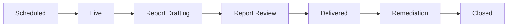
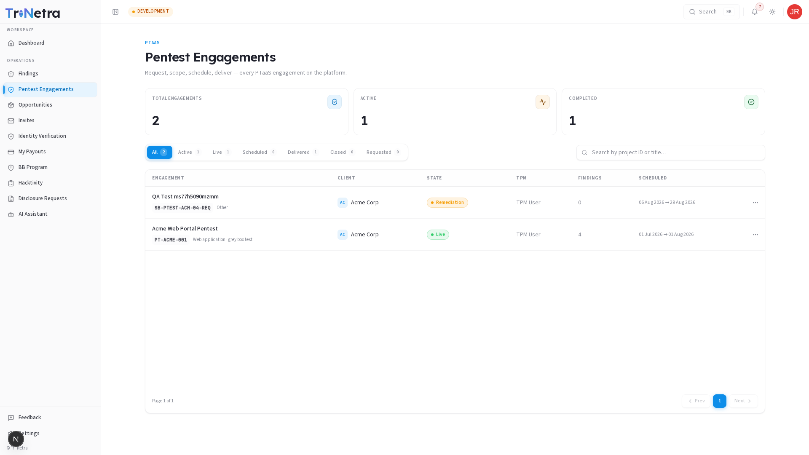

# Engagements Overview

Welcome to the **Pentest Engagements** module. This guide details how Penetration Testing as a Service (PTaaS) engagements operate on the Tri-Netra platform and explains the structured workflows researchers follow during a penetration test.

Unlike continuous Bug Bounty programs, a **PTaaS Engagement** is a scheduled, team-based security assessment with a defined target scope, specific testing timeline, and structured methodology.

---

## The Engagement Lifecycle

Engagements progress through a series of states. Knowing where an engagement stands helps you align your testing and reporting activities:

### Explanation of Lifecycle States

| State | What It Means for You |
| :--- | :--- |
| **Scheduled** | The engagement dates are locked. You can review the scope and brief, but testing has not started yet. |
| **Live** | Testing is actively underway. Perform security tests, collaborate in Chat, check off items on the Coverage checklist, and submit findings in real time. |
| **Report Drafting** | The testing window has closed. The Lead Researcher writes the report and submits it for review (only possible in this state). |
| **Report Review** | The client signs the report off, then SecurityBoat completes the final review and marks it Final. |
| **Delivered** | The final report has been issued to the client. |
| **Remediation** | The client is patching vulnerabilities. You may be requested to perform targeted retests on fixed assets. |
| **Closed** | The engagement is complete. Details are preserved as read-only. |

---

## Researcher Roles on Engagements

Your permissions and responsibilities depend on your assigned role:

*   **Lead Researcher**: Coordinates the pentest team, reviews finding submissions, monitors testing coverage, leads the report compilation, and communicates directly with SecurityBoat TPMs and CSMs.
*   **Researcher**: Performs security testing, documents coverage checkmarks, chats with the team, and submits findings.

---

## Navigating the Engagements List

To browse your assigned engagements, click **Pentest Engagements** in the main sidebar.

The listing page includes:

1.  **Summary tiles**: **Total engagements**, **Live**, and **Completed** (Delivered plus Closed).
2.  **Filter pills** (each with a count):
    *   **All**: Every engagement you are assigned to.
    *   **Live**: Engagements where active testing is underway.
    *   **Scheduled**: Dates confirmed, testing not started yet.
    *   **Delivered**: Report issued, including engagements in Remediation.
    *   **Closed**: Finished engagements.
    *   **Requested** and **Archived**: rarely used by researchers. Archived engagements have a read-only chat.
3.  **Search & Table**: *Search by project ID or title…* The table lists the engagement (title, Project ID, testing type), Client, State, TPM, Findings, and Scheduled dates.

!!! note
    Click on any row in the table to open the **Engagement Detail** view.

---

## Troubleshooting Engagement Access

| Issue | Cause / Solution |
| :--- | :--- |
| **An engagement is missing from my list** | You must be on the engagement team — through an accepted application on **Opportunities** or an invitation on **Invites**. If you were removed from the team, the engagement is no longer listed, but findings you submitted stay visible under **Findings**. |
| **No Pentest Engagements in the sidebar** | PTaaS is not enabled for your account. Contact SecurityBoat. |
| **Testing target does not respond** | If target servers are down or blocking your IP, report it immediately in the engagement **Chat** tab to alert the TPM and Client. |
| **Cannot submit a finding** | Ensure the engagement state is **Live**. The **Submit finding** button only appears while the engagement accepts findings. |

---

← Previous: [Invites](../05-invites.md) | Next: [Engagement Detail: Brief →](detail/brief.md)
